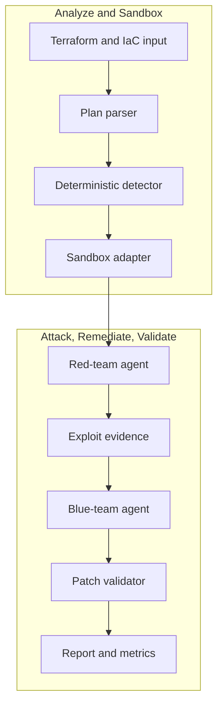

# nullstate

<!-- i18n-switcher:start -->
[English](../../../README.md) | [Español](../es/README.md) | [简体中文](../zh-CN/README.md) | [Français](../fr/README.md) | [日本語](../ja/README.md) | [Deutsch](README.md) | [Português (Brasil)](../pt-BR/README.md)
<!-- i18n-switcher:end -->

Evidenzgestützte Validierung von Cloud-Angriffspfaden für Infrastructure-as-Code und bereitgestellte Umgebungen.


`nullstate` macht die Sicherheitsprüfung von Cloud und Infrastruktur zu einem wiederholbaren Zyklus aus Erkennung, Angriff, Patch und Validierung. Es verbindet deterministische IaC-Analyse mit modellgestütztem Red-/Blue-Team-Reasoning über OpenAI-kompatible Endpunkte wie vLLM auf AMD MI300X.

Die V1-Demo weist öffentliche Cloud-Speicherexposition in lokalen Sandboxes nach, wendet Terraform-Abhilfen an, validiert erneut und schreibt Evidenzartefakte für Sicherheits-, Cloud- und DevSecOps-Teams. Die Produktrichtung erweitert diesen Zyklus durch Korrelation von IaC mit schreibgeschützten AWS-/Azure-Inventaren, Identitätsbeziehungen, Netzwerkpfaden, Laufzeitbefunden und Datenklassifikationen. Die aktuelle öffentliche Version ist eine Alpha für lokale Evaluation, Demos und Beiträge.

<a id="what-it-does"></a>
## Ablauf

1. Terraform-/IaC-Eingaben lesen.
2. Unterstützte ausnutzbare Fehlkonfigurationen erkennen.
3. Das Szenario ableiten und einem Sandbox-Backend zuordnen.
4. Ein Red-Team-Modell über den Angriffspfad nachdenken lassen.
5. Ein eingeschränktes generiertes Angriffsskript gegen das lokale Ziel ausführen.
6. Ein Blue-Team-Modell die Abhilfe erläutern lassen.
7. Einen deterministischen Terraform-Patch anwenden.
8. Validieren, dass der Angriffspfad blockiert ist.
9. Evidenz und Metriken für Fallstudien schreiben.

Hackathon V1 enthält einen live validierten LocalStack-AWS-S3-Pfad, einen manifestgestützten Azure-Blob-Probe-Pfad, dessen Live-Validierung noch eine LocalStack-Azure-Berechtigung benötigt, sowie deterministische Offline-Demos für Kubernetes, Docker Compose, On-Premises-Baselines und allgemeine Planprüfung.

<a id="why-this-exists"></a>
## Motivation

Statische IaC-Scanner und Cloud-Posture-Werkzeuge erkennen riskante Konfigurationen, beantworten aber nicht immer die operativen Fragen zum tatsächlichen Risiko:

- Kann ein externer Angreifer, kompromittierter Workload, Entwickler, eine CI-Identität, ein KI-Agent oder eine überprivilegierte Cloud-Rolle den Pfad nutzen?
- Welche Daten, Metadaten, Zugangsdaten, Dienste oder Rechte werden erreichbar?
- Offenbart eine scheinbar harmlose Öffnung Dateinamen, Mandantendetails, interne Topologie, Logs, Backups, Quellartefakte oder andere Informationen für spätere Angriffe?
- Lässt sich der Pfad reproduzieren, ohne Produktionsdaten und Workloads zu gefährden?
- Blockiert die vorgeschlagene Abhilfe tatsächlich denselben Angriff?

`nullstate` soll deklarierte Infrastruktur mit beobachtetem Cloud-Zustand korrelieren, Angriffspfade über Netzwerk-, Identitäts-, Dienst- und Datenbeziehungen konstruieren, relevante Pfade kontrolliert validieren und nach der Abhilfe erneut ausführen.

<a id="why-not-attack-production-directly"></a>
### Warum nicht direkt die Produktion angreifen?

Schreibgeschützte Erkennung und sorgfältig begrenzte Validierung können gegen Produktion erfolgen; autonome Ausnutzung sollte jedoch nicht der Standard sein:

- Exploits können echte Kundendaten verändern, löschen, beschädigen oder offenlegen.
- Netzwerk- und Authentifizierungsproben können Ausfälle, Drosselung, Quarantäne oder automatische Incident Response auslösen.
- IAM- und Privilegieneskalationstests können dauerhafte Zugänge schaffen, die den Test überleben.
- Exfiltrationstests können Datenschutz-, Vertrags-, regulatorische oder Datenresidenzanforderungen verletzen.
- Produktionsabhängigkeiten können Kunden und Dritte außerhalb des genehmigten Testumfangs betreffen.
- Bereinigung stellt den ursprünglichen Zustand nicht immer exakt wieder her.

Nullstate trennt deshalb Beobachtung von Ausnutzung. Es kann Produktion schreibgeschützt erkennen und modellieren, explizit erlaubte nicht destruktive Prüfungen mit Genehmigung durchführen und relevante Angriffspfade mit synthetischen Daten in einer wegwerfbaren AWS-, Azure-, Emulator-, Kubernetes-, Container- oder VM-Umgebung rekonstruieren. Ziel ist nicht das Klonen einer gesamten Subscription oder eines Kontos, sondern der kleinste sicherheitsrelevante Graph zum Belegen oder Widerlegen einer Angriffshypothese.

<a id="what-makes-it-different"></a>
### Was ist anders?

Der beabsichtigte Mehrwert ist keine weitere Liste von Cloud-Fehlkonfigurationen. Nullstate sollte Evidenz liefern, die Folgendes verbindet:

```text
attacker identity
-> reachable entry point
-> identity or privilege transition
-> accessible service
-> exposed data or capability
-> remediation
-> blocked replay
```

Angriffsanalyse berücksichtigt Identitäten. Eine Ausführung kann anonyme Internetnutzer, authentifizierte Mandantennutzer, Entwickler, CI-Workloads, kompromittierte Compute-Identitäten, Managed Identities, IAM-Rollen, KI-Agenten oder andere explizit autorisierte Principals bewerten. Bei KI-Agenten sollte Nullstate eigene Agentenidentität, Werkzeug-/Laufzeitidentität und menschlich delegierte Befugnisse unterscheiden. Berichte sollten getestete Identität und Delegationsmodus nennen und Konfigurationsexposition von beobachtetem Zugriff auf sensible Daten trennen.

Extern gehostete Agenten schaffen eine zusätzliche Vertrauensgrenze. Eine gültige Cloud-Identität beweist nicht die Sicherheit von Maschine, Container, Agentenframework, Speicher, Connector oder Hosting-Anbieter. Die Produktrichtung umfasst deshalb Laufzeit-Posture-Verifikation: kurzlebige Workload-Identität, Artefaktsignaturen und Provenienz, unveränderliche Deployment-Digests, Host-/Laufzeitattestierung soweit verfügbar, Netzwerkbeschränkungen, Werkzeugautorisierung, Auditierbarkeit, Evidenzaktualität und Widerrufsbereitschaft. Fehlende Evidenz bleibt unbekannt und wird nicht als sicher gewertet.

Siehe [Produkt- und Validierungsmodell](docs/product-validation-model.md).

<a id="demo-result"></a>
## Demo-Ergebnis

Die abschließenden AMD-MI300X/vLLM-Demos verwendeten `nullstate-gemma4-26b-a4b` für beide Rollen:

| Szenario | Ziel | Befund | Ergebnis |
|---|---|---|---|
| `aws-public-s3` | LocalStack AWS | S3-Blockierung öffentlichen Zugriffs deaktiviert | Laufzeitprobe beobachtete Zugriff vor der Abhilfe und blockierten Zugriff danach |
| `azure-public-blob` | LocalStack Azure/Offline-Pfad | Anonymer Zugriff auf Blob-Container | Manifestgestützte Probe generiert; Live-Validierung von LocalStack Azure wartet auf Emulatorberechtigung |

Repräsentative Modellmetriken:

| Ausführung | Rolle | Ausgabe-Tokens | Latenz | Ausgabegeschwindigkeit |
|---|---|---:|---:|---:|
| AWS S3 | Rot | 942 | 9.018s | 104.452 tok/s |
| AWS S3 | Blau | 640 | 3.977s | 160.937 tok/s |
| Azure Blob | Rot | 709 | 4.112s | 172.424 tok/s |
| Azure Blob | Blau | 794 | 4.548s | 174.586 tok/s |

<a id="architecture"></a>
## Architektur



Siehe [Architektur](docs/architecture.md) und [Technischer Rundgang](docs/technical-walkthrough.md).

<a id="security-model"></a>
## Sicherheitsmodell

V1 zielt standardmäßig nicht auf echte Cloud-Umgebungen. Sandboxes sind explizit, Artefakte lokal und Abhilfen erfolgen in einer kopierten Laufzeitarbeitsumgebung statt im ursprünglichen Terraform-Verzeichnis.

Der Red-Tool-Runner ist auf generierte `attack.py`-Skripte im Ausführungsverzeichnis beschränkt. Er protokolliert Befehl, stdout, stderr, Rückgabecode, Ziel-URL, Phase, Startzeit, Endzeit und Dauer in `events.jsonl`.

Siehe [Sicherheitsmodell](docs/security-model.md) und [Bedrohungsmodell](docs/threat-model.md).

<a id="installation"></a>
## Installation

Aktuelle Installation aus dem Quellcode:

```powershell
git clone https://github.com/Ker102/nullstate-cli.git
cd nullstate-cli
python -m pip install -e .
```

Dies installiert Paketabhängigkeiten und den in `pyproject.toml` deklarierten Konsolenbefehl `nullstate`.

Wird `nullstate` nach der Installation nicht erkannt, liegt das Python-Scripts-Verzeichnis nicht in `PATH`. Dieselbe CLI kann über Python gestartet werden:

```powershell
python -m nullstate doctor --offline
```

Installationsort der Python-Konsolenskripte anzeigen:

```powershell
python -c "import sysconfig; print(sysconfig.get_path('scripts'))"
```

Aktuelle Vorabversion direkt von GitHub installieren:

```powershell
python -m pip install "git+https://github.com/Ker102/nullstate-cli.git@v0.1.0-alpha.2"
```

Für Beiträge auch Entwicklungswerkzeuge installieren:

```powershell
python -m pip install -e ".[dev]"
python -m ruff check src tests
python -m mypy src
python -m unittest discover -s tests -v
```

<a id="quickstart"></a>
## Schnellstart

```powershell
nullstate
nullstate doctor --offline
nullstate status
nullstate init-demo azure-public-blob --output examples/azure-public-blob
nullstate run examples/azure-public-blob --offline
nullstate report
nullstate scrub
```

Eine bereinigte Beispielausführung ohne Docker, Terraform, LocalStack oder Modellzugang prüfen:

```powershell
nullstate report --runs-dir examples/sample-runs
nullstate summary --runs-dir examples/sample-runs --json
```

Das eingecheckte Beispiel enthält auch `run-bundle.json` und `dashboard.html`, um den portablen Bundle-Vertrag und die lokale Dashboard-Ausgabe ohne neue Artefakte zu prüfen.

Ein weiteres Offline-Szenario ausführen:

```powershell
nullstate run examples/aws-public-s3 --offline
nullstate run examples/k8s-privileged-pod --offline
nullstate run examples/aws-public-s3 --offline --mock-agents --ci --fail-on-severity high
nullstate baseline --output nullstate-baseline.json
nullstate run examples/aws-public-s3 --offline --mock-agents --ci --baseline-file nullstate-baseline.json
nullstate policy-result --baseline-file nullstate-baseline.json
```

Sandbox-Erkennung:

```powershell
nullstate sandbox list
nullstate sandbox status localstack-azure
nullstate sandbox up localstack-azure --dry-run
nullstate scenarios list
nullstate scenarios status aws-public-s3
nullstate policy init --output nullstate-policy.json
nullstate policy init --scenario aws-public-s3 --output aws-policy.json
```

`status`, `init-demo`, `sandbox` und `run` drucken eine kurze `Next`-Tabelle mit wahrscheinlichen Folgebefehlen. `run` verwendet standardmäßig `--scenario auto` und `--target auto`; die CLI leitet das Szenario aus der IaC-Struktur ab und wählt das passende Backend. `--scenario` oder `--target` nur für bestimmte Demoaufzeichnungen oder Adaptertests angeben.

Laufzeit-Angriffsproben bleiben standardmäßig lokal. Künftige nicht lokale HTTP(S)-Ziele erfordern `--allow-live-cloud`; die Zustimmung wird in `events.jsonl` dokumentiert. Enthält die Richtlinie `allowed_target_hosts`, muss auch der Zielhostname passen. Aktuelle integrierte Szenarien verwenden weiterhin lokale/Offline-Sandbox-Ziele.

GitHub Actions initialisieren:

```powershell
nullstate init-ci github --scenario aws-public-s3 --iac-path examples/aws-public-s3
```

Dies schreibt `.github/workflows/nullstate.yml` und `nullstate-policy.json`, damit Nullstate ohne manuelles Kopieren der Workflow-Vorlage als Pull-Request-Gate eingesetzt werden kann.

Vorschau für Vertrauen in externe KI-Agenten:

```powershell
nullstate agent posture verify examples/agent-trust/external-agent-manifest.json
nullstate agent blast-radius examples/agent-trust/external-agent-manifest.json
```

Diese Befehle validieren ein lokales Manifest externer Agenten und fassen Laufzeit-Posture-Evidenz, Aktualität, Identitätstypen, delegierte Nutzerbefugnisse, sensible Ressourcen, Hochrisikoaktionen und wahrscheinliche Angriffspfadklassen zusammen. Dies ist eine deterministische Vorschau des externen Vertrauensmodells; sie sammelt noch kein Provider-Inventar und attestiert keine laufende fremde Laufzeitumgebung.

Neuesten Bericht öffnen:

```powershell
nullstate report
```

Bei Ausführungen in einem benannten Ordner die Berichtssuche auf dessen Elternverzeichnis richten:

```powershell
nullstate report --runs-dir runs/live-aws-model
nullstate report 20260509-200601 --runs-dir runs
```

Ein portables Bundle oder kostenloses lokales HTML-Dashboard erstellen:

```powershell
nullstate summary --json
nullstate bundle
nullstate dashboard --open
nullstate sarif
nullstate upload --dry-run
```

`summary --json` liefert ein kompaktes maschinenlesbares Objekt für Coding-Agenten, GitHub-Actions-Schritte und PR-Kommentarautomatisierung. Das Dashboard fasst Befunde, Abhilferegeln, Bundle-Schemametadaten, Artefaktinventar, Evidenzzeitlinie und Berichtsauszug der ausgewählten Ausführung zusammen.

Zusammenfassungen und Bundles enthalten die Evidenzstufe des Szenarios, damit Automatisierung live validierte Ausführungen von deterministischen Offline-, Gerüst- oder reinen Planevidenzen unterscheiden kann.

Vorschau für schreibgeschützten Cloud-Kontext:

```powershell
nullstate context validate examples/cloud-context/aws-readonly-context.json
nullstate context summary examples/cloud-context/aws-readonly-context.json --json
```

Der Kontextbefehl validiert und fasst ein lokales Cloud-Inventarmanifest zusammen. Es ist der sichere Vertrag für künftige schreibgeschützte AWS-/Azure-/GCP-Collector; noch werden weder Cloud-APIs aufgerufen noch Zugangsdaten angefordert.

Evaluationsmetriken:

```powershell
nullstate eval run examples/eval/iac-security-regression.json --output-dir eval-runs/iac-security-regression
```

Die Evaluationsumgebung führt reproduzierbare Benchmarkfälle aus und schreibt `eval-results.json` sowie `eval-report.md`. Sie liefert Fallstudienevidenz zu Dauer, Befundzahl, maximaler Schwere, Angriff vor/nach Abhilfe, Token-Gesamtzahl, Artefaktzahl, erwarteten Erfolgs-/Fehlerprüfungen und Baseline-Vergleich. Das Beispiel vergleicht Nullstate mit einer transparenten allgemeinen IaC-only-Baseline und zeigt zusätzliche Angriffs-Replays, Validierung nach Abhilfe, Tokenmetriken und strukturierte Artefaktabdeckung. Externe Scanner wie Checkov, tfsec oder Terrascan werden noch nicht benchmarked.

<a id="live-localstack-demo-path"></a>
## Live-LocalStack-Demopfad

Nach Einrichtung von Docker, Terraform, LocalStack-Zugang und Modellendpunktvariablen verwenden.

AWS:

```powershell
nullstate sandbox up localstack-aws
nullstate sandbox status localstack-aws
nullstate run examples/aws-public-s3 --target localstack-aws
nullstate report
```

Azure:

```powershell
nullstate sandbox up localstack-azure
nullstate sandbox status localstack-azure
nullstate run examples/azure-public-blob --target localstack-azure
nullstate report
```

Der Terraform-Demoprovider enthält:

```hcl
metadata_host = "localhost.localstack.cloud:4566"
```

Damit bleibt Terraform auf den LocalStack-Azure-Emulator statt auf echtes Azure gerichtet.

`LOCALSTACK_AUTH_TOKEN` in Shell, `.env.local` oder `.env` halten. `nullstate sandbox up` erkennt zuerst `.env.local`, dann `.env`; für eigene Pfade bleibt `--env-file` verfügbar.

Meldet Docker, dass `127.0.0.1:4566` bereits belegt ist, reserviert wahrscheinlich ein verbliebener LocalStack-Container den gemeinsamen Edge-Port. Ausführen:

```powershell
nullstate sandbox down localstack-aws
nullstate sandbox down localstack-azure
docker ps -a --filter name=localstack
```

Docker-Compose-Alternative:

```powershell
$env:LOCALSTACK_AUTH_TOKEN = "<token>"
docker compose -f docker-compose.localstack-azure.yml up
```

Oder eine lokale `.env` neben der Compose-Datei erstellen:

```env
LOCALSTACK_AUTH_TOKEN=your-token-here
```

Git ignoriert `.env` und `.env.local`. Den Token nicht committen.

<a id="model-endpoint"></a>
## Modellendpunkt

`nullstate` kommuniziert mit OpenAI-kompatiblen Modellservern. Für selbst gehostetes vLLM, SGLang oder einen privaten Proxy den Custom-Provider mit einem Endpunkt für beide Rollen verwenden:

```powershell
$env:NULLSTATE_LLM_PROVIDER = "custom"
$env:NULLSTATE_LLM_BASE_URL = "http://<mi300x-host>:8000"
$env:NULLSTATE_LLM_API_KEY = "<optional-token>"
nullstate run examples/azure-public-blob --blue-model gemma-4-31b-it --red-model qwen3-coder-next
```

Für Google AI Studio / Gemini genügen Provider-Preset und API-Key; `nullstate` liefert die OpenAI-kompatible Gemini-Basis-URL:

```powershell
$env:NULLSTATE_LLM_PROVIDER = "google"
$env:NULLSTATE_LLM_API_KEY = "<google-ai-studio-key>"
nullstate run examples/azure-public-blob --blue-model gemini-3.5-flash --red-model gemini-3.5-flash
```

Für Claude über Anthropics OpenAI-SDK-Kompatibilität das Claude-Preset nutzen. Dieser Pfad ist experimentell; bei Claude-spezifischen Funktionen ist künftig ein nativer Adapter der bessere Produktionsweg:

```powershell
$env:NULLSTATE_LLM_PROVIDER = "claude"
$env:NULLSTATE_LLM_API_KEY = "<anthropic-api-key>"
nullstate run examples/azure-public-blob --blue-model claude-sonnet-4-6 --red-model claude-sonnet-4-6
```

Für zwei vLLM-/SGLang-Container oder zwei SSH-Tunnel rollenspezifische Endpunkte setzen:

```powershell
$env:NULLSTATE_LLM_PROVIDER = "custom"
$env:NULLSTATE_RED_LLM_BASE_URL = "http://127.0.0.1:8001"
$env:NULLSTATE_BLUE_LLM_BASE_URL = "http://127.0.0.1:8002"
$env:NULLSTATE_RED_LLM_API_KEY = "<optional-red-token>"
$env:NULLSTATE_BLUE_LLM_API_KEY = "<optional-blue-token>"
nullstate run examples/azure-public-blob --red-model nullstate-red --blue-model nullstate-blue
```

Die CLI akzeptiert auch `--llm-provider`, `--red-provider`, `--blue-provider`, `--red-base-url` und `--blue-base-url` für einzelne Ausführungen. Aktuelle Presets sind `google`, `claude`, `custom` und `openai-compatible`. Nicht gesetzte Rollenwerte greifen auf `NULLSTATE_LLM_PROVIDER`, `NULLSTATE_LLM_BASE_URL` und `NULLSTATE_LLM_API_KEY` zurück. Explizite Basis-URLs haben immer Vorrang, sodass eigene Gateways, selbst gehostete Modelle und Provider-Proxies unterstützt bleiben.

Nutzer müssen keine Prompts schreiben. `nullstate` sendet interne Red-/Blue-Agentenanweisungen und Szenarioevidenz. Fehlt ein Rollenendpunkt, nutzt diese Rolle eine deterministische Mock-Antwort, sodass lokale und LocalStack-Demos ohne Modell laufen können. `--offline` überspringt Terraform-/Cloud-Laufzeitaufrufe und verwendet statisches IaC-Parsing. Bei konfiguriertem gemeinsamen oder Rollenendpunkt nutzt `--offline` diesen weiterhin; `--mock-agents` nur für deterministische Antworten ohne Modell ergänzen.

<a id="sandbox-backends"></a>
## Sandbox-Backends

| Backend | Modus | IaC-Ziel | Status |
|---|---|---|---|
| `localstack-azure` | ausführbar | Terraform AzureRM | Live-Demoziel |
| `localstack-aws` | ausführbar | Terraform AWS | Live-Demoziel |
| `kind-kubernetes` | ausführbar | Kubernetes YAML, Helm, Kustomize | Adaptergerüst |
| `docker-compose` | digitaler Zwilling | Docker Compose und Anwendungsstacks | Adaptergerüst |
| `microvm-onprem` | digitaler Zwilling | Ansible, Linux-Härtung, Terraform nach libvirt-/Proxmox-Art | entworfener Fallback |
| `plan-only` | nur Plan | beliebiger exportierter Plan/Parser | verfügbar |

<a id="scenarios"></a>
## Szenarien

`nullstate scenarios list` nennt explizite Evidenzstufen, damit vor der Ausführung sichtbar ist, was live belegt, deterministisch oder lediglich als Gerüst vorhanden ist.

| Szenario | Backend | Evidenzstufe | Status |
|---|---|---|---|
| `aws-public-s3` | `localstack-aws` | `live-validated` | LocalStack-AWS-S3-Deployment und eingeschränkte anonyme Objektleseprobe vor/nach Abhilfe validiert |
| `azure-public-blob` | `localstack-azure` | `offline-deterministic` | Statische IaC-Erkennung, Abhilfe, manifestgestützte Probegenerierung und Offline-Berichte implementiert; Live-Emulatornachweis ausstehend |
| `k8s-privileged-pod` | `kind-kubernetes` | `scaffolded` | Deterministische Offline-Erkennung und Abhilfe verfügbar; Live-kind-Clusterprobe ausstehend |
| `compose-exposed-admin` | `docker-compose` | `scaffolded` | Deterministische Offline-Erkennung und Abhilfe verfügbar; Live-Container-/Netzwerkprobe ausstehend |
| `onprem-ssh-password` | `microvm-onprem` | `scaffolded` | Deterministische Offline-Erkennung und Abhilfe verfügbar; microVM-Zwillingsausführung ausstehend |
| `generic-plan-review` | `plan-only` | `plan-only` | Statische Plan-/Konfigurationsprüfung verfügbar; kein ausführbares Sandbox- oder Laufzeit-Exploit-Probing |

<a id="artifacts"></a>
## Artefakte

Jede Ausführung schreibt:

- `runs/<run-id>/events.jsonl`
- `runs/<run-id>/findings.json`
- `runs/<run-id>/metrics.json`
- `runs/<run-id>/ci-summary.json` bei `nullstate run --ci`
- `runs/<run-id>/policy-result.json` bei `nullstate policy-result`
- `runs/<run-id>/vllm-metrics-before.prom`, wenn `/metrics` erreichbar ist
- `runs/<run-id>/vllm-metrics-after.prom`, wenn `/metrics` erreichbar ist
- `runs/<run-id>/vllm-metrics-red-before.prom` und Rollenvarianten bei unterschiedlichen Red-/Blue-Endpunkten
- `runs/<run-id>/attack.py`
- `runs/<run-id>/attack-manifest.json`
- `runs/<run-id>/remediation.json`
- `runs/<run-id>/run-bundle.json` bei `nullstate bundle` oder `nullstate dashboard`
- `runs/<run-id>/dashboard.html` bei `nullstate dashboard`
- `runs/<run-id>/nullstate.sarif` bei `nullstate sarif`
- `runs/<run-id>/evidence-manifest.json` bei `nullstate evidence-manifest`
- `runs/<run-id>/evidence-verification.json` bei `nullstate evidence-verify`
- `runs/<run-id>/upload-plan.json` bei `nullstate upload --dry-run`
- `runs/<run-id>/remediation.patch`
- `runs/<run-id>/report.md`
- `scrubbed-runs/<run-id>/scrub-report.json` bei `nullstate scrub`

Vor dem Teilen von Evidenz eine bereinigte Kopie erstellen:

```powershell
nullstate scrub
nullstate scrub 20260608-224625 --runs-dir runs --output-dir scrubbed-runs
```

`attack-manifest.json` enthält einen `$schema`-Verweis auf `docs/schemas/attack-manifest.schema.json`; die CLI validiert das generierte Manifest vor eingeschränkten Proben. `events.jsonl` enthält `red-tool`-Einträge zum erlaubten Angriffsbefehl vor/nach Abhilfe. `remediation.json` erfasst deterministische Regelversion, Szenario, geänderte Dateien und angewendete Regel-IDs. Generierte Abhilfemetadaten enthalten einen `$schema`-Verweis auf `docs/schemas/remediation-metadata.schema.json` und werden vor Nutzung durch Berichte, Bundles und Artefakte validiert.

`ci-summary.json` enthält einen `$schema`-Verweis auf `docs/schemas/ci-summary.schema.json`; `nullstate run --ci` validiert das Entscheidungsartefakt vor dem Schreiben.

`run-bundle.json` enthält einen `$schema`-Verweis auf `docs/schemas/run-bundle.schema.json` und wird beim Schreiben strukturell validiert. Das Schema ist der lokale Vertrag für Dashboards, CI-Uploads, Support-Bundles und künftige Cloud-Ingestion.

Befunde für CI oder Code-Scanning-Uploads exportieren:

```powershell
nullstate run examples/aws-public-s3 --offline --mock-agents --ci --fail-on-severity none
nullstate sarif
nullstate sarif 20260608-224625 --runs-dir runs --output artifacts/nullstate.sarif
```

`--fail-on-severity high` oder `--fail-on-severity critical` verwenden, wenn der CI-Job bei passenden Befunden fehlschlagen soll.

Eine Red-Tool-Richtliniendatei erstellen und verwenden:

```powershell
nullstate policy init --output nullstate-policy.json
nullstate policy init --scenario aws-public-s3 --output aws-policy.json
nullstate policy validate nullstate-policy.json --output policy-validation.json
nullstate run examples/aws-public-s3 --offline --mock-agents --policy-file nullstate-policy.json
```

Die generierte Richtlinie enthält einen `$schema`-Verweis auf `docs/schemas/nullstate-policy.schema.json` und wird vor dem Schreiben validiert. Sie erlaubt Szenarionamen, Backends, Phasen, Flags des generierten `attack.py`, Zielklassen wie `offline`, `local`, `local-http` und künftig `external-http`, Hostnamen wie `localhost.localstack.cloud` oder `*.blob.core.windows.net`, Befehlsrichtlinien-IDs wie `generated-attack-script-v1` und Timeout-/Ausgabegrenzen. `policy init --scenario` erzeugt ein engeres Preset für ein bekanntes Szenario-/Backend-Paar mit denselben Runner-Beschränkungen. `nullstate policy validate` prüft ohne Szenarioausführung und beendet sich mit Code `2` bei fehlerhaftem oder ungültigem Inhalt.

Vor Anhängen einer Ausführung an Ticket, Fallstudie oder Supportprozess ein Integritätsmanifest erstellen:

```powershell
nullstate evidence-manifest
nullstate evidence-verify
nullstate evidence-manifest 20260608-224625 --runs-dir runs --output artifacts/evidence-manifest.json
nullstate evidence-verify 20260608-224625 --runs-dir runs --manifest artifacts/evidence-manifest.json
$env:NULLSTATE_EVIDENCE_SIGNING_KEY = "<secret>"
nullstate evidence-manifest --signing-key-env NULLSTATE_EVIDENCE_SIGNING_KEY
nullstate evidence-verify --signing-key-env NULLSTATE_EVIDENCE_SIGNING_KEY
```

Das Manifest enthält einen `$schema`-Verweis auf `docs/schemas/evidence-manifest.schema.json` und wird vor Schreiben validiert. Es inventarisiert teilbare Artefakte mit SHA-256, schließt kopierte Workspaces und Terraform-Interna aus und erlaubt optional eine HMAC-SHA256-Signatur mit gemeinsamem Schlüssel. `nullstate evidence-verify` berechnet Hashes neu, prüft signierte Manifeste bei `--signing-key-env`, schreibt `evidence-verification.json` und endet mit Code `2`, wenn ein Artefakt fehlt, geändert wurde, aus einer anderen Ausführung stammt oder ungültig signiert ist. Schlüssel kommen aus Umgebungsvariablen und werden nie ins Manifest geschrieben.

Eine Baseline einer bekannten Ausführung erstellen, damit CI bekannte Befunde ignoriert und bei neuen fehlschlägt:

```powershell
nullstate baseline --output nullstate-baseline.json
nullstate run examples/aws-public-s3 --offline --mock-agents --ci --baseline-file nullstate-baseline.json
nullstate policy-result --baseline-file nullstate-baseline.json
```

`policy-result.json` bewertet eine bestehende Ausführung ohne neuen Scan. Nachgelagerte Automatisierung erhält dieselbe Schwellen- und Baseline-Entscheidung wie CI als eigenständiges JSON-Artefakt.

Künftigen Cloud-Ingestion-Uploadplan ohne Datenversand vorbereiten:

```powershell
nullstate upload --dry-run
nullstate upload 20260608-224625 --runs-dir runs --endpoint https://api.nullstate.dev/v1/runs --dry-run
```

`upload-plan.json` enthält einen `$schema`-Verweis auf `docs/schemas/upload-plan.schema.json` und wird vor Schreiben validiert. Es erfasst Zielendpunkt, Bundle-Prüfsumme, Artefaktzahl, Tokenpräsenz und Scrub-Vorprüfstatus, niemals Tokenwerte. Rohe Ausführungen sind im Dry-Run erlaubt, aber mit `upload_recommended: false` markiert; vor Teilen oder künftiger Cloud-Ingestion zuerst `nullstate scrub` ausführen und aus `scrubbed-runs/` hochladen.

<a id="documentation"></a>
## Dokumentation

- [Fallstudie](docs/case-study.md)
- [Die ersten 10 Minuten](docs/quickstart-10-minutes.md)
- [Technischer Rundgang](docs/technical-walkthrough.md)
- [Architektur](docs/architecture.md)
- [Produkt- und Validierungsmodell](docs/product-validation-model.md)
- [Externe Agenten: Vertrauens- und Laufzeit-Posture-Design](docs/plans/2026-06-22-external-agent-trust-design.md)
- [Schema für externe Agentenmanifeste](../../schemas/external-agent-manifest.schema.json)
- [Cloud-Kontextschema](../../schemas/cloud-context.schema.json)
- [Evaluationssuite-Schema](../../schemas/eval-suite.schema.json)
- [Ausführungszusammenfassungsschema](../../schemas/run-summary.schema.json)
- [Sicherheitsmodell](docs/security-model.md)
- [Bedrohungsmodell](docs/threat-model.md)
- [Abhängigkeitsaudit](docs/dependency-audit.md)
- [CI/CD](docs/ci-cd.md)
- [Betriebshandbuch](docs/runbook.md)
- [Modellbereitstellung](docs/model-serving.md)
- [Enterprise-Roadmap](docs/enterprise-roadmap.md)
- [Enterprise-Bereitschaft](docs/enterprise-readiness.md)
- [Open-Source-Meilensteine](docs/open-source-readiness.md)
- [Produktisierungsfortschritt](../../progress.md)
- [Plan für echte Sandbox-Red-Team-Befehle](../../plans/2026-06-01-real-sandbox-red-team-commands.md)
- [Projektübergabe](../../handoff.md)
- [AMD-Compute-Strategie](docs/compute-strategy.md)
- [Fehlermodi](docs/failure-modes.md)
- [Kostenbericht](docs/cost-report.md)

<a id="release-model"></a>
## Veröffentlichungsmodell

Die Vorabversion `Media` hostet nur README-Assets. Produktversionen sollten Versionstags verwenden:

| Tag | Zweck |
|---|---|
| `v0.1.0-alpha.1` | Erste Hackathon-Vorabversion mit Offline-Demos und ausgearbeiteter Dokumentation |
| `v0.1.0-alpha.2` | Open-Source-Vorabversion mit eingeschränktem Red-Runner, CI-Artefakten, Evidenzbundles, lokalem Dashboard, Richtliniengerüsten, SBOM-/Provenienzworkflow und Release-Dokumentation |
| `v0.1.0-beta.1` | Funktionierender LocalStack-Azure-Live-Validierungspfad |
| `v0.1.0` | Finaler Hackathon-Release-Kandidat mit Demovideo, Fallstudie und Metrikevidenz |

Der GitHub-Releasetitel kann dem Tag entsprechen oder lesbar sein, etwa `nullstate v0.1.0-alpha.2`.

Getaggte Releases bauen wheel/sdist, installieren das Wheel testweise sauber, prüfen `nullstate` mit `doctor --offline`, laden `release-manifest.json` mit SHA-256-Digests hoch, erzeugen und validieren `sbom.spdx.json` aus dem sauber installierten Wheel, validieren nochmals mit SPDX-Python-Werkzeugen, erzeugen GitHub-Artefaktattestierungen für Paketprovenienz und SBOM und veröffentlichen schlüssellose Sigstore-Signaturbundles `.sigstore.json` neben den Assets. Ein heruntergeladenes Wheel prüfen mit:

```powershell
gh attestation verify dist/nullstate-*.whl -R Ker102/nullstate-cli
gh attestation verify dist/nullstate-*.whl -R Ker102/nullstate-cli --predicate-type https://spdx.dev/Document/v2.3
```

Sigstore-Bundles werden als benachbarte Release-Assets wie `nullstate-...whl.sigstore.json` hochgeladen.

Vor dem Tag den `Release`-Workflow manuell mit `dry_run=true` starten, um Build, SBOM-Validierung, Attestierungen, Signaturen und Bundle-Prüfungen ohne GitHub-Release zu proben.

Vor lokalem Tagging prüfen, dass ein gebautes Wheel installierbar ist und `nullstate` bereitstellt:

```powershell
python scripts/release/install_smoke.py
```

Nach Veröffentlichung eines Vorabtags prüfen, dass die öffentliche GitHub-Installation denselben Konsolenbefehl bereitstellt:

```powershell
python scripts/release/install_smoke.py --tag v0.1.0-alpha.2
```

Wheel-Signaturen mit Cosign anhand des benachbarten Bundles und der Release-Workflow-Identität prüfen:

```powershell
$wheel = Get-ChildItem dist\nullstate-*.whl | Select-Object -First 1
cosign verify-blob $wheel.FullName --bundle "$($wheel.FullName).sigstore.json" --certificate-identity "https://github.com/Ker102/nullstate-cli/.github/workflows/release.yml@refs/tags/v0.1.0" --certificate-oidc-issuer "https://token.actions.githubusercontent.com"
```

<a id="status"></a>
## Status

Funktioniert: Live-LocalStack-AWS-Speichervalidierung, manifestgestützte Azure-Blob-Probegenerierung mit ausstehender Live-Azure-Berechtigung, deterministische Offline-Demos aller Szenarien, eingeschränkte Red-Befehle, deterministische Abhilfe, Sandbox-Registry, Berichts- und Modellmetrikartefakte, markengestaltete CLI-Ausgabe und DevSecOps-Repostruktur.

Experimentell: reichere szenariospezifische Angriffsskripte, Live-Kubernetes-/Compose-/On-Premises-Adapter, vollständigere SBOMs aufgelöster Abhängigkeiten und breitere Artefaktredaktion.
