<a id="nullstate-architecture"></a>
# nullstate-Architektur

<a id="goal"></a>
## Ziel

Einen wiederholbaren Purple-Team-Workflow liefern, der mit IaC beginnt und zur Korrelation beobachteter AWS-/Azure-Umgebungen wächst, ohne echte Cloud-Ausnutzung zum Standard zu machen.

<a id="pipeline"></a>
## Pipeline

```mermaid
flowchart LR
    A[Terraform / IaC directory] --> B[Plan JSON or static parser]
    B --> C[Deterministic exposure detector]
    C --> S[Sandbox adapter]
    S --> D[Red-team agent instructions]
    D --> E[Constrained attack.py runner]
    E --> F[Exploit evidence]
    F --> G[Blue-team agent instructions]
    G --> H[Deterministic remediation]
    H --> I[Validation attack]
    I --> J[Run report and metrics]
```



<a id="design-choices"></a>
## Designentscheidungen

- Der deterministische Detektor ist die maßgebliche Grundlage zuverlässiger Demos.
- IaC beschreibt Sollkonfiguration; künftige schreibgeschützte AWS-/Azure-Erkennung liefert Istzustand und Drift.
- Langfristige Analysebasis ist ein normalisierter Graph über Ressourcen, Erreichbarkeit, Identitäten, Privilegien, Dienste und Datenfolgen.
- Pfade werden aus expliziten Identitäten wie anonymen Nutzern, Entwicklern, CI, kompromittierten Compute-Identitäten, AWS-Rollen und Azure Managed Identities bewertet.
- Wegwerfbare Validierungsumgebungen sollten nur den kleinsten relevanten Pfad statt ganzer Konten rekonstruieren.
- Red-/Blue-Agenten erhalten interne Anweisungen und Evidenz; manuelle Prompts sind unnötig.
- `run` verwendet `--scenario auto` und `--target auto`; explizite Werte bleiben für Demos/Tests möglich.
- Offline verwendet statisches Terraform-Parsing und funktioniert ohne LocalStack, Terraform oder GPUs.
- Online folgt Terraform-Befehlen: `init`, `plan -out=tfplan` und `show -json tfplan`.
- Backends sind explizite ausführbare, Digital-Twin- oder Plan-only-Adapter.
- Der Red-Runner führt nur generiertes `attack.py` im Ausführungsverzeichnis aus und protokolliert in `events.jsonl`.

Siehe [Produkt- und Validierungsmodell](product-validation-model.md) zu Produktionserkennung, Identitäten, Datenfolgen, Genauigkeitsstufen und CI-Triggern.

<a id="sandbox-adapters"></a>
## Sandbox-Adapter

| Backend | Modus | Ziel |
|---|---|---|
| `localstack-azure` | ausführbar | Terraform AzureRM |
| `localstack-aws` | ausführbar | Terraform AWS |
| `kind-kubernetes` | ausführbar | Kubernetes YAML, Helm, Kustomize |
| `docker-compose` | digitaler Zwilling | Docker Compose und Anwendungsstacks |
| `microvm-onprem` | digitaler Zwilling | On-Premises-Linux-/VM-/Netzwerk-IaC |
| `plan-only` | nur Plan | IaC mit Parser/exportiertem Plan |

<a id="on-prem-sandboxing-model"></a>
## On-Premises-Sandboxmodell

On-Premises-Infrastruktur ist meist nicht durch einen universellen Cloud-Emulator abbildbar. nullstate wählt die beste verfügbare Ausführungsstufe:

- ausführbare Sandbox bei wegwerfbarer Laufzeit
- digitaler Zwilling bei Abbildung auf lokale Container/VMs
- reine Plananalyse bei unsicherer oder nicht unterstützter Ausführung

<a id="current-rule"></a>
## Aktuelle Regel

`AZURE_STORAGE_PUBLIC_BLOB` markiert `azurerm_storage_container`, wenn `container_access_type` gleich `blob` oder `container` ist.

Die Abhilfe setzt:

```hcl
container_access_type = "private"
allow_nested_items_to_be_public = false
```

<a id="scenario-roadmap"></a>
## Szenarioroadmap

| Szenario | Ziel | Sandbox | Ausführungsstatus |
|---|---|---|---|
| `azure-public-blob` | Terraform AzureRM | LocalStack Azure oder künftig Azurite | Manifest-/Offline-Demo verfügbar; Live-Validierung wartet auf Emulatorberechtigung |
| `aws-public-s3` | Terraform AWS | LocalStack AWS | Live-Demo verfügbar |
| `k8s-privileged-pod` | Kubernetes YAML/Helm/Kustomize | kind | Offline-Demo verfügbar; Live-Ausführung ausstehend |
| `compose-exposed-admin` | Docker Compose | isoliertes Docker-Netz | Offline-Demo verfügbar; Live-Probe ausstehend |
| `onprem-ssh-password` | Ansible-/cloud-init-/libvirt-/Proxmox-IaC | VM-/Containerlabor-Zwilling | Offline-Demo verfügbar; microVM-Zwilling ausstehend |
| `generic-plan-review` | nicht unterstützte IaC-Exporte | keine | Plan-only verfügbar |
