<a id="nullstate-autonomous-purple-team-iac-sandbox-on-amd-mi300x"></a>
# nullstate: Autonome Purple-Team-IaC-Sandbox auf AMD MI300X

<a id="1-executive-summary"></a>
## 1. Zusammenfassung

Ich baute `nullstate` beim AMD-x-lablab.ai-Hackathon, um statische IaC-Befunde durch eine wiederholbare Red-/Blue-Schleife zu erweitern. CLI liest Terraform, startet lokal, erkennt Speicherexposition, lässt Rot denken, führt generierten beschränkten Angriff aus, lässt Blau Abhilfe erklären, patcht deterministisch, validiert und erzeugt Jury-Evidenz. Finale Demo: Terraform-Automation, LocalStack, Python Typer/Rich, OpenAI-vLLM, ROCm, AMD Instinct MI300X-Droplet. Kernentscheidung: deterministisches Urteil, Modelle für adversariales Reasoning/Erklärung/Berichte. Offene Alpha mit live geprüftem AWS, manifestgebundenem Azure vor Emulatornachweis und stabiler Release-Roadmap.

<a id="2-problem"></a>
## 2. Problem

Scanner sagen oft nur riskant. Offene Betriebsfragen:

- Hier wirklich ausnutzbar?
- Welche Evidenz?
- Exakter Terraformpatch?
- Angriff danach gescheitert?
- Ohne Produktionskonto?

`nullstate` erzeugt reproduzierbare Befund-/Angriffs-/Abhilfe-/Validierungs-/Berichtsspur für Security/Cloud/DevSecOps.

IaC ist nicht ganze Cloud: Soll/gemanagt plus Read-only-AWS-/Azure-Realität, Identitäten, Netz, Runtime, Drift. Graph korreliert Angreiferzugriff und rekonstruiert minimal.

<a id="why-not-attack-production-directly"></a>
### Warum nicht Produktion?

- Kundendaten ändern/löschen/beschädigen/offenlegen.
- Netz/Auth verursacht Ausfall, Throttling, Lockout, Quarantäne, Response.
- IAM hinterlässt Credentials, Trust, Rechte.
- Exfiltration verletzt Datenschutz, Verträge, Regulierung, Residency.
- Abhängigkeiten betreffen Dritte außerhalb Scope.
- Cleanup nicht exakt.

Workflow: read-only entdecken, nicht destruktiv genehmigen, synthetisch exploitieren, deterministisch korrigieren, wiederholen. Auch Entwickler, CI, kompromittiertes Compute, AWS-IAM, Azure-Serviceprincipals/Managed IDs als Start.

KI kann native ID, klassische Rolle, separate Toolruntime oder Menschendelegation haben. Prompt/Speicher/Connector/MCP/Plugin/Folgecredential kompromittiert zeigt Rechte, die reine Ressourcengraphen nicht erfassen. Eigene, delegierte, Toolrechte trennen und Daten/Privilegienpfade berichten.

Extern kontrolliert Kunde Rechte, nicht Maschine. Gültiger Token beweist keine Patches/Isolation/Artefakte/Tools/ungeklauten Credentials. Künftige Posture/Radien trennen Kryptoprüfung, Providerbeobachtung, Betreiberangabe, Ableitung, Unbekanntes gegen Falschsicherheit.

<a id="3-context-and-constraints"></a>
## 3. Kontext

- Etwa 48 Stunden.
- Funktionierende Evidenz vor Deadline statt breite unfertige Plattform.
- Lokal zuerst ohne echte AWS-/Azure-Credentials.
- MI300X vLLM/ROCm selbst gehostet.
- LocalStack, Azure live benötigt Berechtigung.
- CLI statt Vollweb.
- Keine öffentlichen vLLM/LocalStack/Tokens/State/`.env`.
- Modell nicht Verdictquelle.

<a id="4-requirements"></a>
## 4. Anforderungen

<a id="functional-requirements"></a>
### Funktional

- Terraformanalyse.
- Szenario inferieren/annehmen.
- Backends starten/prüfen.
- Öffentliche Storageexposition.
- Privates Red-Reasoning.
- Beschränktes Skript vorher/nachher.
- Command/stdout/stderr/Code/URL/Phase/Start/Ende/Dauer in `events.jsonl`.
- Privates Blue-Reasoning.
- Deterministische Abhilfe.
- Nachprüfung.
- `report.md`, `findings.json`, `events.jsonl`, `metrics.json`, `attack.py`, `remediation.patch`, `remediation.json`.
- Offline/Mock ohne GPU/Sandbox.

<a id="non-functional-requirements"></a>
### Nicht funktional

- Keine echte Cloud standardmäßig.
- Kein freies Red-Shell, nur Run-`attack.py`.
- Unter Druck verständlich.
- Spätere Fallstudienevidenz.
- Secrets/State nicht Git.
- PR/Dependency/CodeQL/Branchschutz.

<a id="5-architecture"></a>
## 5. Architektur

```mermaid
flowchart LR
    A[Terraform IaC input] --> B[Terraform init / plan / show JSON]
    B --> C[Deterministic detector]
    C --> D[Sandbox adapter]
    D --> E[Red-team model reasoning]
    E --> F[Attack evidence]
    F --> G[Blue-team model remediation]
    G --> H[Deterministic Terraform patch]
    H --> I[Re-plan and apply]
    I --> J[Validation attack]
    J --> K[Report and metrics artifacts]
```



Verlässliche Entscheidungen getrennt:

- Live `terraform init -input=false`, `terraform plan -out=tfplan -input=false`, `terraform show -json tfplan`, `terraform apply -auto-approve -input=false tfplan`.
- Konfig-/Plan-JSON-Detektor.
- Rot erhält Evidenz/Reasoning.
- Blau erhält Evidenz/Empfehlung.
- Deterministischer Patch.
- Restbefund und Nachangriff prüfen.

<a id="6-what-the-red-agent-actually-does-today"></a>
## 6. Was Rot tut

Genau beschreiben.

Modell erhält keine Shell, nur Systemprompt/Befunde, liefert S3-/Azure-`curl`-Reasoning.

Nach dem Reasoning führt `nullstate` nur das generierte `attack.py` im Ausführungsverzeichnis über den eingeschränkten Runner aus. Er ruft den aktuellen Python-Interpreter direkt auf, übergibt nur `--target-url` und `--stage` und protokolliert Befehl, stdout, stderr, Rückgabecode, Ziel-URL, Phase, Startzeit, Endzeit und Dauer in `events.jsonl`.

Enger als freie Shell, reale lokale Evidenz bei auditierbarer Grenze.

<a id="7-security-model"></a>
## 7. Sicherheit

| Risiko | Kontrolle | Evidenz |
|---|---|---|
| Versehentliche Cloud | LocalStack/Plan-only | Adapter/Befehle |
| Unsicheres Modell | deterministischer Detektor/versionierte Abhilfe | `findings.json`, `remediation.patch`, `remediation.json` |
| Arbiträrer Exploit | nur `attack.py` | `red-tool`, `src/nullstate/attack_runner.py` |
| Geheimnisse | `.env`/State ignoriert, Bilder schwärzen | Hygiene/Checkliste |
| Modell öffentlich | vLLM per SSH | Droplet/Tunnel |
| Ungeprüfter Code | PR/Schutz/CI | GitHub |

<a id="8-deployment-and-devsecops-workflow"></a>
## 8. Deployment

Branches/PR statt direktem main:

```text
feature branch
-> PR
-> unit tests, lint, type checks, dependency/security checks
-> review/merge
-> release tag / release notes
```

Praktiken:

- Pythonmetadaten/Entry.
- Architektur, Betrieb, Threat, Security, CI, Kosten, Fehler.
- Actionsqualität.
- CodeQL/Dependencies.
- Dependabot-Hygiene.
- Evidenzcheckliste außerhalb Git.
- Getaggte Artefakte.

<a id="9-final-demo-results"></a>
## 9. Ergebnisse

<a id="open-source-readiness-status"></a>
## Open-Source-Status

`nullstate` Alpha, nicht stabile Produktion.

Belegt:

- AWS live. `attack.py` anonym vorher, Evidenz, blockiert nach deterministischem Patch.
- Reale Befehle nur generierte Run-`attack.py`, Modell ohne Shell.
- Tests für Offline, CI, SARIF, Policy, Scrub, Manifest, Bundle, Dashboard.
- `nullstate agent posture verify`, `nullstate agent blast-radius` lokale Vorschau: alte/unbekannte Evidenz sichtbar, Identität/Delegation/Ressourcen/Aktionen/Pfade getrennt.
- `nullstate summary --json` Status, Befunde, Angriff, Tokens, Artefakte, Grenzen; `nullstate context summary --json` künftiger lokaler Read-only-Vertrag.
- `nullstate eval run examples/eval/iac-security-regression.json` schreibt `eval-results.json`, `eval-report.md` Dauer/Befunde/Schwere/Angriff/Tokens/Artefakte/Erwartung/Baseline. Vergleicht transparent IaC-only für Replay/Nachprüfung/Metriken/Abdeckung.

Nicht belegt:

- Azure nicht live: Workspace ohne Emulatorrecht.
- Kubernetes/Compose/On-Premises/Plan bleiben offline/Gerüste soweit nicht anders.
- Externes KI-Trust ohne Liveinventory/Attestierung/Gatewaydurchsetzung.
- Kontextmanifest statt AWS-/Azure-/GCP-Collector.
- Eigene Evaluation/Deterministik, kein Checkov/tfsec/Terrascan/Manual-/Generic-Agent-Benchmark.
- Stabiler Releasefluss/Erstnutzeranleitung weiterhin nötig.

Meilensteine `docs/open-source-readiness.md`.

<a id="aws-public-s3-scenario"></a>
### AWS-Public-S3

Artefakt:

```text
runs/final-aws-gemma26b/20260510-170931
```

Befund:

```text
HIGH AWS_S3_PUBLIC_ACCESS_BLOCK_DISABLED
Resource: aws_s3_bucket_public_access_block.public_logs
Evidence: block_public_acls, block_public_policy, ignore_public_acls, and restrict_public_buckets were disabled.
```

Patch:

```diff
-  block_public_acls       = false
-  block_public_policy     = false
-  ignore_public_acls      = false
-  restrict_public_buckets = false
+  block_public_acls       = true
+  block_public_policy     = true
+  ignore_public_acls      = true
+  restrict_public_buckets = true
```

Liveergebnis:

```text
Red before: success
Red after: blocked
Verdict: Exploit blocked after remediation
```

`metrics.json`:

| Rolle | Modell | Tokens | Latenz | Geschwindigkeit |
|---|---:|---:|---:|---:|
| Rot | `nullstate-gemma4-26b-a4b` | 942 | 9.018s | 104.452 tok/s |
| Blau | `nullstate-gemma4-26b-a4b` | 640 | 3.977s | 160.937 tok/s |

<a id="azure-public-blob-scenario"></a>
### Azure-Public-Blob

Artefakt:

```text
runs/final-azure-gemma26b/20260510-174858
```

Befund:

```text
HIGH AZURE_STORAGE_PUBLIC_BLOB
Resource: azurerm_storage_container.secrets
Evidence: container_access_type is "container"; storage account allows nested items to be public.
```

Patch:

```diff
-  allow_nested_items_to_be_public  = true
+  allow_nested_items_to_be_public  = false

-  container_access_type = "container"
+  container_access_type = "private"
```

Aktueller Status:

```text
Deterministic finding: present before remediation
Deterministic remediation: patch generated and validated
Runtime probe: generated from attack-manifest.json
Live LocalStack Azure validation: blocked by LocalStack Azure Emulator entitlement
```

`metrics.json`:

| Rolle | Modell | Tokens | Latenz | Geschwindigkeit |
|---|---:|---:|---:|---:|
| Rot | `nullstate-gemma4-26b-a4b` | 709 | 4.112s | 172.424 tok/s |
| Blau | `nullstate-gemma4-26b-a4b` | 794 | 4.548s | 174.586 tok/s |

<a id="10-evidence-artifacts"></a>
## 10. Artefakte

Jeder Run:

- `events.jsonl`: Terraform/Analyse/Tool/Rot/Blau/Prüfung.
- `findings.json`: strukturierte Befunde.
- `attack.py`: Szenarioskript.
- `remediation.patch`: deterministischer Diff.
- `remediation.json`: Version/Dateien/IDs.
- `metrics.json`: Tokens/Latenz/Durchsatz/Endpunkt.
- `report.md`: lesbarer Bericht.
- `run-bundle.json`: Schemavertrag für Dashboard/Support/CI/Ingestion.
- `dashboard.html`: gratis lokaler Einzelrun.
- `workspace/`: reproduzierbare Kopie.

Bilder ergänzen:

- `nullstate` Root/Logo/Folgeschritte.
- `nullstate run` AWS/Azure.
- `report.md` mit `Exploit blocked after remediation`.
- MI300X-GPU-Seite.
- vLLM `/v1/models` für `nullstate-gemma4-26b-a4b`.
- `/metrics` oder `metrics.json`.
- GitHub PR/Checks/Release.

<a id="11-cost-analysis"></a>
## 11. Kosten

MI300X-Modell-Droplet Hauptkosten; Terraform/LocalStack lokal, keine bezahlten AWS-/Azure-Ressourcen nötig. Echte Cloud ausgeschlossen, GPU nur für finale Evidenz/Metriken.

Final erfassen:

- DO-Credits.
- Stunden.
- ob zerstört.
- fehlgeschlagene Starts.

<a id="12-tradeoffs"></a>
## 12. Abwägungen

| Wahl | Alternative | Grund | Nachteil |
|---|---|---|---|
| CLI | Next.js | schnell/Terminalevidenz | weniger visuell |
| Determinismus | LLM-Scanner | Urteil/Patch reproduzierbar | engere V1 |
| LocalStack | echte Cloud | sicher/keine Credentials | Emulator/Setup |
| Großes gemeinsames Modell | getrennt | vermeidet doppelte VRAM-/Runtimefehler | weniger spezialisiert |
| Kompatibel/Presets | native SDKs | vLLM/SGLang/Gemini/Claude/Proxy | Adapter später |
| Runner beschränkt | freie Shell | Evidenz ohne freie Tools | enge Skripte |

<a id="13-failure-modes-and-lessons-learned"></a>
## 13. Fehler/Lernen

- DO-Zugang verzögerte GPU.
- Container reservieren `4566`, Recoveryhinweis.
- Azure startet/endet ohne Recht, CLI meldet Fehler/Berechtigung.
- Editable bricht nach Pfadwechsel, Produktionsentry nutzen.
- Zwei MI300X-Modelle: VRAM/Cacheprobleme.
- ROCm-AITER-fused-MoE bei Gemma scheiterte, ein großer Endpunkt.
- SGLang/Qwen3.5 nach Importfehlern zurückgestellt.
- Windows erfasst entferntes `amd-smi` nicht direkt, Metriken/Bilder ergänzen.

<a id="14-what-i-would-improve-next"></a>
## 14. Verbesserungen

- Reichere `attack.py`-Proben.
- Allowlists über Python hinaus.
- `nullstate run --auto-sandbox`.
- Eigene Ports parallel.
- Breitere Schwärzung.
- SBOM/Signatur/Provenienz.
- Mehr Cloud/Kubernetes/Compose/On-Premises.
- Portfolio mit Bild/Diagramm/Video.
- Azureberechtigung/Azurite oder explizit offline.

<a id="15-enterprise-next-iteration"></a>
## 15. Enterprise

Hackathon belegt Architektur: Detektion, LocalStack, Red/Blue, beschränkte Befehle, deterministische Abhilfe, Evidenz.

Nächster Schritt tiefere Befehle; sichere Grenze/Logs da, Skripte eng. Von Befund+Probe zu beobachtetem Exploit+Prüfung.

S3: exponiertes Evidenzobjekt, anonym vorher, blockiert nachher, beide Ausgaben. Azure wo API unterstützt; sonst Grenzen statt Übertreibung.

»Ausgenutzt« erfordert beobachtete Befehle; Offline/Emulatorlimit als Simulation/unklar. Das schafft Glaubwürdigkeit.

<a id="16-repository-and-demo-links"></a>
## 16. Links

- GitHub: <https://github.com/Ker102/nullstate-cli>
- Portfolio-Slug: `/case-studies/nullstate-autonomous-purple-team-iac-sandbox`
- Video: ausstehend
- AWS: `runs/final-aws-gemma26b/20260510-170931/report.md`
- Azure: `runs/final-azure-gemma26b/20260510-174858/report.md` (historischer Hackathon; aktuelle Livevalidierung als ausstehend markieren)

<a id="17-interview-explanation"></a>
## 17. Interview

Ich baute `nullstate`, weil Befunde nicht Exploit/Abhilfe beweisen. Pläne, lokal, Determinismus, beschränkte Skripte, private Modelle bilden die Schleife. Wichtig: Verdict deterministisch und nur `attack.py`, keine freie Shell. Schwieriger Tradeoff: verlässliche begrenzte Evidenz statt breiter ungestützter Automation. Neu würde ich Szenarioallowlists erweitern und Azure stabil emulieren vor Livebehauptung.

<a id="18-resume-bullets"></a>
## 18. Lebenslauf

- Python-`nullstate` prüft Terraform mit Red/Blue, Abhilfe, Artefakten.
- MI300X vLLM/ROCm mit Tokens/Latenz/Durchsatz/Endpunkt für AWS/Azure.
- Terraform, LocalStack, Artefakte, Reports, CI, Threat, Runbook, Release-PR.
- AWS live korrigiert/blockiert, Azure deterministisch/offline vor Berechtigung.
