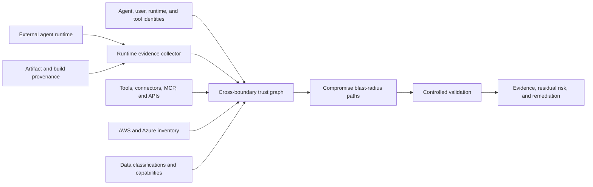

<a id="external-agent-trust-and-runtime-posture-design"></a>
# Externe Agenten: Vertrauen und Laufzeit-Posture

<a id="goal"></a>
## Ziel

Effektives Tenant-Risiko durch extern gehostete, fremd betriebene oder drittanbieterkontrollierte KI-Agenten bewerten.

Kompromittierte Laufzeit annehmen; verifizierbare Posture, Identität/Delegation, Toolkette, Datenerreichbarkeit, kontrollierte Simulation kombinieren.

<a id="problem"></a>
## Problem

IAM sagt wer anfragen darf, beweist nicht Sicherheit von Maschine, Container, Framework, Toolserver, Speicher oder Hoster.

Korrekte Authentifizierung trotz:

- verwundbarer/ungepatchter Software
- offener Verwaltung
- gestohlener langlebiger Credentials
- unsignierter/unverfolgbarer Artefakte
- schädlicher Plugins, Connectoren, MCP, Inhalte
- schwacher Tenant-Isolation
- breitem Netz
- geteilter Runtime-IDs
- unzureichenden Logs/Widerruf

Angreifer erbt eigene Cloudrechte, Nutzerdelegation, Tools und Folgecredentials.

<a id="architecture"></a>
## Architektur



Trennen:

1. **Runtime-Posture:** Was über Ort/Ausführung nachweisbar?
2. **Identität:** Welche IDs/delegierten Rechte?
3. **Toolkette:** Welche Tools, Connectoren, MCP, Gateways, Credentials?
4. **Erreichbarkeit:** Welche Dienste, Daten, privilegierten Operationen?
5. **Eindämmung:** Schadensgrenzen bei Kompromittierung?
6. **Erkennung/Wiederherstellung:** Schnell zuordnen, widerrufen, rotieren, untersuchen?

<a id="runtime-evidence-model"></a>
## Evidenzmodell

Jede Behauptung erfasst:

- Namen
- beobachteten Wert
- Quelle
- Erhebungszeit
- Aktualität/Ablauf
- Prüfmethode
- Aussteller
- Konfidenzklasse
- Hash/Provider-ID
- unbelegte/unsupported Annahmen

Klassen:

| Klasse | Bedeutung |
|---|---|
| `cryptographically-verified` | Signatur, Provenienz, Workload-ID oder Hardwareattestierung geprüft |
| `provider-observed` | Authentifizierte Cloud-/Identitäts-/Runtime-/Security-API |
| `operator-attested` | Administratorangabe ohne unabhängige Prüfung |
| `inferred` | Aus anderer Evidenz abgeleitet |
| `unknown` | Erforderliche Evidenz fehlt |

Unbekannt erhöht Restunsicherheit, niemals still compliant.

<a id="runtime-posture-dimensions"></a>
## Dimensionen

<a id="workload-identity"></a>
### Workload-Identität

- Eigene ID je Agent/Deployment.
- Kurzlebige Föderation.
- Audience/Aussteller begrenzen.
- ID an Attribute binden.
- Keine wiederverwendbaren Credentials in Image/Speicher/Config/Logs.

SPIFFE/SPIRE bindet Selektoren wie Instanz-ID, Kubernetes-Namespace/Serviceaccount, Prozess, Container. Native Föderation zusätzlich unterstützen.

<a id="artifact-integrity"></a>
### Artefaktintegrität

- Signierte Artefakte.
- Immutable Digest statt mutable Tag.
- Source-/Build-Provenienz.
- Genehmigter Builder/Repo.
- Dependencies/Vulnerabilitätsstatus.
- Deployment-Digest entspricht Genehmigung.

SLSA beschreibt wo/wann/wie gebaut, stärkt Supply Chain, beweist nicht allein Host-/Anwendungssicherheit.

<a id="runtime-and-host-integrity"></a>
### Host/Runtime

- Gepatchtes unterstütztes OS.
- Gehärtete Container/VM/Confidential-Computing-Konfiguration.
- Hardwareattestierung wenn verfügbar.
- Verwaltung einschränken.
- Fremdtenants/Workloads isolieren.
- Securitytelemetrie.

Azure Confidential VM guest attestation, AWS NitroTPM/Nitro Enclaves liefern Hardwareevidenz bei Unterstützung. Fehlendes Confidential Computing ist kein automatischer Fehler, aber schwächerer Nachweis.

<a id="network-posture"></a>
### Netzwerk

- Keine unnötige öffentliche Administration.
- Expliziter In-/Egress.
- Tenant-APIs durch kontrolliertes Gateway.
- DNS/Proxy/Zertifikate.
- Egress nur genehmigt.
- Exfiltration durch beliebige Tools verhindern.

<a id="agent-execution-posture"></a>
### Agentenausführung

- Genehmigtes Modell, Systeminstruktionen, Version.
- Toolallowlists/Parameterautorisierung.
- Sandboxcode.
- Speicherprovenienz/Retention.
- Retrieval-Vertrauensgrenzen.
- Injectionabwehr/untrusted Markierung.
- Menschliche Zustimmung bei hoher Wirkung.
- Pro Aktion statt breiter Session autorisieren.

<a id="logging-and-recovery"></a>
### Logs/Recovery

- Korrelations-IDs Mensch/Agent/Runtime/Tool/Cloud.
- Immutable Audit.
- Tool-/Rechteanomalien erkennen.
- Notabschaltung.
- Tokens/Credentials widerrufen.
- Rollenabbau/Quarantäne.
- Incidentowner/getestete Wiederherstellung.

<a id="authorization-gateway"></a>
## Autorisierungsgateway

Keine breiten Tenantcredentials direkt an Externe:

```text
external agent
-> tenant-controlled authorization gateway
-> agent identity verification
-> runtime posture and evidence freshness check
-> user/delegation validation
-> task and tool policy
-> optional approval
-> narrowly scoped short-lived credential
-> cloud operation
```

Effektive Rechte begrenzen durch:

```text
agent permission
intersection delegated-user permission
intersection approved task
intersection tool policy
intersection environment policy
intersection runtime trust policy
```

Fehlende/veraltete/ungültige/zu schwache Evidenz führt zur Verweigerung oder Reduktion.

<a id="trust-and-risk-output"></a>
## Vertrauen/Risiko

Kein undurchsichtiger Gesamtscore allein. Zeigen:

- Evidenzstärke je Dimension
- Kompromittierungsradius
- Datensensibilität
- destruktive/privilegienändernde Operationen
- Eindämmungsqualität
- Erkennung/Widerruf
- Aktualität
- offene Unsicherheit

Gesamtnote möglich, Dimensionen/Pfade bleiben sichtbar.

Beispiel:

```text
Runtime evidence: weak
Identity scope: high
Delegated authority: privileged
Tool-chain exposure: medium
Reachable data: production customer records
Destructive capability: resource deletion
Revocation readiness: partial
Overall decision: deny production write access
```

<a id="controlled-validation"></a>
## Kontrollierte Validierung

Annahme »externe Runtime kompromittiert« ohne echte Kompromittierung prüfen.

Nutzt:

- synthetische ID mit äquivalenten begrenzten Rechten
- synthetische delegierte Nutzerklassen
- kontrollierte Injection-/Toolkonfusionsfixtures
- synthetische Secrets/Marker
- Wegwerfkonto AWS, Azure-Subscription, Cluster, Zwilling
- erlaubte Tools/begrenzte Ausgabe

ID, Delegation, Tool, Digest, Posture, Ziel, Datenklasse aufzeichnen.

<a id="product-surface"></a>
## Produktoberfläche

Mögliche Befehle:

```text
nullstate agent register
nullstate agent posture collect
nullstate agent posture verify
nullstate agent graph
nullstate agent blast-radius
nullstate agent validate --assume-compromised
nullstate agent monitor
```

CLI: lokale Evidenz, Schemas, Graphen, Kundenintegrationen. Team/Enterprise: kontinuierliche Ingestion, gehostete Historie, Policies, Managed-Validierung, Alerts, Approval, Support, Agentendashboards.

<a id="failure-handling"></a>
## Fehler

- Fehlend unbekannt, nicht bestanden.
- Alte Attestierung scheitert Aktualitätsregeln.
- ID-/Runtime-Bindungsfehler blockiert hohe Wirkung.
- Nicht unterstützte Hosts: Betreiberangabe, weniger Konfidenz.
- Cleanup-/Widerrufsfehler macht Run erfolglos trotz abgeschlossenem Test.
- Hardware beweist weder Anwendungskorrektheit, Promptsicherheit noch Vulnerabilitätsfreiheit.

<a id="initial-scope"></a>
## Startumfang

Klein beginnen:

1. Externes Manifestschema.
2. Agent-, Runtime-, Delegations-, Tool-, Credential-, Ziel-, Datenknoten.
3. Betreiberposture plus prüfbare Digests/ID-Konfiguration.
4. Deterministischer Blast-Radius-Bericht.
5. AWS-/Azure-Collector schrittweise.
6. Hardware/Continuity nach stabilen Verträgen.

<a id="testing-strategy"></a>
## Tests

- Malformed/unsigned gemäß Policy ablehnen.
- Fehlend/alt unbekannt oder Fehler.
- Keine Rechte außerhalb Schnittmenge.
- Reichweite erweiternde Delegation erkennen.
- Privilegiertes Tool hinter schwacher ID erkennen.
- Sensible Daten von Grundreichweite trennen.
- Simulation nur synthetisch/erlaubt.
- Quelle, Konfidenz, Zeit, Aktualität erfassen.

<a id="primary-references"></a>
## Primärreferenzen

- [Microsoft Entra Agent ID](https://learn.microsoft.com/en-us/entra/agent-id/)
- [Azure workload identity federation](https://learn.microsoft.com/en-us/entra/workload-id/workload-identity-federation)
- [Azure Conditional Access for workload identities](https://learn.microsoft.com/en-us/entra/identity/conditional-access/workload-identity)
- [Azure Confidential VM guest attestation](https://learn.microsoft.com/en-us/azure/confidential-computing/guest-attestation-confidential-vms)
- [AWS AgentCore Identity](https://docs.aws.amazon.com/bedrock-agentcore/latest/devguide/identity-overview.html)
- [AWS IAM Roles Anywhere](https://docs.aws.amazon.com/rolesanywhere/latest/userguide/introduction.html)
- [AWS NitroTPM attestation](https://docs.aws.amazon.com/AWSEC2/latest/UserGuide/attestation-get-doc.html)
- [AWS Nitro Enclaves attestation](https://docs.aws.amazon.com/enclaves/latest/user/set-up-attestation.html)
- [SLSA build provenance](https://slsa.dev/spec/v1.2/build-provenance)
- [SPIFFE and SPIRE workload identity](https://spiffe.io/docs/latest/spiffe-about/overview/)
