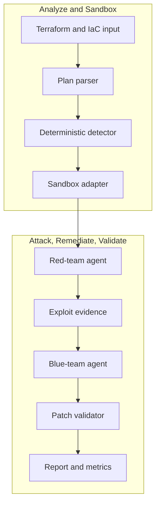

# nullstate

<!-- i18n-switcher:start -->
[English](../../../README.md) | [Español](README.md) | [简体中文](../zh-CN/README.md) | [Français](../fr/README.md) | [日本語](../ja/README.md) | [Deutsch](../de/README.md) | [Português (Brasil)](../pt-BR/README.md)
<!-- i18n-switcher:end -->

Validación de rutas de ataque en la nube respaldada por evidencias para infraestructura como código y entornos desplegados.


`nullstate` convierte la revisión de seguridad de la nube y la infraestructura en un ciclo repetible de descubrimiento, ataque, parche y validación. Combina análisis determinista de IaC con razonamiento de equipos rojo y azul asistido por modelos mediante endpoints compatibles con OpenAI, como vLLM en AMD MI300X.

La demo V1 demuestra la exposición pública del almacenamiento en la nube en sandboxes locales, aplica remediación de Terraform, repite la validación y genera artefactos de evidencia revisables por equipos de seguridad, nube y DevSecOps. La dirección del producto amplía este ciclo correlacionando IaC con inventarios de solo lectura de AWS y Azure, relaciones de identidad, rutas de red, hallazgos en ejecución y clasificaciones de datos. La versión pública actual es una alfa para evaluación local, demos y contribuciones.

<a id="what-it-does"></a>
## Qué hace

1. Lee entradas Terraform/IaC.
2. Detecta configuraciones incorrectas explotables compatibles.
3. Deduce el escenario y lo dirige a un backend de sandbox.
4. Pide a un modelo de equipo rojo que razone sobre la ruta de ataque.
5. Ejecuta un script de ataque generado y restringido contra el objetivo local.
6. Pide a un modelo de equipo azul que explique la remediación.
7. Aplica un parche determinista de Terraform.
8. Valida que la ruta de ataque esté bloqueada.
9. Escribe evidencias y métricas listas para un caso de estudio.

La V1 del hackathon incluye una ruta LocalStack AWS S3 validada en ejecución, una ruta de sondeo Azure Blob respaldada por un manifiesto que aún necesita habilitación de LocalStack Azure para validación en ejecución, y demos deterministas sin conexión de Kubernetes, Docker Compose, líneas base de entornos locales y revisión genérica de planes.

<a id="why-this-exists"></a>
## Por qué existe

Los analizadores estáticos de IaC y las herramientas de postura de seguridad de la nube identifican configuraciones arriesgadas, pero no siempre responden las preguntas operativas que determinan el riesgo real:

- ¿Puede usar la ruta un atacante externo, una carga de trabajo comprometida, un desarrollador, una identidad de CI, un agente de IA o un rol de nube con privilegios excesivos?
- ¿Qué datos, metadatos, credenciales, servicios o privilegios quedan accesibles?
- ¿Una apertura aparentemente inocua expone nombres de archivos, detalles de inquilinos, topología interna, registros, copias de seguridad, artefactos de código fuente u otra información que facilite un ataque posterior?
- ¿Puede reproducirse la ruta sin poner en riesgo los datos y las cargas de trabajo de producción?
- ¿La remediación propuesta bloquea realmente el mismo ataque?

`nullstate` pretende correlacionar la infraestructura declarada con el estado observado de la nube, construir rutas de ataque entre relaciones de red, identidad, servicios y datos, validar rutas relevantes en un entorno controlado y repetirlas tras la remediación.

<a id="why-not-attack-production-directly"></a>
### ¿Por qué no atacar producción directamente?

El descubrimiento de solo lectura y la validación cuidadosamente delimitada pueden ejecutarse contra producción, pero la explotación autónoma no debe ser la opción predeterminada:

- Los exploits pueden modificar, eliminar, corromper o exponer datos reales de clientes.
- Los sondeos de red y autenticación pueden provocar interrupciones, limitación de solicitudes, cuarentena o respuesta automática a incidentes.
- Las pruebas de IAM y escalada de privilegios pueden crear acceso persistente que sobreviva a la prueba.
- Las pruebas de exfiltración pueden infringir requisitos de privacidad, contractuales, regulatorios o de residencia de datos.
- Las dependencias de producción pueden afectar a clientes y terceros fuera del alcance autorizado.
- La limpieza no siempre permite restaurar exactamente el estado original.

Por ello, Nullstate separa observación y explotación. Puede descubrir y modelar producción con acceso de solo lectura, realizar comprobaciones no destructivas expresamente permitidas donde se autoricen y reconstruir la ruta de ataque relevante con datos sintéticos en un entorno desechable de AWS, Azure, emulador, Kubernetes, contenedor o VM. No se trata de clonar una suscripción o cuenta completa, sino de reproducir el grafo mínimo relevante para la seguridad necesario para demostrar o rechazar una hipótesis de ataque.

<a id="what-makes-it-different"></a>
### ¿Qué lo diferencia?

El valor previsto no es otra lista de configuraciones incorrectas de nube. Nullstate debería generar evidencias que conecten:

```text
attacker identity
-> reachable entry point
-> identity or privilege transition
-> accessible service
-> exposed data or capability
-> remediation
-> blocked replay
```

El análisis de ataques tiene en cuenta la identidad. Una ejecución puede evaluar a un usuario anónimo de internet, usuario autenticado del inquilino, desarrollador, carga de CI, identidad de cómputo comprometida, identidad administrada, rol IAM, identidad de agente de IA u otro principal expresamente autorizado. Para agentes de IA, Nullstate debería distinguir la identidad propia del agente de la identidad de herramienta/runtime y la autoridad delegada por un usuario humano. Los informes deberían indicar la identidad y el modo de delegación probados y distinguir exposición de configuración de acceso observado a datos sensibles.

Los agentes alojados externamente introducen otro límite de confianza. Una identidad de nube válida no demuestra que sean seguros la máquina, contenedor, framework de agentes, memoria, conector o proveedor de alojamiento que la utiliza. Por eso, la dirección del producto incluye verificación de postura en ejecución: identidad de carga de corta duración, firmas y procedencia de artefactos, digests de despliegue inmutables, atestación de host/runtime cuando exista, restricciones de red, autorización de herramientas, auditabilidad, vigencia de las evidencias y preparación para revocación. La ausencia de evidencia sigue siendo desconocida, no se considera segura.

Consulte [Modelo de producto y validación](docs/product-validation-model.md).

<a id="demo-result"></a>
## Resultado de la demo

Las ejecuciones finales de la demo AMD MI300X/vLLM usaron `nullstate-gemma4-26b-a4b` para ambos roles, rojo y azul:

| Escenario | Objetivo | Hallazgo | Resultado |
|---|---|---|---|
| `aws-public-s3` | LocalStack AWS | Bloqueo de acceso público de S3 desactivado | El sondeo en ejecución observó acceso antes de la remediación y acceso bloqueado después |
| `azure-public-blob` | LocalStack Azure/ruta sin conexión | Acceso anónimo a contenedor Blob | Sondeo respaldado por manifiesto generado; validación en ejecución de LocalStack Azure pendiente de habilitación del emulador |

Métricas representativas del modelo:

| Ejecución | Rol | Tokens de respuesta | Latencia | Velocidad de salida |
|---|---|---:|---:|---:|
| AWS S3 | Rojo | 942 | 9.018s | 104.452 tok/s |
| AWS S3 | Azul | 640 | 3.977s | 160.937 tok/s |
| Azure Blob | Rojo | 709 | 4.112s | 172.424 tok/s |
| Azure Blob | Azul | 794 | 4.548s | 174.586 tok/s |

<a id="architecture"></a>
## Arquitectura



Consulte [Arquitectura](docs/architecture.md) y [Recorrido técnico](docs/technical-walkthrough.md).

<a id="security-model"></a>
## Modelo de seguridad

V1 no apunta a entornos reales de nube por defecto. Los sandboxes son explícitos, los artefactos son locales y la remediación se realiza en una copia del espacio de trabajo de la ejecución, sin modificar el directorio Terraform original.

El ejecutor de herramientas rojo se limita a scripts `attack.py` generados dentro del directorio de ejecución. Registra comando, stdout, stderr, código de retorno, URL objetivo, etapa, hora de inicio, hora de fin y duración en `events.jsonl`.

Consulte [Modelo de seguridad](docs/security-model.md) y [Modelo de amenazas](docs/threat-model.md).

<a id="installation"></a>
## Instalación

Instalación actual desde el código fuente:

```powershell
git clone https://github.com/Ker102/nullstate-cli.git
cd nullstate-cli
python -m pip install -e .
```

Esto instala las dependencias del paquete y el comando de consola `nullstate` declarado en `pyproject.toml`.

Si no se reconoce `nullstate` después de instalar, el directorio Scripts de Python no está en `PATH`. Puede ejecutar la misma CLI mediante Python:

```powershell
python -m nullstate doctor --offline
```

Para ver dónde instaló Python los scripts de consola:

```powershell
python -c "import sysconfig; print(sysconfig.get_path('scripts'))"
```

Instale la versión preliminar actual directamente desde GitHub:

```powershell
python -m pip install "git+https://github.com/Ker102/nullstate-cli.git@v0.1.0-alpha.2"
```

Para contribuir, instale también las herramientas de desarrollo:

```powershell
python -m pip install -e ".[dev]"
python -m ruff check src tests
python -m mypy src
python -m unittest discover -s tests -v
```

<a id="quickstart"></a>
## Inicio rápido

```powershell
nullstate
nullstate doctor --offline
nullstate status
nullstate init-demo azure-public-blob --output examples/azure-public-blob
nullstate run examples/azure-public-blob --offline
nullstate report
nullstate scrub
```

Inspeccione una ejecución de ejemplo saneada sin Docker, Terraform, LocalStack ni acceso a modelos:

```powershell
nullstate report --runs-dir examples/sample-runs
nullstate summary --runs-dir examples/sample-runs --json
```

El ejemplo incluido en el repositorio también contiene `run-bundle.json` y `dashboard.html` para revisar el contrato del paquete portable y la salida del panel local sin generar nuevos artefactos.

Ejecute otro escenario sin conexión:

```powershell
nullstate run examples/aws-public-s3 --offline
nullstate run examples/k8s-privileged-pod --offline
nullstate run examples/aws-public-s3 --offline --mock-agents --ci --fail-on-severity high
nullstate baseline --output nullstate-baseline.json
nullstate run examples/aws-public-s3 --offline --mock-agents --ci --baseline-file nullstate-baseline.json
nullstate policy-result --baseline-file nullstate-baseline.json
```

Descubrimiento de sandboxes:

```powershell
nullstate sandbox list
nullstate sandbox status localstack-azure
nullstate sandbox up localstack-azure --dry-run
nullstate scenarios list
nullstate scenarios status aws-public-s3
nullstate policy init --output nullstate-policy.json
nullstate policy init --scenario aws-public-s3 --output aws-policy.json
```

`status`, `init-demo`, `sandbox` y `run` imprimen una tabla breve `Next` con los siguientes comandos más probables. `run` usa por defecto `--scenario auto` y `--target auto`; la CLI deduce el escenario de la estructura IaC y elige el backend correspondiente. Pase `--scenario` o `--target` solo al registrar una ruta concreta de demo o probar un adaptador.

Los sondeos de ataque en ejecución permanecen locales por defecto. Los futuros objetivos HTTP(S) no locales requieren `--allow-live-cloud`, y la aprobación se registra en `events.jsonl`; cuando una política incluye `allowed_target_hosts`, el hostname objetivo también debe coincidir con esa lista permitida. Los escenarios integrados actuales siguen resolviéndose a objetivos de sandbox locales/sin conexión.

Inicialice GitHub Actions:

```powershell
nullstate init-ci github --scenario aws-public-s3 --iac-path examples/aws-public-s3
```

Esto escribe `.github/workflows/nullstate.yml` y `nullstate-policy.json` para ejecutar Nullstate como control de pull requests sin copiar manualmente la plantilla del workflow.

Vista previa de confianza de agentes de IA externos:

```powershell
nullstate agent posture verify examples/agent-trust/external-agent-manifest.json
nullstate agent blast-radius examples/agent-trust/external-agent-manifest.json
```

Estos comandos validan un manifiesto local de agente externo y resumen evidencias de postura en ejecución, vigencia de evidencias, tipos de identidad, autoridad delegada del usuario, recursos sensibles, acciones de alto riesgo y clases probables de rutas de ataque. Es una vista previa determinista del modelo de confianza de agentes externos; aún no recopila inventario de proveedores ni atesta un runtime externo en vivo.

Abra el informe más reciente:

```powershell
nullstate report
```

Si guarda ejecuciones en una carpeta con nombre, apunte la búsqueda de informes al directorio padre:

```powershell
nullstate report --runs-dir runs/live-aws-model
nullstate report 20260509-200601 --runs-dir runs
```

Cree un paquete portable de ejecución o un panel HTML local gratuito:

```powershell
nullstate summary --json
nullstate bundle
nullstate dashboard --open
nullstate sarif
nullstate upload --dry-run
```

`summary --json` emite un objeto compacto legible por máquinas para agentes de programación, pasos de GitHub Actions y automatización de comentarios de PR. El panel resume hallazgos, reglas de remediación, metadatos del esquema del paquete, inventario de artefactos, cronología de evidencias y extracto del informe de la ejecución seleccionada.

Los resúmenes y paquetes incluyen el nivel de evidencia del escenario, para que la automatización distinga ejecuciones validadas en vivo de evidencias deterministas sin conexión, esqueletos de implementación o revisión solo de planes.

Vista previa del contexto de nube de solo lectura:

```powershell
nullstate context validate examples/cloud-context/aws-readonly-context.json
nullstate context summary examples/cloud-context/aws-readonly-context.json --json
```

El comando de contexto valida y resume un manifiesto local de inventario de nube. Es el contrato seguro para futuros recolectores de solo lectura AWS/Azure/GCP; todavía no llama APIs de nube ni solicita credenciales.

Métricas de evaluación:

```powershell
nullstate eval run examples/eval/iac-security-regression.json --output-dir eval-runs/iac-security-regression
```

El banco de evaluación ejecuta casos de benchmark repetibles y escribe `eval-results.json` y `eval-report.md`. Úselo como evidencia para casos de estudio: duración, número de hallazgos, máxima severidad, estado del ataque antes/después, totales de tokens, número de artefactos, comprobaciones de expectativas de éxito/fallo y comparación con línea base. El ejemplo compara Nullstate con una línea base transparente de revisión genérica solo de IaC y muestra si añade evidencia de repetición del ataque, validación posterior a remediación, métricas de tokens y cobertura estructurada de artefactos. Aún no compara analizadores externos como Checkov, tfsec o Terrascan.

<a id="live-localstack-demo-path"></a>
## Ruta de demo LocalStack en ejecución

Úsela después de configurar Docker, Terraform, acceso a LocalStack y variables del endpoint de modelo.

AWS:

```powershell
nullstate sandbox up localstack-aws
nullstate sandbox status localstack-aws
nullstate run examples/aws-public-s3 --target localstack-aws
nullstate report
```

Azure:

```powershell
nullstate sandbox up localstack-azure
nullstate sandbox status localstack-azure
nullstate run examples/azure-public-blob --target localstack-azure
nullstate report
```

El proveedor Terraform de la demo incluye:

```hcl
metadata_host = "localhost.localstack.cloud:4566"
```

Esto mantiene Terraform apuntando al emulador LocalStack Azure y no a Azure real.

Guarde `LOCALSTACK_AUTH_TOKEN` en la shell, `.env.local` o `.env`. `nullstate sandbox up` descubre automáticamente primero `.env.local` y después `.env`; `--env-file` sigue disponible para una ruta personalizada.

Si Docker indica que `127.0.0.1:4566` ya está asignado, probablemente un contenedor LocalStack anterior reserva el puerto edge compartido. Ejecute:

```powershell
nullstate sandbox down localstack-aws
nullstate sandbox down localstack-azure
docker ps -a --filter name=localstack
```

Alternativa con Docker Compose:

```powershell
$env:LOCALSTACK_AUTH_TOKEN = "<token>"
docker compose -f docker-compose.localstack-azure.yml up
```

O cree un archivo `.env` local junto al archivo Compose:

```env
LOCALSTACK_AUTH_TOKEN=your-token-here
```

Git ignora `.env` y `.env.local`. No incluya el token en commits.

<a id="model-endpoint"></a>
## Endpoint de modelo

`nullstate` se comunica con servidores de modelos compatibles con OpenAI. Para vLLM, SGLang o un proxy privado autoalojados, use el proveedor personalizado y un endpoint para ambos roles:

```powershell
$env:NULLSTATE_LLM_PROVIDER = "custom"
$env:NULLSTATE_LLM_BASE_URL = "http://<mi300x-host>:8000"
$env:NULLSTATE_LLM_API_KEY = "<optional-token>"
nullstate run examples/azure-public-blob --blue-model gemma-4-31b-it --red-model qwen3-coder-next
```

Para Google AI Studio / Gemini solo se necesitan el preset del proveedor y la API key; `nullstate` proporciona la URL base compatible con OpenAI de Gemini:

```powershell
$env:NULLSTATE_LLM_PROVIDER = "google"
$env:NULLSTATE_LLM_API_KEY = "<google-ai-studio-key>"
nullstate run examples/azure-public-blob --blue-model gemini-3.5-flash --red-model gemini-3.5-flash
```

Para Claude mediante la capa de compatibilidad de Anthropic con el SDK OpenAI, use el preset Claude. Considérelo experimental; si necesita funciones específicas de Claude, un adaptador nativo sigue siendo la mejor vía futura de producción:

```powershell
$env:NULLSTATE_LLM_PROVIDER = "claude"
$env:NULLSTATE_LLM_API_KEY = "<anthropic-api-key>"
nullstate run examples/azure-public-blob --blue-model claude-sonnet-4-6 --red-model claude-sonnet-4-6
```

Para dos contenedores vLLM/SGLang o dos túneles SSH, configure endpoints por rol:

```powershell
$env:NULLSTATE_LLM_PROVIDER = "custom"
$env:NULLSTATE_RED_LLM_BASE_URL = "http://127.0.0.1:8001"
$env:NULLSTATE_BLUE_LLM_BASE_URL = "http://127.0.0.1:8002"
$env:NULLSTATE_RED_LLM_API_KEY = "<optional-red-token>"
$env:NULLSTATE_BLUE_LLM_API_KEY = "<optional-blue-token>"
nullstate run examples/azure-public-blob --red-model nullstate-red --blue-model nullstate-blue
```

La CLI también acepta `--llm-provider`, `--red-provider`, `--blue-provider`, `--red-base-url` y `--blue-base-url` para ejecuciones individuales. Los presets actuales incluyen `google`, `claude`, `custom` y `openai-compatible`. Los ajustes por rol recurren a `NULLSTATE_LLM_PROVIDER`, `NULLSTATE_LLM_BASE_URL` y `NULLSTATE_LLM_API_KEY` si no están definidos. Las URLs base explícitas siempre tienen prioridad, conservando soporte para gateways personalizados, modelos autoalojados y proxies de proveedores.

No es necesario escribir prompts. `nullstate` envía instrucciones internas de agentes rojo y azul y evidencias del escenario. Si falta un endpoint para un rol, ese rol usa una respuesta simulada determinista, permitiendo demos locales y LocalStack sin modelo. Use `--offline` para omitir llamadas Terraform/runtime de nube y usar análisis estático de IaC. Si hay un endpoint compartido o por rol configurado, `--offline` sigue usándolo; añada `--mock-agents` solo cuando quiera respuestas deterministas sin modelo.

<a id="sandbox-backends"></a>
## Backends de sandbox

| Backend | Modo | Objetivo IaC | Estado |
|---|---|---|---|
| `localstack-azure` | ejecutable | Terraform AzureRM | objetivo de demo en ejecución |
| `localstack-aws` | ejecutable | Terraform AWS | objetivo de demo en ejecución |
| `kind-kubernetes` | ejecutable | Kubernetes YAML, Helm, Kustomize | esqueleto de adaptador |
| `docker-compose` | gemelo digital | Docker Compose y stacks de aplicaciones | esqueleto de adaptador |
| `microvm-onprem` | gemelo digital | Ansible, endurecimiento Linux, Terraform estilo libvirt/Proxmox | alternativa con diseño listo |
| `plan-only` | solo plan | cualquier plan exportado/parser | disponible |

<a id="scenarios"></a>
## Escenarios

`nullstate scenarios list` imprime un nivel de evidencia explícito para ver qué está probado en ejecución frente a lo determinista o a los esqueletos antes de ejecutarlo.

| Escenario | Backend | Nivel de evidencia | Estado |
|---|---|---|---|
| `aws-public-s3` | `localstack-aws` | `live-validated` | Despliegue S3 en LocalStack AWS y sondeo restringido de lectura anónima de objetos validados antes y después de la remediación |
| `azure-public-blob` | `localstack-azure` | `offline-deterministic` | Implementados detección estática IaC, remediación, generación de sondeo con manifiesto y evidencias de informes sin conexión; prueba en vivo del emulador Azure pendiente |
| `k8s-privileged-pod` | `kind-kubernetes` | `scaffolded` | Disponibles detección y remediación deterministas sin conexión; sondeo en vivo del clúster kind pendiente |
| `compose-exposed-admin` | `docker-compose` | `scaffolded` | Disponibles detección y remediación deterministas sin conexión; sondeo en vivo de contenedor/red pendiente |
| `onprem-ssh-password` | `microvm-onprem` | `scaffolded` | Disponibles detección y remediación deterministas sin conexión; ejecución de gemelo digital microVM pendiente |
| `generic-plan-review` | `plan-only` | `plan-only` | Disponible revisión estática de planes/configuración; no se intenta sandbox ejecutable ni sondeo de exploit en ejecución |

<a id="artifacts"></a>
## Artefactos

Cada ejecución escribe:

- `runs/<run-id>/events.jsonl`
- `runs/<run-id>/findings.json`
- `runs/<run-id>/metrics.json`
- `runs/<run-id>/ci-summary.json` cuando se usa `nullstate run --ci`
- `runs/<run-id>/policy-result.json` cuando se usa `nullstate policy-result`
- `runs/<run-id>/vllm-metrics-before.prom` cuando `/metrics` es accesible
- `runs/<run-id>/vllm-metrics-after.prom` cuando `/metrics` es accesible
- `runs/<run-id>/vllm-metrics-red-before.prom` y variantes por rol cuando los endpoints rojo/azul difieren
- `runs/<run-id>/attack.py`
- `runs/<run-id>/attack-manifest.json`
- `runs/<run-id>/remediation.json`
- `runs/<run-id>/run-bundle.json` cuando se ejecuta `nullstate bundle` o `nullstate dashboard`
- `runs/<run-id>/dashboard.html` cuando se ejecuta `nullstate dashboard`
- `runs/<run-id>/nullstate.sarif` cuando se ejecuta `nullstate sarif`
- `runs/<run-id>/evidence-manifest.json` cuando se ejecuta `nullstate evidence-manifest`
- `runs/<run-id>/evidence-verification.json` cuando se ejecuta `nullstate evidence-verify`
- `runs/<run-id>/upload-plan.json` cuando se ejecuta `nullstate upload --dry-run`
- `runs/<run-id>/remediation.patch`
- `runs/<run-id>/report.md`
- `scrubbed-runs/<run-id>/scrub-report.json` cuando se usa `nullstate scrub`

Cree una copia saneada antes de compartir evidencias:

```powershell
nullstate scrub
nullstate scrub 20260608-224625 --runs-dir runs --output-dir scrubbed-runs
```

`attack-manifest.json` incluye un puntero `$schema` a `docs/schemas/attack-manifest.schema.json`; la CLI valida el manifiesto generado antes del sondeo restringido. `events.jsonl` incluye entradas `red-tool` para el comando de ataque permitido antes y después de la remediación. `remediation.json` registra versión del conjunto determinista de reglas, escenario, archivos modificados e IDs de reglas aplicadas. Los metadatos de remediación incluyen un puntero `$schema` a `docs/schemas/remediation-metadata.schema.json`, y la CLI los valida antes de que los consuman informes, paquetes y artefactos.

`ci-summary.json` incluye un puntero `$schema` a `docs/schemas/ci-summary.schema.json`; `nullstate run --ci` valida el artefacto de decisión de CI antes de escribirlo.

`run-bundle.json` incluye un puntero `$schema` a `docs/schemas/run-bundle.schema.json`; la CLI valida la estructura al escribirlo. Trate este esquema como contrato local para paneles, subidas de CI, paquetes de soporte y futura ingestión en nube.

Exporte hallazgos para CI o subida a análisis de código:

```powershell
nullstate run examples/aws-public-s3 --offline --mock-agents --ci --fail-on-severity none
nullstate sarif
nullstate sarif 20260608-224625 --runs-dir runs --output artifacts/nullstate.sarif
```

Use `--fail-on-severity high` o `--fail-on-severity critical` cuando CI deba fallar por hallazgos correspondientes.

Cree y use un archivo de política de herramientas rojas:

```powershell
nullstate policy init --output nullstate-policy.json
nullstate policy init --scenario aws-public-s3 --output aws-policy.json
nullstate policy validate nullstate-policy.json --output policy-validation.json
nullstate run examples/aws-public-s3 --offline --mock-agents --policy-file nullstate-policy.json
```

La política generada incluye un puntero `$schema` a `docs/schemas/nullstate-policy.schema.json` y se valida antes de escribirse. Permite nombres de escenarios, backends, etapas, flags de `attack.py` generado, clasificaciones como `offline`, `local`, `local-http` y el futuro `external-http`, hostnames como `localhost.localstack.cloud` o `*.blob.core.windows.net`, IDs de política de comandos como `generated-attack-script-v1` y límites de timeout/captura de salida. `policy init --scenario` crea un preset más restringido para un par conocido de escenario/backend manteniendo las restricciones del ejecutor. `nullstate policy validate` comprueba sin ejecutar escenarios y termina con código `2` si el archivo está mal formado o no es válido.

Cree un manifiesto de integridad antes de adjuntar una ejecución a un ticket, caso de estudio o flujo de soporte:

```powershell
nullstate evidence-manifest
nullstate evidence-verify
nullstate evidence-manifest 20260608-224625 --runs-dir runs --output artifacts/evidence-manifest.json
nullstate evidence-verify 20260608-224625 --runs-dir runs --manifest artifacts/evidence-manifest.json
$env:NULLSTATE_EVIDENCE_SIGNING_KEY = "<secret>"
nullstate evidence-manifest --signing-key-env NULLSTATE_EVIDENCE_SIGNING_KEY
nullstate evidence-verify --signing-key-env NULLSTATE_EVIDENCE_SIGNING_KEY
```

El manifiesto incluye un puntero `$schema` a `docs/schemas/evidence-manifest.schema.json` y se valida antes de escribirse. Inventaría artefactos compartibles con hashes SHA-256, excluye espacios de trabajo copiados e internos de Terraform y permite una firma opcional HMAC-SHA256 de clave compartida. `nullstate evidence-verify` recalcula hashes, comprueba manifiestos firmados con `--signing-key-env` y escribe `evidence-verification.json`; termina con código `2` si falta un artefacto, cambió, procede de otra ejecución o tiene firma inválida. Las claves se leen de variables de entorno y nunca se escriben en el manifiesto.

Cree una línea base de una ejecución conocida para ignorar hallazgos conocidos en CI y fallar por los nuevos:

```powershell
nullstate baseline --output nullstate-baseline.json
nullstate run examples/aws-public-s3 --offline --mock-agents --ci --baseline-file nullstate-baseline.json
nullstate policy-result --baseline-file nullstate-baseline.json
```

`policy-result.json` evalúa una ejecución existente sin repetir el análisis. Sirve para automatización posterior que necesita la misma decisión de umbral y línea base que CI en un artefacto JSON independiente.

Prepare un plan futuro de ingestión en nube sin enviar datos:

```powershell
nullstate upload --dry-run
nullstate upload 20260608-224625 --runs-dir runs --endpoint https://api.nullstate.dev/v1/runs --dry-run
```

`upload-plan.json` incluye un puntero `$schema` a `docs/schemas/upload-plan.schema.json` y se valida antes de escribirse. Registra endpoint objetivo, checksum del paquete, número de artefactos, presencia de token y estado previo de saneado. Nunca almacena valores de tokens. Se permiten ejecuciones sin sanear en dry-run, pero se marcan `upload_recommended: false`; ejecute primero `nullstate scrub` y suba desde `scrubbed-runs/` antes de compartir o de la futura ingestión en nube.

<a id="documentation"></a>
## Documentación

- [Caso de estudio](docs/case-study.md)
- [Primeros 10 minutos](docs/quickstart-10-minutes.md)
- [Recorrido técnico](docs/technical-walkthrough.md)
- [Arquitectura](docs/architecture.md)
- [Modelo de producto y validación](docs/product-validation-model.md)
- [Diseño de confianza y postura de agentes externos](docs/plans/2026-06-22-external-agent-trust-design.md)
- [Esquema del manifiesto de agentes externos](../../schemas/external-agent-manifest.schema.json)
- [Esquema de contexto de nube](../../schemas/cloud-context.schema.json)
- [Esquema de suite de evaluación](../../schemas/eval-suite.schema.json)
- [Esquema de resumen de ejecución](../../schemas/run-summary.schema.json)
- [Modelo de seguridad](docs/security-model.md)
- [Modelo de amenazas](docs/threat-model.md)
- [Auditoría de dependencias](docs/dependency-audit.md)
- [CI/CD](docs/ci-cd.md)
- [Guía operativa](docs/runbook.md)
- [Guía de servicio de modelos](docs/model-serving.md)
- [Hoja de ruta empresarial](docs/enterprise-roadmap.md)
- [Preparación empresarial](docs/enterprise-readiness.md)
- [Hitos de preparación para código abierto](docs/open-source-readiness.md)
- [Progreso de productización](../../progress.md)
- [Plan de comandos rojos en sandbox real](../../plans/2026-06-01-real-sandbox-red-team-commands.md)
- [Traspaso del proyecto](../../handoff.md)
- [Estrategia de cómputo AMD](docs/compute-strategy.md)
- [Modos de fallo](docs/failure-modes.md)
- [Informe de costes](docs/cost-report.md)

<a id="release-model"></a>
## Modelo de versiones

La versión preliminar `Media` solo aloja recursos del README. Las versiones del producto deberían usar etiquetas de versión:

| Etiqueta | Propósito |
|---|---|
| `v0.1.0-alpha.1` | Primera versión preliminar del hackathon con demos sin conexión y documentación pulida |
| `v0.1.0-alpha.2` | Versión preliminar de preparación de código abierto con ejecutor rojo restringido, artefactos CI, paquetes de evidencias, panel local, esqueletos de políticas, workflow SBOM/procedencia y documentación de versiones |
| `v0.1.0-beta.1` | Ruta de validación en ejecución de LocalStack Azure funcionando |
| `v0.1.0` | Candidato final del hackathon con vídeo de demo, caso de estudio y evidencias métricas |

El título de la versión en GitHub puede coincidir con la etiqueta o ser legible, como `nullstate v0.1.0-alpha.2`.

Las versiones etiquetadas construyen wheel/sdist, instalan el wheel en un entorno limpio para una prueba básica, verifican el comando `nullstate` con `doctor --offline`, suben `release-manifest.json` con digests SHA-256, generan y validan `sbom.spdx.json` desde el wheel instalado en un entorno limpio, vuelven a validar el SBOM con herramientas Python SPDX, crean atestaciones GitHub para procedencia del paquete y SBOM, y publican paquetes de firma Sigstore sin claves `.sigstore.json` junto a los recursos de la versión. Verifique un wheel descargado con:

```powershell
gh attestation verify dist/nullstate-*.whl -R Ker102/nullstate-cli
gh attestation verify dist/nullstate-*.whl -R Ker102/nullstate-cli --predicate-type https://spdx.dev/Document/v2.3
```

Los paquetes de firma Sigstore se suben como recursos adyacentes, por ejemplo `nullstate-...whl.sigstore.json`.

Antes de etiquetar, ejecute manualmente el workflow `Release` con `dry_run=true` para ensayar construcción, validación SBOM, atestaciones, firma y comprobaciones de paquetes de firma sin crear una versión GitHub.

Antes de etiquetar localmente, verifique que el wheel construido se instala y expone el comando de consola `nullstate`:

```powershell
python scripts/release/install_smoke.py
```

Después de publicar una etiqueta preliminar, verifique que la instalación pública desde GitHub expone el mismo comando:

```powershell
python scripts/release/install_smoke.py --tag v0.1.0-alpha.2
```

Verifique la firma de un wheel con Cosign usando su paquete adyacente y la identidad del workflow de publicación:

```powershell
$wheel = Get-ChildItem dist\nullstate-*.whl | Select-Object -First 1
cosign verify-blob $wheel.FullName --bundle "$($wheel.FullName).sigstore.json" --certificate-identity "https://github.com/Ker102/nullstate-cli/.github/workflows/release.yml@refs/tags/v0.1.0" --certificate-oidc-issuer "https://token.actions.githubusercontent.com"
```

<a id="status"></a>
## Estado

Funciona actualmente: validación de almacenamiento LocalStack AWS en ejecución, generación de sondeo Azure Blob con manifiesto pendiente de habilitación LocalStack Azure en vivo, demos deterministas sin conexión para todos los escenarios listados, ejecución restringida de comandos rojos, remediación determinista, registro de sandboxes, artefactos de informes y métricas de modelos, salida CLI de marca y estructura de repositorio DevSecOps.

Experimental: scripts de ataque más ricos por escenario, adaptadores Kubernetes/Compose/on-prem en ejecución, SBOM de dependencias resueltas más completos y cobertura de redacción de artefactos más amplia.
