<a id="nullstate-architecture"></a>
# Arquitectura de nullstate

<a id="goal"></a>
## Objetivo

Entregar un flujo purple-team repetible que comience con infraestructura como código y evolucione hacia la correlación con entornos AWS y Azure observados, sin convertir la explotación de nube real en la opción predeterminada.

<a id="pipeline"></a>
## Pipeline

```mermaid
flowchart LR
    A[Terraform / IaC directory] --> B[Plan JSON or static parser]
    B --> C[Deterministic exposure detector]
    C --> S[Sandbox adapter]
    S --> D[Red-team agent instructions]
    D --> E[Constrained attack.py runner]
    E --> F[Exploit evidence]
    F --> G[Blue-team agent instructions]
    G --> H[Deterministic remediation]
    H --> I[Validation attack]
    I --> J[Run report and metrics]
```



<a id="design-choices"></a>
## Decisiones de diseño

- El detector determinista es la fuente de verdad para la fiabilidad de las demos.
- IaC describe la configuración prevista; el futuro descubrimiento de solo lectura de AWS y Azure aporta estado desplegado y desviaciones.
- La base de análisis a largo plazo es un grafo normalizado que abarca recursos, conectividad, identidades, privilegios, servicios e impacto en datos.
- Las rutas se evalúan desde identidades explícitas: usuarios anónimos, desarrolladores, cargas CI, identidades de cómputo comprometidas, roles AWS e identidades administradas Azure.
- Los entornos desechables deberían reconstruir la ruta mínima relevante, no clonar cuentas o suscripciones enteras.
- Los agentes rojo/azul reciben instrucciones internas y evidencias; el usuario no necesita escribir prompts.
- `run` usa por defecto `--scenario auto` y `--target auto`; siguen disponibles valores explícitos para demos y pruebas.
- El modo sin conexión usa un parser Terraform estático para funcionar sin LocalStack, Terraform ni GPU.
- El modo online sigue los comandos Terraform: `init`, `plan -out=tfplan` y `show -json tfplan`.
- Los backends son adaptadores explícitos: ejecutables, gemelos digitales o solo plan.
- El ejecutor rojo solo ejecuta `attack.py` generado en el directorio de ejecución y registra evidencias en `events.jsonl`.

Consulte [Modelo de producto y validación](product-validation-model.md) para descubrimiento de producción, análisis por identidad, impacto de datos expuestos, niveles de fidelidad y diseño de disparadores CI.

<a id="sandbox-adapters"></a>
## Adaptadores de sandbox

| Backend | Modo | Objetivo |
|---|---|---|
| `localstack-azure` | ejecutable | Terraform AzureRM |
| `localstack-aws` | ejecutable | Terraform AWS |
| `kind-kubernetes` | ejecutable | Kubernetes YAML, Helm, Kustomize |
| `docker-compose` | gemelo digital | Docker Compose y stacks de aplicaciones |
| `microvm-onprem` | gemelo digital | IaC tipo Linux/VM/red local |
| `plan-only` | solo plan | cualquier IaC con parser/plan exportado |

<a id="on-prem-sandboxing-model"></a>
## Modelo de sandbox local

La infraestructura on-prem normalmente no puede emularse con un único emulador de nube universal. nullstate elige el mejor nivel disponible:

- sandbox ejecutable si existe un runtime desechable
- gemelo digital si la topología puede mapearse a contenedores o VM locales
- análisis solo de plan si la ejecución sería insegura o no compatible

<a id="current-rule"></a>
## Regla actual

`AZURE_STORAGE_PUBLIC_BLOB` marca recursos `azurerm_storage_container` cuyo `container_access_type` es `blob` o `container`.

La remediación establece:

```hcl
container_access_type = "private"
allow_nested_items_to_be_public = false
```

<a id="scenario-roadmap"></a>
## Hoja de ruta de escenarios

| Escenario | Objetivo | Sandbox | Estado de ejecución |
|---|---|---|---|
| `azure-public-blob` | Terraform AzureRM | LocalStack Azure o futuro fallback Azurite | demo con manifiesto/sin conexión disponible; validación LocalStack Azure en vivo pendiente de habilitación |
| `aws-public-s3` | Terraform AWS | LocalStack AWS | demo en ejecución disponible |
| `k8s-privileged-pod` | Kubernetes YAML/Helm/Kustomize | kind | demo sin conexión disponible; ejecución en vivo pendiente |
| `compose-exposed-admin` | Docker Compose | red Docker aislada | demo sin conexión disponible; sondeo en vivo pendiente |
| `onprem-ssh-password` | IaC tipo Ansible/cloud-init/libvirt/Proxmox | gemelo digital de laboratorio VM/contenedores | demo sin conexión disponible; gemelo microVM pendiente |
| `generic-plan-review` | exportaciones IaC no compatibles | ninguno | solo plan disponible |
