<a id="nullstate-autonomous-purple-team-iac-sandbox-on-amd-mi300x"></a>
# nullstate: Sandbox IaC purple-team autónomo en AMD MI300X

<a id="1-executive-summary"></a>
## 1. Resumen ejecutivo

Construí `nullstate` durante el hackathon AMD x lablab.ai para explorar si la validación de seguridad podía superar los hallazgos estáticos y convertirse en un ciclo rojo/azul repetible. La CLI lee Terraform, inicia sandbox local, detecta exposición peligrosa de almacenamiento, pide razonamiento rojo, ejecuta un ataque generado restringido local, pide explicación azul, parchea Terraform determinísticamente, revalida y genera evidencias para jueces. La demo final usó automatización Terraform, sandboxes tipo LocalStack, Python Typer/Rich, endpoints vLLM compatibles OpenAI, ROCm y droplet AMD Instinct MI300X. La decisión clave fue un veredicto determinista con modelo para razonamiento adversario, explicación y calidad de informes. El resultado es alfa abierta con AWS LocalStack validado en vivo, Azure Blob con manifiesto pendiente de emulador y hoja de ruta de publicación estable.

<a id="2-problem"></a>
## 2. Problema

Los scanners IaC son útiles, pero suelen detenerse en «configuración arriesgada». Quedan preguntas operativas:

- ¿Es explotable en este contexto?
- ¿Qué evidencia prueba exposición?
- ¿Qué cambio Terraform exacto la corrige?
- ¿Falló el ataque tras el parche?
- ¿Se demuestra sin tocar cuentas de producción?

`nullstate` cubre esa brecha: apuntar a proyecto IaC y obtener trazabilidad reproducible de hallazgo, razonamiento, remediación, validación e informe revisable por seguridad, nube o DevSecOps.

La dirección no presupone que IaC contenga toda la nube. IaC es estado previsto/gestionado; descubrimiento AWS/Azure de solo lectura aporta realidad, identidad, red, runtime y deriva. Correlacionar en grafo, determinar identidades atacantes con acceso a datos/capacidades y reconstruir solo ruta mínima para validación controlada.

<a id="why-not-attack-production-directly"></a>
### ¿Por qué no atacar producción?

- Exploits modifican, borran, corrompen o exponen datos reales.
- Sondeos de red/autenticación causan cortes, throttling, bloqueos, cuarentena o respuesta.
- IAM puede crear credenciales, relaciones o privilegios persistentes.
- Exfiltración viola privacidad, contratos, regulación y residencia.
- Dependencias afectan terceros fuera de alcance.
- Limpieza no siempre restaura estado exacto.

Flujo previsto: descubrir producción de solo lectura, checks no destructivos aprobados, explotación sintética controlada, remediación determinista y repetir mismo ataque. Además de anónimos, desarrolladores, CI, identidades de cómputo comprometidas, IAM AWS, principales Azure y managed identities son puntos de partida.

Los agentes IA añaden identidades poco estudiadas: nativas, principales/IAM convencionales, runtime separado o autoridad humana delegada. Comprometer prompts, memoria, conector, MCP, plugin o credencial posterior hereda accesos difíciles de ver en grafos solo de recursos. Modele por separado permisos nativos, delegados y herramientas, e informe datos/operaciones privilegiadas por ruta.

Agentes externos agravan porque cliente controla permisos, no máquina. Token válido no prueba parches, aislamiento, artefacto aprobado, herramientas fiables ni ausencia de credenciales robadas. Próximo diseño añade postura y radio de compromiso, separando criptografía, observación del proveedor, afirmación del operador, inferencia y desconocido para evitar falsa garantía.

<a id="3-context-and-constraints"></a>
## 3. Contexto y restricciones

- Construcción del hackathon: unas 48 horas.
- Presión final: evidencia funcional antes del plazo, no plataforma amplia incompleta.
- Cloud: sandbox local primero, sin credenciales reales Azure/AWS por defecto.
- Modelo autoalojado MI300X mediante vLLM/ROCm.
- LocalStack para AWS/Azure; Azure vivo requiere habilitación Emulator.
- UX CLI primero, no aplicación web completa.
- No exponer vLLM, LocalStack, tokens, estado Terraform ni `.env` públicamente.
- Modelo no es fuente de veredicto.

<a id="4-requirements"></a>
## 4. Requisitos

<a id="functional-requirements"></a>
### Funcionales

- Analizar Terraform.
- Inferir/aceptar objetivo de escenario.
- Iniciar/inspeccionar backends locales.
- Detectar exposición pública de almacenamiento alto riesgo.
- Razonamiento rojo con modelo propio.
- Ataque restringido generado antes/después.
- Registrar comando, stdout, stderr, retorno, URL, etapa, inicio, fin, duración en `events.jsonl`.
- Explicar remediación azul con modelo propio.
- Remediar determinísticamente.
- Revalidar.
- Generar `report.md`, `findings.json`, `events.jsonl`, `metrics.json`, `attack.py`, `remediation.patch`, `remediation.json`.
- Offline/mock sin GPU/sandbox.

<a id="non-functional-requirements"></a>
### No funcionales

- Sin nube real por defecto.
- Sin shell roja arbitraria V1; solo `attack.py` generado en ejecución.
- Comandos comprensibles bajo presión de demo.
- Artefactos útiles para casos posteriores.
- Secretos/estado fuera de Git.
- CI con PR, dependencias, CodeQL, ramas protegidas.

<a id="5-architecture"></a>
## 5. Arquitectura

```mermaid
flowchart LR
    A[Terraform IaC input] --> B[Terraform init / plan / show JSON]
    B --> C[Deterministic detector]
    C --> D[Sandbox adapter]
    D --> E[Red-team model reasoning]
    E --> F[Attack evidence]
    F --> G[Blue-team model remediation]
    G --> H[Deterministic Terraform patch]
    H --> I[Re-plan and apply]
    I --> J[Validation attack]
    J --> K[Report and metrics artifacts]
```



Separa decisión fiable de explicación del modelo:

- Terraform en vivo: `terraform init -input=false`, `terraform plan -out=tfplan -input=false`, `terraform show -json tfplan`, `terraform apply -auto-approve -input=false tfplan`.
- Detector determinista sobre config/plan JSON.
- Modelo rojo recibe evidencia y razona.
- Azul recibe evidencia y recomienda.
- Motor determinista parchea.
- Validador comprueba hallazgos restantes y ataque posterior.

<a id="6-what-the-red-agent-actually-does-today"></a>
## 6. Qué hace realmente el agente rojo

Describir con precisión es importante.

El modelo no recibe shell. Recibe prompt interno y hallazgos, devuelve razonamiento como lectura S3 anónima o `curl` Azure.

Después, `nullstate` solo ejecuta `attack.py` generado dentro de directorio mediante runner restringido. Invoca Python directamente, solo `--target-url` y `--stage`, registra comando, stdout, stderr, retorno, URL, etapa, inicio, fin y duración en `events.jsonl`.

Más estrecho que shell libre: evidencia real local y frontera fiable/auditable.

<a id="7-security-model"></a>
## 7. Seguridad

| Riesgo | Control | Evidencia |
|---|---|---|
| Ataque cloud accidental | LocalStack/solo plan por defecto | adaptadores/comandos |
| Modelo inseguro | detector/remediación versionada deterministas | `findings.json`, `remediation.patch`, `remediation.json` |
| Exploit arbitrario | solo `attack.py`, sin shell | `red-tool`, `src/nullstate/attack_runner.py` |
| Filtración | `.env`/estado ignorados; capturas redactadas | higiene/lista |
| Endpoint público | vLLM vía túnel SSH, no entrada pública | droplet/túnel |
| Código sin revisar | PR, protección, CI | GitHub checks |

<a id="8-deployment-and-devsecops-workflow"></a>
## 8. Despliegue y DevSecOps

Construido con ramas y PR, no edición directa de main:

```text
feature branch
-> PR
-> unit tests, lint, type checks, dependency/security checks
-> review/merge
-> release tag / release notes
```

Prácticas añadidas:

- Metadatos Python/entrada consola.
- Arquitectura, runbook, amenazas, seguridad, CI, costes, fallos.
- GitHub Actions calidad.
- CodeQL/revisión dependencias.
- Higiene tipo Dependabot.
- Lista de evidencia fuera de Git.
- Publicación con artefactos etiquetados.

<a id="9-final-demo-results"></a>
## 9. Resultados finales

<a id="open-source-readiness-status"></a>
## Preparación de código abierto

`nullstate` sirve a alfa, no afirmaciones de producción estable.

Probado:

- AWS LocalStack en vivo. `attack.py` lee S3 anónimo antes, registra y verifica bloqueo determinista después.
- Comandos reales solo por `attack.py` generado en ejecución; sin shell del modelo.
- Pruebas cubren offline, CI, SARIF, políticas, saneado, manifiestos, paquetes y panel.
- Preview de confianza IA: `nullstate agent posture verify` y `nullstate agent blast-radius` validan postura local, mantienen antiguo/desconocido, separan identidad, delegación, recursos, riesgos, clases.
- Interfaz compacta: `nullstate summary --json` expone estado, hallazgos, ataque antes/después, tokens, artefactos, límites; `nullstate context summary --json` define contrato local de solo lectura para recolectores futuros.
- Evaluación: `nullstate eval run examples/eval/iac-security-regression.json` escribe `eval-results.json`, `eval-report.md` con duración, hallazgos, severidad, ataque, tokens, artefactos, expectativas y comparación transparente IaC genérico. Muestra aportación de replay, validación posterior, métricas y cobertura estructurada.

No probado:

- Azure Blob no validado en vivo; intento falla por falta de habilitación Azure Emulator.
- Kubernetes, Compose, on-prem y planes siguen offline/esqueleto salvo documentación explícita.
- Confianza IA no recoge inventario vivo, atesta terceros ni impone gateway.
- Contexto es manifiesto/resumen, no recolector AWS/Azure/GCP vivo.
- Evaluación propia y baseline determinista; no ejecuta Checkov, tfsec, Terrascan, revisión manual o agentes genéricos.
- Aún necesita flujo estable de artefactos y recorrido inicial antes de promocionar estabilidad.

Hitos en `docs/open-source-readiness.md`.

<a id="aws-public-s3-scenario"></a>
### Escenario AWS S3 público

Artefacto:

```text
runs/final-aws-gemma26b/20260510-170931
```

Hallazgo:

```text
HIGH AWS_S3_PUBLIC_ACCESS_BLOCK_DISABLED
Resource: aws_s3_bucket_public_access_block.public_logs
Evidence: block_public_acls, block_public_policy, ignore_public_acls, and restrict_public_buckets were disabled.
```

Parche:

```diff
-  block_public_acls       = false
-  block_public_policy     = false
-  ignore_public_acls      = false
-  restrict_public_buckets = false
+  block_public_acls       = true
+  block_public_policy     = true
+  ignore_public_acls      = true
+  restrict_public_buckets = true
```

Resultado runtime:

```text
Red before: success
Red after: blocked
Verdict: Exploit blocked after remediation
```

Métricas de `metrics.json`:

| Rol | Modelo | Tokens | Latencia | Velocidad |
|---|---:|---:|---:|---:|
| Rojo | `nullstate-gemma4-26b-a4b` | 942 | 9.018s | 104.452 tok/s |
| Azul | `nullstate-gemma4-26b-a4b` | 640 | 3.977s | 160.937 tok/s |

<a id="azure-public-blob-scenario"></a>
### Escenario Azure Blob público

Artefacto:

```text
runs/final-azure-gemma26b/20260510-174858
```

Hallazgo:

```text
HIGH AZURE_STORAGE_PUBLIC_BLOB
Resource: azurerm_storage_container.secrets
Evidence: container_access_type is "container"; storage account allows nested items to be public.
```

Parche:

```diff
-  allow_nested_items_to_be_public  = true
+  allow_nested_items_to_be_public  = false

-  container_access_type = "container"
+  container_access_type = "private"
```

Estado de validación actual:

```text
Deterministic finding: present before remediation
Deterministic remediation: patch generated and validated
Runtime probe: generated from attack-manifest.json
Live LocalStack Azure validation: blocked by LocalStack Azure Emulator entitlement
```

Métricas de `metrics.json`:

| Rol | Modelo | Tokens | Latencia | Velocidad |
|---|---:|---:|---:|---:|
| Rojo | `nullstate-gemma4-26b-a4b` | 709 | 4.112s | 172.424 tok/s |
| Azul | `nullstate-gemma4-26b-a4b` | 794 | 4.548s | 174.586 tok/s |

<a id="10-evidence-artifacts"></a>
## 10. Artefactos

Cada ejecución crea:

- `events.jsonl`: Terraform, análisis, comandos, rojo, azul y validación.
- `findings.json`: hallazgos estructurados.
- `attack.py`: ataque por escenario.
- `remediation.patch`: diff determinista.
- `remediation.json`: versión, archivos, IDs.
- `metrics.json`: tokens, latencia, throughput, endpoint.
- `report.md`: caso legible.
- `run-bundle.json`: contrato portable con esquema para panel, soporte, CI y nube futura.
- `dashboard.html`: panel gratuito local de una ejecución.
- `workspace/`: Terraform copiado reproducible.

Capturas antes de publicar:

- raíz `nullstate` con logo y siguientes pasos.
- resumen `nullstate run` AWS/Azure.
- `report.md` con `Exploit blocked after remediation`.
- página GPU droplet MI300X.
- `/v1/models` vLLM de `nullstate-gemma4-26b-a4b`.
- `/metrics` o `metrics.json` throughput.
- GitHub PR/checks/release.

<a id="11-cost-analysis"></a>
## 11. Costes

Principal coste: GPU MI300X para modelos. LocalStack/Terraform locales, sin recursos cloud de pago AWS/Azure necesarios. Mantener nube real fuera de alcance y GPU solo para evidencias/métricas finales.

Portfolio final debe incluir:

- créditos DigitalOcean totales.
- horas droplet.
- si se destruyó tras recopilar.
- intentos fallidos que consumieron GPU.

<a id="12-tradeoffs"></a>
## 12. Compromisos

| Decisión | Alternativa | Motivo | Desventaja |
|---|---|---|---|
| CLI primero | dashboard Next.js | rapidez/evidencia terminal | menos visual |
| Determinismo | scanner LLM puro | veredicto/parches reproducibles | menos escenarios V1 |
| LocalStack | cloud real | seguro/sin credenciales producción | diferencias/configuración |
| Modelo grande compartido | modelos separados | evitó VRAM/runtime dual | menor especialización |
| Endpoint compatible/presets | SDK por proveedor | vLLM, SGLang, Gemini, Claude, proxies | nativo necesita adaptadores |
| Ejecutor restringido | shell libre | comandos reales sin herramientas arbitrarias | sondeos estrechos |

<a id="13-failure-modes-and-lessons-learned"></a>
## 13. Fallos y lecciones

- Acceso DigitalOcean retrasó GPU.
- Contenedores reservan `4566`; CLI da recuperación.
- Azure inicia y termina sin habilitación; CLI falla y orienta.
- Instalación editable rompe al mover repo; producción usa entrada del paquete.
- Dos modelos en MI300X causaron presión VRAM/cache.
- AITER fused-MoE ROCm falló al arrancar Gemma; final modelo grande único.
- SGLang/Qwen3.5 relegado por imports.
- Windows no captura `amd-smi` del droplet directamente; métricas endpoint/capturas cubren hueco.

<a id="14-what-i-would-improve-next"></a>
## 14. Próximas mejoras

- Ampliar `attack.py` permitido a exploits por escenario.
- Allowlists de comandos más allá Python.
- `nullstate run --auto-sandbox` para locales.
- Puertos LocalStack personalizados AWS/Azure simultáneos.
- Más redacción antes de publicar.
- Mejor SBOM/firma/procedencia.
- Más Azure/AWS/Kubernetes/Compose/on-prem.
- Portfolio con capturas/diagrama/vídeo.
- Resolver Azure, Azurite o mantener explícitamente offline hasta emulador compatible.

<a id="15-enterprise-next-iteration"></a>
## 15. Siguiente iteración empresarial

Hackathon prueba arquitectura: IaC determinista, LocalStack, modelos rojo/azul, ejecución restringida, remediación y evidencias.

Siguiente paso profundiza comandos. Frontera/logs existen, scripts AWS/Azure siguen sondeos estrechos. Evolucionar de configuración+sondeo a exploit observado+validación determinista.

Para S3, crear objeto expuesto, leer anónimo antes, bloquear después y registrar ambas salidas. Azure igual donde APIs permitan; si no, etiquetar límites en vez de exagerar.

Si informe dice explotado, debe contener comandos observados. Offline/emulador limitado se etiqueta simulación/inconcluso. Eso da credibilidad.

<a id="16-repository-and-demo-links"></a>
## 16. Repo y enlaces

- GitHub: <https://github.com/Ker102/nullstate-cli>
- Slug portfolio sugerido: `/case-studies/nullstate-autonomous-purple-team-iac-sandbox`
- Vídeo: pendiente
- Informe AWS final: `runs/final-aws-gemma26b/20260510-170931/report.md`
- Informe Azure final: `runs/final-azure-gemma26b/20260510-174858/report.md` (histórico hackathon; docs actuales deben marcar validación Azure pendiente)

<a id="17-interview-explanation"></a>
## 17. Explicación para entrevista

Construí `nullstate` porque detectar configuraciones no prueba explotación/remediación. Planes Terraform, sandboxes, determinismo, ataque restringido y modelos propios crean ciclo repetible. Decisión crucial: veredicto determinista y solo `attack.py` generado, no shell arbitraria. Lo difícil fue evidencia acotada fiable frente a automatización amplia no respaldada. Ampliaría allowlists y estabilizaría emulador Azure antes de llamarlo validado en vivo.

<a id="18-resume-bullets"></a>
## 18. Puntos de currículum

- Creé `nullstate`, CLI Python DevSecOps de Terraform con ciclo local rojo/azul, remediación determinista y artefactos.
- Serví modelo grande MI300X/vLLM/ROCm y registré tokens, latencia, throughput/endpoints de ejecuciones finales AWS/Azure.
- Implementé Terraform, LocalStack, artefactos, informes, CI, amenazas, runbook y PR orientados a publicación.
- Evidencia AWS S3 en vivo de remediación/bloqueo y Azure Blob documentado determinista/offline pendiente de habilitación.
