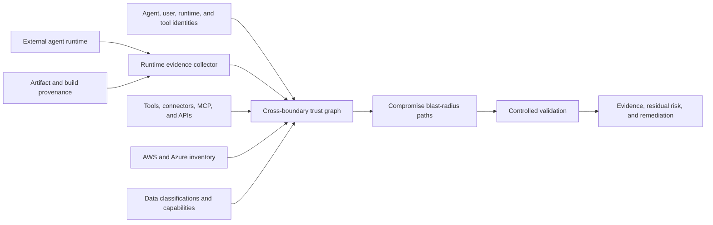

<a id="external-agent-trust-and-runtime-posture-design"></a>
# Diseño de confianza y postura runtime de agentes externos

<a id="goal"></a>
## Objetivo

Permitir a Nullstate evaluar el riesgo efectivo del inquilino por un agente IA alojado fuera de su nube, operado por otro equipo o controlado por proveedor externo.

El diseño presupone compromiso del runtime: combina postura verificable, identidad/delegación, inspección de herramientas, datos accesibles y simulación controlada.

<a id="problem"></a>
## Problema

IAM indica quién puede solicitar operaciones; no prueba seguridad de máquina, contenedor, framework, servidor de herramientas, memoria o proveedor.

Un agente puede autenticarse correctamente en un entorno con:

- software vulnerable o sin parches
- interfaces administrativas expuestas
- credenciales persistentes robadas
- artefactos sin firma o trazabilidad
- plugins, conectores, MCP o contenido maliciosos
- aislamiento débil entre inquilinos
- acceso amplio de red
- identidades runtime compartidas
- logs o revocación insuficientes

Comprometer el agente puede dar al atacante permisos propios, autoridad delegada, identidades de herramientas y credenciales posteriores.

<a id="architecture"></a>
## Arquitectura



Nullstate debería separar:

1. **Postura runtime:** ¿Qué se verifica del lugar y forma de ejecución?
2. **Postura de identidad:** ¿Qué identidades y permisos delegados usa?
3. **Cadena de herramientas:** ¿Qué herramientas, conectores, MCP, gateways y credenciales invoca?
4. **Alcance:** ¿Qué servicios, datos y operaciones privilegiadas alcanza?
5. **Contención:** ¿Qué limita daño si se compromete?
6. **Detección y recuperación:** ¿Se puede atribuir, revocar, rotar e investigar rápidamente?

<a id="runtime-evidence-model"></a>
## Modelo de evidencia runtime

Cada afirmación debe registrar:

- nombre
- valor observado
- fuente
- tiempo de recopilación
- vigencia o caducidad
- método de verificación
- emisor
- clase de confianza
- hash o ID de recurso proveedor
- supuestos no soportados/no verificables

Clasificaciones:

| Clase | Significado |
|---|---|
| `cryptographically-verified` | Firma, procedencia, identidad de carga o atestación hardware verificada |
| `provider-observed` | Obtenido de API autenticada cloud, identidad, runtime o seguridad |
| `operator-attested` | Aportado por administrador, no verificado independientemente |
| `inferred` | Derivado de otras evidencias |
| `unknown` | Evidencia requerida no disponible |

Lo desconocido aumenta incertidumbre residual; nunca se considera conforme silenciosamente.

<a id="runtime-posture-dimensions"></a>
## Dimensiones de postura

<a id="workload-identity"></a>
### Identidad de carga

- Identidad distinta por agente/despliegue.
- Credenciales federadas breves.
- Restricciones de audience/emisor.
- Vínculo entre identidad y atributos.
- Sin credenciales reutilizables en imágenes, memoria, configuración o logs.

Atestación tipo SPIFFE/SPIRE vincula identidades a selectores de instancia cloud, namespace/cuenta Kubernetes, proceso o contenedor. Debe coexistir con federación nativa.

<a id="artifact-integrity"></a>
### Integridad de artefactos

- Contenedor/artefacto firmado.
- Digest inmutable, no etiqueta mutable.
- Procedencia fuente/build.
- Constructor y repo aprobados.
- Inventario de dependencias y vulnerabilidades.
- Digest desplegado coincide con aprobado.

SLSA describe dónde, cuándo y cómo se construyó; refuerza confianza de suministro, no prueba por sí solo seguridad del host o comportamiento de aplicación.

<a id="runtime-and-host-integrity"></a>
### Integridad host/runtime

- OS/runtime compatible y parcheado.
- Contenedor, VM o cómputo confidencial endurecidos.
- Atestación hardware donde exista.
- Administración restringida.
- Aislamiento de otras cargas/inquilinos.
- Telemetría de seguridad.

Azure Confidential VM guest attestation, AWS NitroTPM y Nitro Enclaves aportan evidencia hardware en entornos compatibles. No tener cómputo confidencial no es fallo automático, pero reduce fuerza probatoria.

<a id="network-posture"></a>
### Red

- Sin administración pública innecesaria.
- Política explícita de entrada/salida.
- API del inquilino por gateway controlado.
- Controles DNS/proxy/certificados.
- Salida a modelos/herramientas/servicios aprobados.
- Protección de exfiltración por llamadas arbitrarias.

<a id="agent-execution-posture"></a>
### Ejecución del agente

- Modelo, instrucciones y versión aprobados.
- Herramientas permitidas y autorización por parámetros.
- Código en sandbox.
- Procedencia y retención de memoria.
- Límites de confianza de recuperación.
- Defensas de inyección y etiquetado no confiable.
- Aprobación humana para alto impacto.
- Autorizar por acción, no sesión amplia.

<a id="logging-and-recovery"></a>
### Logs y recuperación

- IDs correlacionan usuario, agente, runtime, herramienta y nube.
- Eventos inmutables.
- Detectar uso anómalo de herramientas/permisos.
- Desactivación de emergencia.
- Revocar tokens/credenciales.
- Reducir roles o cuarentena automática.
- Responsable de incidentes y recuperación probada.

<a id="authorization-gateway"></a>
## Gateway de autorización

Arquitectura preferida no expone credenciales amplias directamente al externo:

```text
external agent
-> tenant-controlled authorization gateway
-> agent identity verification
-> runtime posture and evidence freshness check
-> user/delegation validation
-> task and tool policy
-> optional approval
-> narrowly scoped short-lived credential
-> cloud operation
```

Los permisos efectivos deben acotarse por:

```text
agent permission
intersection delegated-user permission
intersection approved task
intersection tool policy
intersection environment policy
intersection runtime trust policy
```

El gateway debe negar/reducir privilegios si evidencia falta, caducó, es inválida o inferior a política para la operación.

<a id="trust-and-risk-output"></a>
## Salida de confianza y riesgo

No solo puntuación opaca. Mostrar:

- fuerza de evidencia por dimensión
- radio de impacto del compromiso
- sensibilidad de datos accesibles
- operaciones destructivas/de privilegios accesibles
- calidad de contención
- detección/revocación listas
- vigencia
- incertidumbre sin resolver

Una nota global ayuda al panel, pero dimensiones y rutas deben ser visibles.

Ejemplo:

```text
Runtime evidence: weak
Identity scope: high
Delegated authority: privileged
Tool-chain exposure: medium
Reachable data: production customer records
Destructive capability: resource deletion
Revocation readiness: partial
Overall decision: deny production write access
```

<a id="controlled-validation"></a>
## Validación controlada

Verificar hipótesis «runtime externo comprometido» sin comprometer el real.

Usa:

- identidad sintética con permisos equivalentes acotados
- usuarios delegados sintéticos por clase de privilegio
- fixtures controlados de inyección/confusión de herramientas
- secretos y marcadores sintéticos
- cuenta AWS, suscripción Azure, clúster o gemelo desechable
- herramientas permitidas y salidas acotadas

Registrar identidad, delegación, herramienta, digest, postura, objetivo y clase de datos.

<a id="product-surface"></a>
## Superficie de producto

Comandos potenciales:

```text
nullstate agent register
nullstate agent posture collect
nullstate agent posture verify
nullstate agent graph
nullstate agent blast-radius
nullstate agent validate --assume-compromised
nullstate agent monitor
```

CLI abierto puede recopilar evidencia local, esquemas, grafos e integraciones del cliente. Team/Enterprise añade ingestión continua, historial alojado, políticas, validación administrada, alertas, aprobaciones, soporte y paneles entre agentes.

<a id="failure-handling"></a>
## Fallos

- Falta de evidencia se marca desconocida, no aprobada.
- Atestación/procedencia antigua falla políticas de vigencia.
- Fallo de vínculo identidad/runtime bloquea alto impacto.
- Hosts no compatibles usan atestación del operador con menor confianza.
- Limpieza/revocación fallida hace ejecución fallida aunque ataque termine.
- No afirmar que hardware prueba corrección de aplicación, seguridad de prompts o ausencia de vulnerabilidades.

<a id="initial-scope"></a>
## Alcance inicial

Primera implementación pequeña:

1. Definir esquema de manifiesto externo.
2. Modelar nodos agente, runtime, usuario delegado, herramienta, credencial, objetivo y datos.
3. Ingerir postura del operador y digests/configuración verificables.
4. Informe determinista de radio de compromiso.
5. Añadir recolectores AWS/Azure gradualmente.
6. Atestación hardware e integración continua después de estabilizar grafo/contratos.

<a id="testing-strategy"></a>
## Estrategia de pruebas

- Rechazar manifiestos malformados/sin firma si se exige.
- Falta/caducidad como desconocido o fallo según política.
- No heredar fuera de intersección.
- Detectar delegación que amplía alcance.
- Detectar herramienta privilegiada detrás de agente limitado.
- Separar datos sensibles de alcance básico.
- Simulación solo objetivos sintéticos/herramientas permitidas.
- Registrar fuente, confianza, timestamp y vigencia.

<a id="primary-references"></a>
## Referencias primarias

- [Microsoft Entra Agent ID](https://learn.microsoft.com/en-us/entra/agent-id/)
- [Azure workload identity federation](https://learn.microsoft.com/en-us/entra/workload-id/workload-identity-federation)
- [Azure Conditional Access for workload identities](https://learn.microsoft.com/en-us/entra/identity/conditional-access/workload-identity)
- [Azure Confidential VM guest attestation](https://learn.microsoft.com/en-us/azure/confidential-computing/guest-attestation-confidential-vms)
- [AWS AgentCore Identity](https://docs.aws.amazon.com/bedrock-agentcore/latest/devguide/identity-overview.html)
- [AWS IAM Roles Anywhere](https://docs.aws.amazon.com/rolesanywhere/latest/userguide/introduction.html)
- [AWS NitroTPM attestation](https://docs.aws.amazon.com/AWSEC2/latest/UserGuide/attestation-get-doc.html)
- [AWS Nitro Enclaves attestation](https://docs.aws.amazon.com/enclaves/latest/user/set-up-attestation.html)
- [SLSA build provenance](https://slsa.dev/spec/v1.2/build-provenance)
- [SPIFFE and SPIRE workload identity](https://spiffe.io/docs/latest/spiffe-about/overview/)
