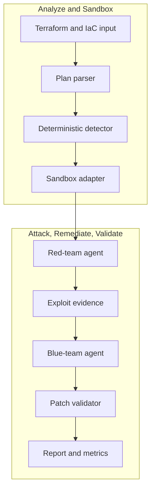

# nullstate

<!-- i18n-switcher:start -->
[English](../../../README.md) | [Español](../es/README.md) | [简体中文](../zh-CN/README.md) | [Français](README.md) | [日本語](../ja/README.md) | [Deutsch](../de/README.md) | [Português (Brasil)](../pt-BR/README.md)
<!-- i18n-switcher:end -->

Validation des chemins d'attaque cloud étayée par des preuves, pour l'infrastructure en tant que code et les environnements déployés.


`nullstate` transforme la revue de sécurité cloud et infrastructure en une boucle reproductible de découverte, attaque, correction et validation. Il combine l'analyse déterministe de l'IaC avec le raisonnement des équipes rouge et bleue assisté par des modèles via des endpoints compatibles OpenAI, comme vLLM sur AMD MI300X.

La démo V1 démontre l'exposition publique du stockage cloud dans des sandboxes locales, applique une correction Terraform, relance la validation et produit des preuves consultables par les équipes sécurité, cloud et DevSecOps. La direction produit étend cette boucle en corrélant l'IaC avec des inventaires AWS et Azure en lecture seule, des relations d'identité, des chemins réseau, des constats d'exécution et des classifications de données. La version publique actuelle est une alpha destinée à l'évaluation locale, aux démonstrations et aux contributions.

<a id="what-it-does"></a>
## Fonctionnement

1. Lire l'entrée Terraform/IaC.
2. Détecter les mauvaises configurations exploitables prises en charge.
3. Déduire le scénario et l'orienter vers un backend de sandbox.
4. Demander à un modèle d'équipe rouge de raisonner sur le chemin d'attaque.
5. Exécuter un script d'attaque généré et contraint contre la cible locale.
6. Demander à un modèle d'équipe bleue d'expliquer la correction.
7. Appliquer un patch Terraform déterministe.
8. Valider que le chemin d'attaque est bloqué.
9. Produire des preuves et métriques utilisables dans une étude de cas.

La V1 du hackathon comprend un chemin LocalStack AWS S3 validé en exécution, un chemin de sonde Azure Blob fondé sur un manifeste qui nécessite encore l'habilitation LocalStack Azure pour une validation en exécution, ainsi que des démos déterministes hors ligne pour Kubernetes, Docker Compose, les baselines sur site et la revue générique de plans.

<a id="why-this-exists"></a>
## Raison d'être

Les scanners statiques IaC et les outils de posture cloud peuvent identifier des configurations risquées, mais ne répondent pas toujours aux questions opérationnelles qui déterminent le risque réel :

- Un attaquant externe, une charge compromise, un développeur, une identité CI, un agent IA ou un rôle cloud trop privilégié peut-il emprunter ce chemin ?
- Quelles données, métadonnées, informations d'identification, services ou permissions deviennent accessibles ?
- Une ouverture apparemment anodine expose-t-elle des noms de fichiers, des détails de tenants, la topologie interne, des journaux, sauvegardes, artefacts source ou d'autres informations facilitant une attaque ultérieure ?
- Peut-on reproduire ce chemin sans mettre en danger les données et charges de production ?
- La correction proposée bloque-t-elle réellement la même attaque ?

`nullstate` vise à corréler l'infrastructure déclarée avec l'état cloud observé, construire des chemins d'attaque à travers les relations réseau, identité, service et données, valider les chemins pertinents dans un environnement contrôlé et les rejouer après correction.

<a id="why-not-attack-production-directly"></a>
### Pourquoi ne pas attaquer directement la production ?

La découverte en lecture seule et la validation soigneusement délimitée peuvent viser la production, mais l'exploitation autonome ne doit pas être le comportement par défaut :

- Les exploits peuvent modifier, supprimer, corrompre ou exposer des données client réelles.
- Les sondes réseau et d'authentification peuvent provoquer des interruptions, limitations, quarantaines ou réponses automatisées aux incidents.
- Les tests IAM et d'élévation de privilèges peuvent créer des accès persistants après le test.
- Les tests d'exfiltration peuvent enfreindre des exigences de confidentialité, contractuelles, réglementaires ou de résidence des données.
- Les dépendances de production peuvent affecter des clients et des tiers hors du périmètre approuvé.
- Le nettoyage ne peut pas toujours rétablir exactement l'état initial.

Nullstate sépare donc l'observation de l'exploitation. Il peut découvrir et modéliser la production en lecture seule, effectuer des contrôles non destructifs explicitement autorisés là où ils sont approuvés, et reconstruire le chemin d'attaque pertinent avec des données synthétiques dans un environnement jetable AWS, Azure, émulateur, Kubernetes, conteneur ou VM. Il ne s'agit pas de cloner tout un abonnement ou compte, mais de reproduire le plus petit graphe pertinent pour la sécurité permettant de prouver ou rejeter une hypothèse d'attaque.

<a id="what-makes-it-different"></a>
### Ce qui le distingue

La valeur visée n'est pas une nouvelle liste de mauvaises configurations cloud. Nullstate devrait produire des preuves reliant :

```text
attacker identity
-> reachable entry point
-> identity or privilege transition
-> accessible service
-> exposed data or capability
-> remediation
-> blocked replay
```

L'analyse d'attaque tient compte de l'identité. Une exécution peut évaluer un internaute anonyme, un utilisateur authentifié du tenant, un développeur, une charge CI, une identité de calcul compromise, une identité managée, un rôle IAM, une identité d'agent IA ou un autre principal explicitement autorisé. Pour les agents IA, Nullstate devrait distinguer l'identité propre de l'agent de l'identité de l'outil/runtime et de l'autorité déléguée par un humain. Les rapports devraient préciser l'identité et le mode de délégation testés, et distinguer l'exposition de configuration de l'accès observé à des données sensibles.

Les agents hébergés à l'extérieur ajoutent une frontière de confiance. Une identité cloud valide ne prouve pas que la machine, le conteneur, le framework d'agent, la mémoire, le connecteur ou l'hébergeur qui l'utilise est sûr. La direction produit inclut donc la vérification de posture d'exécution : identité de charge à courte durée de vie, signatures et provenance des artefacts, empreintes de déploiement immuables, attestation hôte/runtime si disponible, restrictions réseau, autorisation des outils, auditabilité, fraîcheur des preuves et capacité de révocation. Une preuve absente reste inconnue, et n'est pas considérée comme sûre.

Voir [Modèle produit et validation](docs/product-validation-model.md).

<a id="demo-result"></a>
## Résultat de la démo

Les dernières démos AMD MI300X/vLLM utilisaient `nullstate-gemma4-26b-a4b` pour les rôles rouge et bleu :

| Scénario | Cible | Constat | Résultat |
|---|---|---|---|
| `aws-public-s3` | LocalStack AWS | Blocage de l'accès public S3 désactivé | La sonde en exécution a observé un accès avant correction et un accès bloqué après |
| `azure-public-blob` | LocalStack Azure/chemin hors ligne | Accès anonyme au conteneur Blob | Sonde fondée sur un manifeste générée ; validation LocalStack Azure en exécution en attente d'habilitation de l'émulateur |

Métriques représentatives du modèle :

| Exécution | Rôle | Tokens de réponse | Latence | Vitesse de sortie |
|---|---|---:|---:|---:|
| AWS S3 | Rouge | 942 | 9.018s | 104.452 tok/s |
| AWS S3 | Bleu | 640 | 3.977s | 160.937 tok/s |
| Azure Blob | Rouge | 709 | 4.112s | 172.424 tok/s |
| Azure Blob | Bleu | 794 | 4.548s | 174.586 tok/s |

<a id="architecture"></a>
## Architecture



Voir [Architecture](docs/architecture.md) et [Parcours technique](docs/technical-walkthrough.md).

<a id="security-model"></a>
## Modèle de sécurité

V1 ne cible pas les environnements cloud réels par défaut. Les sandboxes sont explicites, les artefacts sont locaux et la correction s'effectue dans une copie de l'espace de travail de l'exécution, sans modifier le répertoire Terraform original.

L'exécuteur d'outils rouge est limité aux scripts `attack.py` générés dans le répertoire d'exécution. Il enregistre commande, stdout, stderr, code retour, URL cible, étape, début, fin et durée dans `events.jsonl`.

Voir [Modèle de sécurité](docs/security-model.md) et [Modèle de menace](docs/threat-model.md).

<a id="installation"></a>
## Installation

Installation actuelle depuis les sources :

```powershell
git clone https://github.com/Ker102/nullstate-cli.git
cd nullstate-cli
python -m pip install -e .
```

Cela installe les dépendances et la commande console `nullstate` déclarée dans `pyproject.toml`.

Si `nullstate` n'est pas reconnu après installation, le répertoire Scripts de Python n'est pas dans `PATH`. La même CLI reste accessible via Python :

```powershell
python -m nullstate doctor --offline
```

Pour trouver le répertoire d'installation des scripts console Python :

```powershell
python -c "import sysconfig; print(sysconfig.get_path('scripts'))"
```

Installer la préversion actuelle directement depuis GitHub :

```powershell
python -m pip install "git+https://github.com/Ker102/nullstate-cli.git@v0.1.0-alpha.2"
```

Pour contribuer, installer aussi les outils de développement :

```powershell
python -m pip install -e ".[dev]"
python -m ruff check src tests
python -m mypy src
python -m unittest discover -s tests -v
```

<a id="quickstart"></a>
## Démarrage rapide

```powershell
nullstate
nullstate doctor --offline
nullstate status
nullstate init-demo azure-public-blob --output examples/azure-public-blob
nullstate run examples/azure-public-blob --offline
nullstate report
nullstate scrub
```

Inspecter une exécution exemple assainie sans Docker, Terraform, LocalStack ni accès modèle :

```powershell
nullstate report --runs-dir examples/sample-runs
nullstate summary --runs-dir examples/sample-runs --json
```

L'exemple versionné inclut aussi `run-bundle.json` et `dashboard.html` pour consulter le contrat du bundle portable et la sortie du tableau de bord local sans générer d'autres artefacts.

Exécuter un autre scénario hors ligne :

```powershell
nullstate run examples/aws-public-s3 --offline
nullstate run examples/k8s-privileged-pod --offline
nullstate run examples/aws-public-s3 --offline --mock-agents --ci --fail-on-severity high
nullstate baseline --output nullstate-baseline.json
nullstate run examples/aws-public-s3 --offline --mock-agents --ci --baseline-file nullstate-baseline.json
nullstate policy-result --baseline-file nullstate-baseline.json
```

Découverte des sandboxes :

```powershell
nullstate sandbox list
nullstate sandbox status localstack-azure
nullstate sandbox up localstack-azure --dry-run
nullstate scenarios list
nullstate scenarios status aws-public-s3
nullstate policy init --output nullstate-policy.json
nullstate policy init --scenario aws-public-s3 --output aws-policy.json
```

`status`, `init-demo`, `sandbox` et `run` affichent une courte table `Next` avec les commandes suivantes probables. `run` utilise par défaut `--scenario auto` et `--target auto` ; la CLI déduit le scénario de la structure IaC et choisit le backend correspondant. Fournir `--scenario` ou `--target` uniquement pour enregistrer un chemin de démo précis ou tester un adaptateur.

Les sondes d'attaque restent locales par défaut. Les futures cibles HTTP(S) non locales nécessitent `--allow-live-cloud` et l'approbation est enregistrée dans `events.jsonl` ; lorsqu'une politique contient `allowed_target_hosts`, le nom d'hôte cible doit aussi correspondre à cette liste. Les scénarios intégrés actuels ciblent toujours des sandboxes locales/hors ligne.

Initialiser GitHub Actions :

```powershell
nullstate init-ci github --scenario aws-public-s3 --iac-path examples/aws-public-s3
```

Cela écrit `.github/workflows/nullstate.yml` et `nullstate-policy.json` pour utiliser Nullstate comme contrôle de pull request sans copier manuellement le modèle de workflow.

Aperçu de confiance des agents IA externes :

```powershell
nullstate agent posture verify examples/agent-trust/external-agent-manifest.json
nullstate agent blast-radius examples/agent-trust/external-agent-manifest.json
```

Ces commandes valident un manifeste local d'agent externe et résument posture d'exécution, fraîcheur des preuves, types d'identité, autorité déléguée de l'utilisateur, ressources sensibles, actions à haut risque et classes de chemins d'attaque probables. Cet aperçu déterministe du modèle de confiance externe ne collecte pas encore d'inventaire fournisseur et n'atteste pas de runtime tiers en direct.

Ouvrir le dernier rapport :

```powershell
nullstate report
```

Si les exécutions sont dans un dossier nommé, orienter la recherche de rapports vers le parent :

```powershell
nullstate report --runs-dir runs/live-aws-model
nullstate report 20260509-200601 --runs-dir runs
```

Créer un bundle d'exécution portable ou un tableau de bord HTML local gratuit :

```powershell
nullstate summary --json
nullstate bundle
nullstate dashboard --open
nullstate sarif
nullstate upload --dry-run
```

`summary --json` émet un objet compact lisible par machine pour les agents de programmation, les étapes GitHub Actions et l'automatisation des commentaires de PR. Le tableau de bord résume constats, règles de correction, métadonnées du schéma de bundle, inventaire d'artefacts, chronologie des preuves et extrait du rapport de l'exécution sélectionnée.

Les résumés et bundles incluent le niveau de preuve du scénario afin de distinguer les exécutions validées en direct des preuves déterministes hors ligne, des ébauches ou de l'analyse de plans seuls.

Aperçu du contexte cloud en lecture seule :

```powershell
nullstate context validate examples/cloud-context/aws-readonly-context.json
nullstate context summary examples/cloud-context/aws-readonly-context.json --json
```

La commande de contexte valide et résume un manifeste local d'inventaire cloud. C'est le contrat sûr pour les futurs collecteurs AWS/Azure/GCP en lecture seule ; elle n'appelle pas encore les API cloud et ne demande pas d'identifiants.

Métriques d'évaluation :

```powershell
nullstate eval run examples/eval/iac-security-regression.json --output-dir eval-runs/iac-security-regression
```

Le banc d'évaluation exécute des cas de benchmark reproductibles et écrit `eval-results.json` et `eval-report.md`. Il fournit des preuves pour l'étude de cas : durée, nombre de constats, sévérité maximale, état de l'attaque avant/après, total de tokens, nombre d'artefacts, vérification des attentes succès/échec et comparaison de baseline. L'exemple compare Nullstate à une baseline transparente de revue générique IaC seule, pour montrer l'apport de preuves de rejeu, validation après correction, métriques de tokens et couverture structurée d'artefacts. Il ne compare pas encore des scanners externes comme Checkov, tfsec ou Terrascan.

<a id="live-localstack-demo-path"></a>
## Démo LocalStack en exécution

À utiliser après configuration de Docker, Terraform, accès LocalStack et variables d'endpoint modèle.

AWS :

```powershell
nullstate sandbox up localstack-aws
nullstate sandbox status localstack-aws
nullstate run examples/aws-public-s3 --target localstack-aws
nullstate report
```

Azure :

```powershell
nullstate sandbox up localstack-azure
nullstate sandbox status localstack-azure
nullstate run examples/azure-public-blob --target localstack-azure
nullstate report
```

Le provider Terraform de démo inclut :

```hcl
metadata_host = "localhost.localstack.cloud:4566"
```

Cela maintient Terraform dirigé vers l'émulateur LocalStack Azure plutôt que vers Azure réel.

Garder `LOCALSTACK_AUTH_TOKEN` dans le shell, `.env.local` ou `.env`. `nullstate sandbox up` découvre automatiquement `.env.local` puis `.env` ; `--env-file` reste disponible pour un autre chemin.

Si Docker indique que `127.0.0.1:4566` est déjà alloué, un ancien conteneur LocalStack réserve probablement le port edge partagé. Exécuter :

```powershell
nullstate sandbox down localstack-aws
nullstate sandbox down localstack-azure
docker ps -a --filter name=localstack
```

Alternative Docker Compose :

```powershell
$env:LOCALSTACK_AUTH_TOKEN = "<token>"
docker compose -f docker-compose.localstack-azure.yml up
```

Ou créer un fichier `.env` local à côté du fichier Compose :

```env
LOCALSTACK_AUTH_TOKEN=your-token-here
```

Git ignore `.env` et `.env.local`. Ne pas committer le token.

<a id="model-endpoint"></a>
## Endpoint modèle

`nullstate` communique avec des serveurs de modèles compatibles OpenAI. Pour vLLM, SGLang ou un proxy privé autohébergé, utiliser le provider custom et un endpoint servant les deux rôles :

```powershell
$env:NULLSTATE_LLM_PROVIDER = "custom"
$env:NULLSTATE_LLM_BASE_URL = "http://<mi300x-host>:8000"
$env:NULLSTATE_LLM_API_KEY = "<optional-token>"
nullstate run examples/azure-public-blob --blue-model gemma-4-31b-it --red-model qwen3-coder-next
```

Pour Google AI Studio / Gemini, seuls le preset fournisseur et la clé API sont nécessaires ; `nullstate` fournit l'URL de base Gemini compatible OpenAI :

```powershell
$env:NULLSTATE_LLM_PROVIDER = "google"
$env:NULLSTATE_LLM_API_KEY = "<google-ai-studio-key>"
nullstate run examples/azure-public-blob --blue-model gemini-3.5-flash --red-model gemini-3.5-flash
```

Pour Claude via la couche de compatibilité OpenAI SDK d'Anthropic, utiliser le preset Claude. Cette compatibilité reste expérimentale ; un adaptateur natif est préférable pour une future utilisation en production nécessitant des fonctions propres à Claude :

```powershell
$env:NULLSTATE_LLM_PROVIDER = "claude"
$env:NULLSTATE_LLM_API_KEY = "<anthropic-api-key>"
nullstate run examples/azure-public-blob --blue-model claude-sonnet-4-6 --red-model claude-sonnet-4-6
```

Pour deux conteneurs vLLM/SGLang ou deux tunnels SSH, configurer des endpoints par rôle :

```powershell
$env:NULLSTATE_LLM_PROVIDER = "custom"
$env:NULLSTATE_RED_LLM_BASE_URL = "http://127.0.0.1:8001"
$env:NULLSTATE_BLUE_LLM_BASE_URL = "http://127.0.0.1:8002"
$env:NULLSTATE_RED_LLM_API_KEY = "<optional-red-token>"
$env:NULLSTATE_BLUE_LLM_API_KEY = "<optional-blue-token>"
nullstate run examples/azure-public-blob --red-model nullstate-red --blue-model nullstate-blue
```

La CLI accepte aussi `--llm-provider`, `--red-provider`, `--blue-provider`, `--red-base-url` et `--blue-base-url` pour une exécution ponctuelle. Les presets actuels incluent `google`, `claude`, `custom` et `openai-compatible`. Les paramètres par rôle non définis retombent sur `NULLSTATE_LLM_PROVIDER`, `NULLSTATE_LLM_BASE_URL` et `NULLSTATE_LLM_API_KEY`. Les URL de base explicites sont toujours prioritaires, conservant la prise en charge des passerelles custom, modèles autohébergés et proxies fournisseurs.

Les utilisateurs n'ont pas à écrire de prompts. `nullstate` envoie des instructions internes rouge/bleu et des preuves du scénario. Sans endpoint pour un rôle, celui-ci utilise une réponse simulée déterministe ; les démos locales et LocalStack fonctionnent donc sans modèle. `--offline` évite les appels Terraform/runtime cloud et utilise l'analyse statique IaC. Si un endpoint partagé ou par rôle est configuré, `--offline` l'utilise encore ; ajouter `--mock-agents` uniquement pour des réponses déterministes sans modèle.

<a id="sandbox-backends"></a>
## Backends de sandbox

| Backend | Mode | Cible IaC | État |
|---|---|---|---|
| `localstack-azure` | exécutable | Terraform AzureRM | cible de démo en exécution |
| `localstack-aws` | exécutable | Terraform AWS | cible de démo en exécution |
| `kind-kubernetes` | exécutable | Kubernetes YAML, Helm, Kustomize | adaptateur ébauché |
| `docker-compose` | jumeau numérique | Docker Compose et stacks applicatives | adaptateur ébauché |
| `microvm-onprem` | jumeau numérique | Ansible, durcissement Linux, Terraform de type libvirt/Proxmox | solution de repli conçue |
| `plan-only` | plan seul | tout plan exporté/parseur | disponible |

<a id="scenarios"></a>
## Scénarios

`nullstate scenarios list` affiche un niveau de preuve explicite pour identifier avant exécution ce qui est prouvé en direct, déterministe ou seulement ébauché.

| Scénario | Backend | Niveau de preuve | État |
|---|---|---|---|
| `aws-public-s3` | `localstack-aws` | `live-validated` | Déploiement S3 LocalStack AWS et sonde contrainte de lecture anonyme d'objet validés avant et après correction |
| `azure-public-blob` | `localstack-azure` | `offline-deterministic` | Détection IaC statique, correction, génération de sonde à manifeste et preuves de rapport hors ligne implémentées ; preuve en exécution de l'émulateur Azure en attente |
| `k8s-privileged-pod` | `kind-kubernetes` | `scaffolded` | Détection et correction déterministes hors ligne disponibles ; sonde de cluster kind en direct en attente |
| `compose-exposed-admin` | `docker-compose` | `scaffolded` | Détection et correction déterministes hors ligne disponibles ; sonde conteneur/réseau en direct en attente |
| `onprem-ssh-password` | `microvm-onprem` | `scaffolded` | Détection et correction déterministes hors ligne disponibles ; exécution du jumeau microVM en attente |
| `generic-plan-review` | `plan-only` | `plan-only` | Revue statique de plan/configuration disponible ; aucune sandbox exécutable ni sonde d'exploitation runtime tentée |

<a id="artifacts"></a>
## Artefacts

Chaque exécution écrit :

- `runs/<run-id>/events.jsonl`
- `runs/<run-id>/findings.json`
- `runs/<run-id>/metrics.json`
- `runs/<run-id>/ci-summary.json` si `nullstate run --ci` est utilisé
- `runs/<run-id>/policy-result.json` si `nullstate policy-result` est utilisé
- `runs/<run-id>/vllm-metrics-before.prom` si `/metrics` est accessible
- `runs/<run-id>/vllm-metrics-after.prom` si `/metrics` est accessible
- `runs/<run-id>/vllm-metrics-red-before.prom` et variantes par rôle si les endpoints rouge/bleu diffèrent
- `runs/<run-id>/attack.py`
- `runs/<run-id>/attack-manifest.json`
- `runs/<run-id>/remediation.json`
- `runs/<run-id>/run-bundle.json` si `nullstate bundle` ou `nullstate dashboard` est exécuté
- `runs/<run-id>/dashboard.html` si `nullstate dashboard` est exécuté
- `runs/<run-id>/nullstate.sarif` si `nullstate sarif` est exécuté
- `runs/<run-id>/evidence-manifest.json` si `nullstate evidence-manifest` est exécuté
- `runs/<run-id>/evidence-verification.json` si `nullstate evidence-verify` est exécuté
- `runs/<run-id>/upload-plan.json` si `nullstate upload --dry-run` est exécuté
- `runs/<run-id>/remediation.patch`
- `runs/<run-id>/report.md`
- `scrubbed-runs/<run-id>/scrub-report.json` si `nullstate scrub` est utilisé

Créer une copie assainie avant de partager les preuves :

```powershell
nullstate scrub
nullstate scrub 20260608-224625 --runs-dir runs --output-dir scrubbed-runs
```

`attack-manifest.json` contient un pointeur `$schema` vers `docs/schemas/attack-manifest.schema.json` ; la CLI valide le manifeste généré avant la sonde contrainte. `events.jsonl` contient des entrées `red-tool` pour la commande d'attaque autorisée avant/après correction. `remediation.json` enregistre version des règles déterministes, scénario, fichiers modifiés et identifiants de règles appliquées. Les métadonnées générées incluent un pointeur `$schema` vers `docs/schemas/remediation-metadata.schema.json` et sont validées avant consommation par rapports, bundles et artefacts.

`ci-summary.json` contient un pointeur `$schema` vers `docs/schemas/ci-summary.schema.json` ; `nullstate run --ci` valide la décision CI avant écriture.

`run-bundle.json` contient un pointeur `$schema` vers `docs/schemas/run-bundle.schema.json` et sa structure est validée à l'écriture. Ce schéma est le contrat local pour tableaux de bord, uploads CI, bundles de support et future ingestion cloud.

Exporter les constats pour CI ou analyse de code :

```powershell
nullstate run examples/aws-public-s3 --offline --mock-agents --ci --fail-on-severity none
nullstate sarif
nullstate sarif 20260608-224625 --runs-dir runs --output artifacts/nullstate.sarif
```

Utiliser `--fail-on-severity high` ou `--fail-on-severity critical` lorsque le job CI doit échouer sur les constats correspondants.

Créer et utiliser un fichier de politique des outils rouges :

```powershell
nullstate policy init --output nullstate-policy.json
nullstate policy init --scenario aws-public-s3 --output aws-policy.json
nullstate policy validate nullstate-policy.json --output policy-validation.json
nullstate run examples/aws-public-s3 --offline --mock-agents --policy-file nullstate-policy.json
```

La politique générée contient un pointeur `$schema` vers `docs/schemas/nullstate-policy.schema.json` et est validée avant écriture. Elle autorise noms de scénarios/backends, étapes, flags du `attack.py` généré, classifications `offline`, `local`, `local-http` et future `external-http`, noms d'hôtes comme `localhost.localstack.cloud` ou `*.blob.core.windows.net`, IDs de politique comme `generated-attack-script-v1` et plafonds de timeout/capture. `policy init --scenario` crée un preset plus étroit pour un couple connu scénario/backend, sans relâcher l'exécuteur. `nullstate policy validate` vérifie sans exécuter de scénario et sort avec le code `2` si le fichier est mal formé ou invalide.

Créer un manifeste d'intégrité avant de joindre une exécution à un ticket, une étude de cas ou un flux de support :

```powershell
nullstate evidence-manifest
nullstate evidence-verify
nullstate evidence-manifest 20260608-224625 --runs-dir runs --output artifacts/evidence-manifest.json
nullstate evidence-verify 20260608-224625 --runs-dir runs --manifest artifacts/evidence-manifest.json
$env:NULLSTATE_EVIDENCE_SIGNING_KEY = "<secret>"
nullstate evidence-manifest --signing-key-env NULLSTATE_EVIDENCE_SIGNING_KEY
nullstate evidence-verify --signing-key-env NULLSTATE_EVIDENCE_SIGNING_KEY
```

Le manifeste inclut un pointeur `$schema` vers `docs/schemas/evidence-manifest.schema.json` et est validé avant écriture. Il inventorie les artefacts partageables avec des hashes SHA-256, exclut les espaces copiés et internes Terraform, et peut ajouter une signature HMAC-SHA256 à clé partagée. `nullstate evidence-verify` recalcule les hashes, contrôle les signatures avec `--signing-key-env`, écrit `evidence-verification.json` et sort avec le code `2` si un artefact manque, a changé, provient d'une autre exécution ou a une signature invalide. Les clés sont lues depuis l'environnement et jamais écrites dans le manifeste.

Créer une baseline depuis une exécution connue pour ignorer les constats connus en CI et échouer sur les nouveaux :

```powershell
nullstate baseline --output nullstate-baseline.json
nullstate run examples/aws-public-s3 --offline --mock-agents --ci --baseline-file nullstate-baseline.json
nullstate policy-result --baseline-file nullstate-baseline.json
```

`policy-result.json` évalue une exécution existante sans refaire l'analyse. Il fournit à l'automatisation aval la même décision de seuil et baseline que CI dans un artefact JSON autonome.

Préparer un futur plan d'ingestion cloud sans envoyer de données :

```powershell
nullstate upload --dry-run
nullstate upload 20260608-224625 --runs-dir runs --endpoint https://api.nullstate.dev/v1/runs --dry-run
```

`upload-plan.json` inclut un pointeur `$schema` vers `docs/schemas/upload-plan.schema.json` et est validé avant écriture. Il consigne endpoint, checksum du bundle, nombre d'artefacts, présence de token et état du précontrôle d'assainissement, jamais la valeur des tokens. Les exécutions brutes sont permises en dry-run mais marquées `upload_recommended: false` ; exécuter `nullstate scrub` puis uploader depuis `scrubbed-runs/` avant partage ou future ingestion cloud.

<a id="documentation"></a>
## Documentation

- [Étude de cas](docs/case-study.md)
- [Les 10 premières minutes](docs/quickstart-10-minutes.md)
- [Parcours technique](docs/technical-walkthrough.md)
- [Architecture](docs/architecture.md)
- [Modèle produit et validation](docs/product-validation-model.md)
- [Conception de confiance et posture des agents externes](docs/plans/2026-06-22-external-agent-trust-design.md)
- [Schéma du manifeste d'agent externe](../../schemas/external-agent-manifest.schema.json)
- [Schéma de contexte cloud](../../schemas/cloud-context.schema.json)
- [Schéma de suite d'évaluation](../../schemas/eval-suite.schema.json)
- [Schéma de résumé d'exécution](../../schemas/run-summary.schema.json)
- [Modèle de sécurité](docs/security-model.md)
- [Modèle de menace](docs/threat-model.md)
- [Audit des dépendances](docs/dependency-audit.md)
- [CI/CD](docs/ci-cd.md)
- [Guide d'exploitation](docs/runbook.md)
- [Guide de service des modèles](docs/model-serving.md)
- [Feuille de route entreprise](docs/enterprise-roadmap.md)
- [Préparation entreprise](docs/enterprise-readiness.md)
- [Jalons de préparation open source](docs/open-source-readiness.md)
- [Progression de productisation](../../progress.md)
- [Plan de commandes rouges en sandbox réelle](../../plans/2026-06-01-real-sandbox-red-team-commands.md)
- [Passation du projet](../../handoff.md)
- [Stratégie de calcul AMD](docs/compute-strategy.md)
- [Modes de défaillance](docs/failure-modes.md)
- [Rapport de coûts](docs/cost-report.md)

<a id="release-model"></a>
## Modèle de publication

La préversion `Media` sert uniquement à héberger les ressources du README. Les versions produit devraient utiliser des tags de version :

| Tag | Objet |
|---|---|
| `v0.1.0-alpha.1` | Première préversion hackathon avec démos hors ligne et documentation soignée |
| `v0.1.0-alpha.2` | Préversion de préparation open source avec exécuteur rouge contraint, artefacts CI, bundles de preuves, tableau local, ébauches de politiques, workflow SBOM/provenance et documentation de publication |
| `v0.1.0-beta.1` | Chemin de validation LocalStack Azure en exécution opérationnel |
| `v0.1.0` | Candidat final hackathon avec vidéo de démo, étude de cas et preuves métriques |

Le titre GitHub peut reprendre le tag ou un titre lisible comme `nullstate v0.1.0-alpha.2`.

Les versions taguées construisent wheel/sdist, installent le wheel dans un environnement propre pour un test de base, vérifient `nullstate` avec `doctor --offline`, publient `release-manifest.json` avec empreintes SHA-256, génèrent et valident `sbom.spdx.json` depuis le wheel installé proprement, revalident le SBOM avec les outils Python SPDX, créent les attestations GitHub de provenance et SBOM et publient des bundles de signature Sigstore sans clé `.sigstore.json` à côté des ressources. Vérifier un wheel téléchargé avec :

```powershell
gh attestation verify dist/nullstate-*.whl -R Ker102/nullstate-cli
gh attestation verify dist/nullstate-*.whl -R Ker102/nullstate-cli --predicate-type https://spdx.dev/Document/v2.3
```

Les bundles Sigstore sont publiés comme ressources adjacentes, par exemple `nullstate-...whl.sigstore.json`.

Avant le tag, lancer manuellement le workflow `Release` avec `dry_run=true` pour répéter construction, validation SBOM, attestations, signatures et contrôles des bundles sans créer de release GitHub.

Avant de taguer localement, vérifier qu'un wheel construit s'installe et expose la commande console `nullstate` :

```powershell
python scripts/release/install_smoke.py
```

Après publication d'un tag de préversion, vérifier que l'installation publique GitHub expose la même commande :

```powershell
python scripts/release/install_smoke.py --tag v0.1.0-alpha.2
```

Vérifier la signature d'un wheel avec Cosign en l'associant à son bundle adjacent et à l'identité du workflow de publication :

```powershell
$wheel = Get-ChildItem dist\nullstate-*.whl | Select-Object -First 1
cosign verify-blob $wheel.FullName --bundle "$($wheel.FullName).sigstore.json" --certificate-identity "https://github.com/Ker102/nullstate-cli/.github/workflows/release.yml@refs/tags/v0.1.0" --certificate-oidc-issuer "https://token.actions.githubusercontent.com"
```

<a id="status"></a>
## État

Opérationnel : validation de stockage LocalStack AWS en exécution, génération de sonde Azure Blob à manifeste en attente d'habilitation LocalStack Azure en direct, démos déterministes hors ligne pour tous les scénarios listés, commandes rouges contraintes, correction déterministe, registre de sandboxes, artefacts de rapports et métriques modèle, sortie CLI de marque et structure DevSecOps.

Expérimental : scripts d'attaque plus riches par scénario, adaptateurs Kubernetes/Compose/sur site en direct, SBOM de dépendances résolues plus complets et couverture d'expurgation des artefacts élargie.
