<a id="nullstate-architecture"></a>
# Architecture de nullstate

<a id="goal"></a>
## Objectif

Fournir un processus purple-team reproductible partant de l'IaC et évoluant vers la corrélation avec AWS et Azure observés, sans rendre l'exploitation du cloud réel implicite.

<a id="pipeline"></a>
## Pipeline

```mermaid
flowchart LR
    A[Terraform / IaC directory] --> B[Plan JSON or static parser]
    B --> C[Deterministic exposure detector]
    C --> S[Sandbox adapter]
    S --> D[Red-team agent instructions]
    D --> E[Constrained attack.py runner]
    E --> F[Exploit evidence]
    F --> G[Blue-team agent instructions]
    G --> H[Deterministic remediation]
    H --> I[Validation attack]
    I --> J[Run report and metrics]
```



<a id="design-choices"></a>
## Choix de conception

- Le détecteur déterministe fait autorité pour la fiabilité des démos.
- L'IaC décrit la configuration souhaitée ; la future découverte AWS/Azure en lecture seule fournit état déployé et dérive.
- Le socle à long terme est un graphe normalisé couvrant ressources, accessibilité réseau, identités, privilèges, services et impact sur les données.
- Les chemins sont évalués depuis des identités explicites : anonymes, développeurs, charges CI, identités de calcul compromises, rôles AWS et identités managées Azure.
- Les environnements jetables devraient reconstruire le plus petit chemin pertinent, pas cloner un compte ou abonnement entier.
- Les agents rouge/bleu reçoivent instructions internes et preuves ; aucun prompt manuel n'est nécessaire.
- `run` utilise `--scenario auto` et `--target auto` par défaut ; les valeurs explicites restent possibles pour démos/tests.
- Le mode hors ligne emploie un parseur Terraform statique et fonctionne sans LocalStack, Terraform ou GPU.
- Le mode en ligne suit les commandes Terraform : `init`, `plan -out=tfplan` et `show -json tfplan`.
- Les backends sont des adaptateurs explicites : exécutables, jumeaux numériques ou plans seuls.
- L'exécuteur rouge lance seulement `attack.py` généré dans le répertoire d'exécution et journalise dans `events.jsonl`.

Voir [Modèle produit et validation](product-validation-model.md) pour découverte de production, identités, impact des données exposées, fidélité et déclencheurs CI.

<a id="sandbox-adapters"></a>
## Adaptateurs de sandbox

| Backend | Mode | Cible |
|---|---|---|
| `localstack-azure` | exécutable | Terraform AzureRM |
| `localstack-aws` | exécutable | Terraform AWS |
| `kind-kubernetes` | exécutable | Kubernetes YAML, Helm, Kustomize |
| `docker-compose` | jumeau numérique | Docker Compose et stacks applicatives |
| `microvm-onprem` | jumeau numérique | IaC de type Linux/VM/réseau sur site |
| `plan-only` | plan seul | tout IaC avec parseur/plan exporté |

<a id="on-prem-sandboxing-model"></a>
## Sandboxes sur site

Une infrastructure sur site ne se simule généralement pas avec un émulateur cloud universel. nullstate choisit le meilleur niveau disponible :

- sandbox exécutable si un runtime jetable existe
- jumeau numérique si la topologie peut être mappée sur conteneurs ou VM locaux
- plan seul si l'exécution est dangereuse ou non prise en charge

<a id="current-rule"></a>
## Règle actuelle

`AZURE_STORAGE_PUBLIC_BLOB` signale les ressources `azurerm_storage_container` dont `container_access_type` vaut `blob` ou `container`.

La correction définit :

```hcl
container_access_type = "private"
allow_nested_items_to_be_public = false
```

<a id="scenario-roadmap"></a>
## Feuille de route des scénarios

| Scénario | Cible | Sandbox | État d'exécution |
|---|---|---|---|
| `azure-public-blob` | Terraform AzureRM | LocalStack Azure ou futur repli Azurite | démo à manifeste/hors ligne disponible ; validation en direct en attente d'habilitation |
| `aws-public-s3` | Terraform AWS | LocalStack AWS | démo en exécution disponible |
| `k8s-privileged-pod` | Kubernetes YAML/Helm/Kustomize | kind | démo hors ligne disponible ; exécution en direct en attente |
| `compose-exposed-admin` | Docker Compose | réseau Docker isolé | démo hors ligne disponible ; sonde en direct en attente |
| `onprem-ssh-password` | IaC de type Ansible/cloud-init/libvirt/Proxmox | jumeau de laboratoire VM/conteneurs | démo hors ligne disponible ; jumeau microVM en attente |
| `generic-plan-review` | exports IaC non pris en charge | aucune | plan seul disponible |
