<a id="nullstate-autonomous-purple-team-iac-sandbox-on-amd-mi300x"></a>
# nullstate : Sandbox IaC purple-team autonome sur AMD MI300X

<a id="1-executive-summary"></a>
## 1. Résumé

J'ai construit `nullstate` au hackathon AMD x lablab.ai pour dépasser les constats statiques par une boucle rouge/bleu reproductible. La CLI lit Terraform, lance une sandbox locale, détecte stockage exposé, demande le raisonnement rouge, exécute un script généré contraint, demande l'explication bleue, applique un patch déterministe, revalide et produit des preuves pour les juges. Démo finale : automatisation Terraform, LocalStack, Python Typer/Rich, vLLM compatible OpenAI, ROCm, droplet AMD Instinct MI300X. Décision centrale : verdict déterministe, modèle pour raisonnement adversarial, explication et rapport. Alpha ouverte : AWS direct validé, Azure Blob à manifeste en attente d'émulateur, roadmap stable documentée.

<a id="2-problem"></a>
## 2. Problème

Les scanners sont utiles mais s'arrêtent souvent au risque apparent. Il reste :

- Exploitable dans ce contexte ?
- Quelles preuves ?
- Quel patch exact ?
- Attaque bloquée après ?
- Sans toucher la production ?

`nullstate` fournit une trace reproductible de constat, attaque, correction, validation et rapport pour sécurité/cloud/DevSecOps.

IaC n'est pas tout le cloud : intention/géré, découverte AWS/Azure en lecture seule pour réalité, identités, réseau, runtime, dérive. Corréler, déterminer les identités accédant aux données/capacités, reconstruire le chemin minimal.

<a id="why-not-attack-production-directly"></a>
### Pourquoi pas la production ?

- Modification, suppression, corruption, exposition de vraies données.
- Probes réseau/auth : panne, throttling, lockout, quarantaine, réponse.
- IAM : credentials, relations et privilèges persistants.
- Exfiltration : vie privée, contrat, régulation, résidence.
- Dépendances affectant des tiers hors périmètre.
- Nettoyage imparfait.

Flux visé : production en lecture seule, checks non destructifs approuvés, exploits synthétiques contrôlés, correction déterministe, rejeu. Développeurs, CI, compute compromis, IAM AWS, service principals Azure et identités managées peuvent servir de départ.

Agents IA : identité native, principal/IAM classique, runtime outil distinct ou délégation humaine. Prompt, mémoire, connecteur, MCP, plugin ou credential compromis donnent des droits invisibles dans un graphe de ressources seul. Séparer droits propres, délégués et outils, puis données/opérations accessibles.

Externe : client contrôle les permissions, pas l'hôte. Token valide ne prouve patchs, isolation, artefact, outils ou absence de vol. Prochain design ajoute posture/rayon et sépare cryptographie, observations provider, assertions opérateur, inférence, inconnu pour éviter fausse assurance.

<a id="3-context-and-constraints"></a>
## 3. Contexte

- Environ 48 heures.
- Preuves fonctionnelles avant délai, pas plateforme inachevée.
- Local d'abord, aucun credential AWS/Azure réel par défaut.
- MI300X autohébergé vLLM/ROCm.
- LocalStack AWS/Azure, Azure dépend de l'habilitation.
- CLI avant web.
- Ne pas exposer vLLM, LocalStack, tokens, état, `.env`.
- Modèle non autorité du verdict.

<a id="4-requirements"></a>
## 4. Exigences

<a id="functional-requirements"></a>
### Fonctionnelles

- Terraform.
- Inférer/accepter scénario.
- Démarrer/inspecter sandbox.
- Détecter stockage public risqué.
- Raisonnement rouge privé.
- Script contraint avant/après.
- Commande, stdout, stderr, retour, URL, étape, début, fin, durée dans `events.jsonl`.
- Explication bleue privée.
- Patch déterministe.
- Revalidation.
- `report.md`, `findings.json`, `events.jsonl`, `metrics.json`, `attack.py`, `remediation.patch`, `remediation.json`.
- Offline/mock sans GPU/sandbox.

<a id="non-functional-requirements"></a>
### Non fonctionnelles

- Pas de cloud réel par défaut.
- Pas de shell rouge libre V1 : `attack.py` du run.
- Commandes compréhensibles sous pression.
- Artefacts adaptés au cas.
- Secrets/état hors Git.
- PR, dependency review, CodeQL, protection.

<a id="5-architecture"></a>
## 5. Architecture

```mermaid
flowchart LR
    A[Terraform IaC input] --> B[Terraform init / plan / show JSON]
    B --> C[Deterministic detector]
    C --> D[Sandbox adapter]
    D --> E[Red-team model reasoning]
    E --> F[Attack evidence]
    F --> G[Blue-team model remediation]
    G --> H[Deterministic Terraform patch]
    H --> I[Re-plan and apply]
    I --> J[Validation attack]
    J --> K[Report and metrics artifacts]
```



Décisions fiables séparées des explications :

- Direct : `terraform init -input=false`, `terraform plan -out=tfplan -input=false`, `terraform show -json tfplan`, `terraform apply -auto-approve -input=false tfplan`.
- Détecteur depuis config/plan JSON.
- Rouge reçoit preuves et raisonne.
- Bleu reçoit preuves et corrige en texte.
- Moteur patche déterministement.
- Validateur vérifie les constats et l'attaque après.

<a id="6-what-the-red-agent-actually-does-today"></a>
## 6. Ce que fait le rouge

Décrire exactement.

Le modèle n'a pas de shell : prompt interne/findings puis raisonnement S3 anonyme ou Azure `curl`.

`nullstate` exécute ensuite seulement `attack.py` généré dans le run. Python direct, uniquement `--target-url`/`--stage`, journal de commande/stdout/stderr/code/URL/étape/temps dans `events.jsonl`.

Plus étroit qu'un shell libre : preuve réelle locale avec frontière auditable.

<a id="7-security-model"></a>
## 7. Sécurité

| Risque | Contrôle | Preuve |
|---|---|---|
| Cloud accidentel | LocalStack/plan seuls | adaptateurs/commandes |
| Modèle dangereux | déterminisme/règles versionnées | `findings.json`, `remediation.patch`, `remediation.json` |
| Exploit arbitraire | seulement `attack.py` | `red-tool`, `src/nullstate/attack_runner.py` |
| Fuite | `.env`/état ignorés, captures expurgées | hygiène/checklist |
| Modèle exposé | SSH vLLM, pas ingress public | droplet/tunnel |
| Code non revu | PR/protection/CI | checks |

<a id="8-deployment-and-devsecops-workflow"></a>
## 8. Déploiement

Branches et PR, pas main direct :

```text
feature branch
-> PR
-> unit tests, lint, type checks, dependency/security checks
-> review/merge
-> release tag / release notes
```

Pratiques ajoutées :

- Metadata Python/console.
- Architecture, runbook, menaces, sécurité, CI, coûts, échecs.
- Actions qualité.
- CodeQL/dépendances.
- Hygiène Dependabot.
- Checklist preuves hors Git.
- Releases taguées.

<a id="9-final-demo-results"></a>
## 9. Résultats

<a id="open-source-readiness-status"></a>
## Préparation open source

`nullstate` prêt alpha, pas production stable.

Prouvé :

- AWS direct ; `attack.py` lit anonymement avant, journalise, puis valide le blocage après patch.
- Commandes réelles via `attack.py` généré seulement, pas shell modèle.
- Tests offline, CI, SARIF, politiques, scrub, manifestes, bundles, dashboard.
- Aperçu IA `nullstate agent posture verify`, `nullstate agent blast-radius` : posture locale, ancien/inconnu visibles, identité, délégation, données, risques, chemins séparés.
- `nullstate summary --json` : état, constats, attaque, tokens, artefacts, limites. `nullstate context summary --json` : contrat local en lecture seule des futurs collecteurs.
- `nullstate eval run examples/eval/iac-security-regression.json` produit `eval-results.json`, `eval-report.md` : durée, constats, sévérité, attaques, tokens, artefacts, attentes, baseline IaC transparente. Montre rejeu, postvalidation, métriques et couverture.

Non prouvé :

- Azure Blob pas direct validé ; compte/workspace sans Azure Emulator.
- Kubernetes/Compose/sur site/plan restent offline/ébauchés sauf mention.
- IA externe sans collecte directe, attestation tiers, gateway imposé.
- Contexte manifestes, pas collecteur AWS/Azure/GCP.
- Évaluation propre/baseline déterministe, pas Checkov/tfsec/Terrascan/manual-review/agent générique.
- Release stable et guide initial encore requis avant promesse stable.

Jalons : `docs/open-source-readiness.md`.

<a id="aws-public-s3-scenario"></a>
### AWS S3 public

Artefact :

```text
runs/final-aws-gemma26b/20260510-170931
```

Constat :

```text
HIGH AWS_S3_PUBLIC_ACCESS_BLOCK_DISABLED
Resource: aws_s3_bucket_public_access_block.public_logs
Evidence: block_public_acls, block_public_policy, ignore_public_acls, and restrict_public_buckets were disabled.
```

Patch :

```diff
-  block_public_acls       = false
-  block_public_policy     = false
-  ignore_public_acls      = false
-  restrict_public_buckets = false
+  block_public_acls       = true
+  block_public_policy     = true
+  ignore_public_acls      = true
+  restrict_public_buckets = true
```

Runtime :

```text
Red before: success
Red after: blocked
Verdict: Exploit blocked after remediation
```

Métriques `metrics.json` :

| Rôle | Modèle | Tokens | Latence | Débit |
|---|---:|---:|---:|---:|
| Rouge | `nullstate-gemma4-26b-a4b` | 942 | 9.018s | 104.452 tok/s |
| Bleu | `nullstate-gemma4-26b-a4b` | 640 | 3.977s | 160.937 tok/s |

<a id="azure-public-blob-scenario"></a>
### Azure Blob public

Artefact :

```text
runs/final-azure-gemma26b/20260510-174858
```

Constat :

```text
HIGH AZURE_STORAGE_PUBLIC_BLOB
Resource: azurerm_storage_container.secrets
Evidence: container_access_type is "container"; storage account allows nested items to be public.
```

Patch :

```diff
-  allow_nested_items_to_be_public  = true
+  allow_nested_items_to_be_public  = false

-  container_access_type = "container"
+  container_access_type = "private"
```

État actuel :

```text
Deterministic finding: present before remediation
Deterministic remediation: patch generated and validated
Runtime probe: generated from attack-manifest.json
Live LocalStack Azure validation: blocked by LocalStack Azure Emulator entitlement
```

Métriques `metrics.json` :

| Rôle | Modèle | Tokens | Latence | Débit |
|---|---:|---:|---:|---:|
| Rouge | `nullstate-gemma4-26b-a4b` | 709 | 4.112s | 172.424 tok/s |
| Bleu | `nullstate-gemma4-26b-a4b` | 794 | 4.548s | 174.586 tok/s |

<a id="10-evidence-artifacts"></a>
## 10. Artefacts

Par run :

- `events.jsonl` : Terraform, analyse, commande, rouge/bleu, validation.
- `findings.json` : constats.
- `attack.py` : script scénario.
- `remediation.patch` : diff.
- `remediation.json` : version, fichiers, IDs.
- `metrics.json` : tokens, latence, débit, endpoint.
- `report.md` : humain.
- `run-bundle.json` : contrat portable à schéma, dashboards/support/CI/cloud futur.
- `dashboard.html` : viewer local gratuit mono-run.
- `workspace/` : copie reproductible.

Captures à ajouter :

- Racine `nullstate`, logo/suite.
- Résumé `nullstate run` AWS/Azure.
- `report.md`, `Exploit blocked after remediation`.
- Page GPU MI300X.
- vLLM `/v1/models`, `nullstate-gemma4-26b-a4b`.
- `/metrics` ou `metrics.json` débit.
- PR/checks/release.

<a id="11-cost-analysis"></a>
## 11. Coûts

Principal : GPU MI300X. LocalStack/Terraform locaux, aucun cloud AWS/Azure payant requis. Cloud réel hors périmètre, GPU juste pour preuves/métriques finales.

Version finale inclut :

- crédits DO.
- heures droplet.
- destruction après preuves.
- tentatives échouées consommant GPU.

<a id="12-tradeoffs"></a>
## 12. Compromis

| Décision | Alternative | Raison | Limite |
|---|---|---|---|
| CLI | Next.js | vitesse/preuve terminal | moins visuel |
| Déterminisme | LLM pur | verdict/patch fiables | scénarios étroits V1 |
| LocalStack | vrai cloud | sûr/sans credentials | différences/config |
| Grand modèle commun | séparés | évite VRAM/runtime doubles | spécialisation moindre |
| Compatible/presets | SDK spécifiques | vLLM/SGLang/Gemini/Claude/proxies | natif plus tard |
| Runner contraint | shell libre | preuves sans accès arbitraire | scripts étroits |

<a id="13-failure-modes-and-lessons-learned"></a>
## 13. Échecs/leçons

- Accès DO a retardé GPU.
- Conteneurs réservent `4566`, hint de récupération.
- Azure démarre puis quitte sans entitlement ; CLI échoue et oriente.
- Editable casse si chemin change ; entrée package en production.
- Deux modèles MI300X : VRAM/cache.
- AITER fused-MoE ROCm a échoué pour Gemma ; un grand endpoint final.
- SGLang/Qwen3.5 réduit après imports.
- Windows ne lit pas `amd-smi` distant directement ; métriques/captures compensent.

<a id="14-what-i-would-improve-next"></a>
## 14. Suite

- Enrichir `attack.py` autorisés.
- Commandes par scénario au-delà Python.
- `nullstate run --auto-sandbox`.
- Ports LocalStack custom côte à côte.
- Expurgation élargie.
- SBOM/signatures/provenance.
- Plus de scénarios Azure/AWS/Kubernetes/Compose/sur site.
- Portfolio captures/diagramme/vidéo.
- Entitlement Azure, Azurite, ou offline explicite.

<a id="15-enterprise-next-iteration"></a>
## 15. Entreprise

Architecture prouvée : IaC déterministe, LocalStack, modèles rouge/bleu, commandes contraintes, correction, artefacts.

Approfondir les commandes : frontière/logs déjà là, scripts encore étroits. Du constat+probe à exploit observé+validation.

S3 : objet témoin exposé, lecture anonyme avant/blocage après, deux sorties au rapport. Azure idem si API supportées ; sinon limites émulateur claires.

« Exploité » nécessite preuve observée ; offline/limité = simulation/inconclusif. C'est la crédibilité sécurité.

<a id="16-repository-and-demo-links"></a>
## 16. Liens

- GitHub : <https://github.com/Ker102/nullstate-cli>
- Slug suggéré : `/case-studies/nullstate-autonomous-purple-team-iac-sandbox`
- Vidéo : en attente
- AWS final : `runs/final-aws-gemma26b/20260510-170931/report.md`
- Azure final : `runs/final-azure-gemma26b/20260510-174858/report.md` (historique hackathon ; docs actuelles doivent indiquer direct en attente)

<a id="17-interview-explanation"></a>
## 17. Entretien

J'ai construit `nullstate` car les constats ne prouvent pas exploitation/correction. Plans, sandboxes, déterminisme, scripts contraints, modèles privés forment la boucle. Choix central : verdict déterministe et `attack.py` seul, pas shell libre. Compromis difficile : preuves fiables bornées contre automation large non supportée. Je renforcerais allowlists/scénarios et émulateur Azure avant d'annoncer live.

<a id="18-resume-bullets"></a>
## 18. CV

- CLI Python `nullstate` : Terraform, boucle rouge/bleu, correction et preuves.
- Grand modèle MI300X vLLM/ROCm, tokens/latence/débit/endpoints AWS/Azure finaux.
- Terraform, LocalStack, artefacts, rapports, CI, menaces, runbook, PR de release.
- Preuves S3 direct de correction/blocage, Azure explicite offline en attente d'habilitation.
