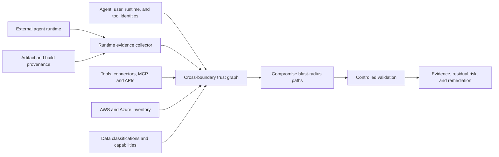

<a id="external-agent-trust-and-runtime-posture-design"></a>
# Confiance et posture runtime des agents externes

<a id="goal"></a>
## Objectif

Évaluer le risque tenant effectif d'un agent IA hébergé hors cloud client, géré par une autre équipe ou un tiers.

Supposer le runtime compromis : posture vérifiable, identités/délégations, outils, données accessibles et simulation contrôlée.

<a id="problem"></a>
## Problème

IAM décrit qui peut demander une opération, pas la sécurité de machine, conteneur, framework, serveur outil, mémoire ou hébergeur.

L'agent peut s'authentifier correctement avec :

- logiciel vulnérable/non patché
- administration exposée
- identifiants durables volés
- artefacts non signés/intraçables
- plugins, connecteurs, MCP ou contenu malveillants
- isolation tenant faible
- réseau large
- identités partagées
- logs/révocation insuffisants

L'attaquant peut hériter permissions propres, délégation utilisateur, identités outils et credentials aval.

<a id="architecture"></a>
## Architecture



Séparer :

1. **Runtime :** Où et comment tourne-t-il, preuves disponibles ?
2. **Identité :** Quelles identités et délégations ?
3. **Chaîne outils :** Outils, connecteurs, MCP, gateways, credentials accessibles ?
4. **Accessibilité :** Services, données, opérations privilégiées ?
5. **Confinement :** Limites du dommage après compromission ?
6. **Détection/récupération :** Attribution, révocation, rotation, enquête rapides ?

<a id="runtime-evidence-model"></a>
## Preuves runtime

Chaque affirmation enregistre :

- nom
- valeur observée
- source
- timestamp
- fraîcheur/expiration
- méthode
- émetteur
- classification confiance
- hash/ID fournisseur
- hypothèses non supportées/non vérifiables

Classifications :

| Classe | Sens |
|---|---|
| `cryptographically-verified` | Signature, provenance, identité ou attestation matérielle vérifiée |
| `provider-observed` | API cloud, identité, runtime ou sécurité authentifiée |
| `operator-attested` | Administrateur, sans vérification indépendante |
| `inferred` | Dérivé d'autres preuves |
| `unknown` | Preuve requise indisponible |

L'inconnu accroît l'incertitude ; jamais implicitement conforme.

<a id="runtime-posture-dimensions"></a>
## Dimensions

<a id="workload-identity"></a>
### Identité de charge

- Identité par agent/déploiement.
- Fédération courte.
- Restrictions audience/émetteur.
- Liaison identité/attributs.
- Aucun secret réutilisable dans images, mémoire, config, logs.

SPIFFE/SPIRE lie aux sélecteurs instance, namespace/service account Kubernetes, processus, conteneur. Supporter aussi la fédération native.

<a id="artifact-integrity"></a>
### Intégrité artefact

- Conteneur/artefact signé.
- Digest immuable, pas tag mutable.
- Provenance source/build.
- Builder/repo approuvés.
- Inventaire/vulnérabilités.
- Digest déployé conforme.

SLSA décrit où/quand/comment construire ; renforce la supply chain, pas preuve autonome de sécurité hôte/application.

<a id="runtime-and-host-integrity"></a>
### Intégrité hôte/runtime

- OS/runtime supporté et patché.
- Conteneur/VM/confidential computing durci.
- Attestation matérielle disponible.
- Administration limitée.
- Isolation tenants/charges.
- Télémétrie sécurité.

Azure Confidential VM guest attestation, AWS NitroTPM et Nitro Enclaves apportent preuves matérielles dans les environnements supportés. Sans confidential computing, pas d'échec automatique mais preuves plus faibles.

<a id="network-posture"></a>
### Réseau

- Pas d'admin publique inutile.
- Politique entrée/sortie explicite.
- API tenant via gateway contrôlé.
- DNS, proxy, certificats.
- Egress vers modèles/outils/services approuvés.
- Défense contre exfiltration par appels arbitraires.

<a id="agent-execution-posture"></a>
### Exécution agent

- Modèle, instructions, version approuvés.
- Allowlist outils/autorisation paramètres.
- Code sandboxé.
- Provenance/rétention mémoire.
- Frontières des sources récupérées.
- Défense injection/étiquetage non fiable.
- Approbation humaine fort impact.
- Autorisation par action plutôt que session large.

<a id="logging-and-recovery"></a>
### Logs/récupération

- IDs reliant utilisateur, agent, runtime, outil, cloud.
- Audit immuable.
- Anomalies outils/permissions.
- Arrêt d'urgence.
- Révocation tokens/credentials.
- Réduction de rôle/quarantaine automatique.
- Responsable incidents et récupération testée.

<a id="authorization-gateway"></a>
## Gateway d'autorisation

Ne pas exposer directement de credentials tenant larges :

```text
external agent
-> tenant-controlled authorization gateway
-> agent identity verification
-> runtime posture and evidence freshness check
-> user/delegation validation
-> task and tool policy
-> optional approval
-> narrowly scoped short-lived credential
-> cloud operation
```

Permissions bornées par :

```text
agent permission
intersection delegated-user permission
intersection approved task
intersection tool policy
intersection environment policy
intersection runtime trust policy
```

Refuser/réduire si preuve absente, périmée, invalide ou insuffisante pour la politique de l'opération.

<a id="trust-and-risk-output"></a>
## Résultats confiance/risque

Pas un score opaque seul. Montrer :

- force par dimension
- rayon de compromission
- sensibilité accessible
- destruction/changement de privilèges possibles
- confinement
- détection/révocation prêtes
- fraîcheur
- incertitude restante

Note résumée utile, mais dimensions/chemins visibles.

Exemple :

```text
Runtime evidence: weak
Identity scope: high
Delegated authority: privileged
Tool-chain exposure: medium
Reachable data: production customer records
Destructive capability: resource deletion
Revocation readiness: partial
Overall decision: deny production write access
```

<a id="controlled-validation"></a>
## Validation contrôlée

Valider « runtime externe compromis » sans compromettre le vrai.

Utiliser :

- identité synthétique à permissions équivalentes bornées
- utilisateurs délégués synthétiques par classe
- fixtures d'injection/confusion contrôlés
- secrets/marqueurs synthétiques
- compte AWS, abonnement Azure, cluster ou jumeau jetable
- outils autorisés et sorties bornées

Consigner identité, délégation, outil, digest, posture, cible, classe de données.

<a id="product-surface"></a>
## Surface produit

Commandes possibles :

```text
nullstate agent register
nullstate agent posture collect
nullstate agent posture verify
nullstate agent graph
nullstate agent blast-radius
nullstate agent validate --assume-compromised
nullstate agent monitor
```

CLI : preuves locales, schémas, graphes, intégrations client. Team/Enterprise : ingestion continue, historique hébergé, politiques, validation managée, alertes, approbations, support, dashboards interagents.

<a id="failure-handling"></a>
## Échecs

- Absence = inconnu, pas passé.
- Attestation/provenance ancienne échoue à la fraîcheur.
- Liaison identité/runtime invalide bloque fort impact.
- Hôtes non supportés : attestations opérateur moins fiables.
- Nettoyage/révocation échoué = run échoué même après test terminé.
- Hardware n'atteste pas correction applicative, prompts sûrs ou absence de vulnérabilités.

<a id="initial-scope"></a>
## Périmètre initial

Rester petit :

1. Schéma de manifeste externe.
2. Nœuds agent, runtime, utilisateur délégué, outil, credential, cible, données.
3. Posture opérateur plus digests et config vérifiables.
4. Rapport de compromission déterministe.
5. Collecteurs AWS/Azure progressivement.
6. Hardware/continu après stabilisation des contrats.

<a id="testing-strategy"></a>
## Tests

- Rejeter malformé/non signé si signatures requises.
- Absent/périmé inconnu/échec selon politique.
- Pas de droits hors intersection.
- Détecter délégation qui élargit.
- Détecter outil privilégié masqué par agent faible.
- Données sensibles distinctes des ressources.
- Simulations seulement synthétiques/autorisées.
- Source, confiance, timestamp, fraîcheur présents.

<a id="primary-references"></a>
## Références primaires

- [Microsoft Entra Agent ID](https://learn.microsoft.com/en-us/entra/agent-id/)
- [Azure workload identity federation](https://learn.microsoft.com/en-us/entra/workload-id/workload-identity-federation)
- [Azure Conditional Access for workload identities](https://learn.microsoft.com/en-us/entra/identity/conditional-access/workload-identity)
- [Azure Confidential VM guest attestation](https://learn.microsoft.com/en-us/azure/confidential-computing/guest-attestation-confidential-vms)
- [AWS AgentCore Identity](https://docs.aws.amazon.com/bedrock-agentcore/latest/devguide/identity-overview.html)
- [AWS IAM Roles Anywhere](https://docs.aws.amazon.com/rolesanywhere/latest/userguide/introduction.html)
- [AWS NitroTPM attestation](https://docs.aws.amazon.com/AWSEC2/latest/UserGuide/attestation-get-doc.html)
- [AWS Nitro Enclaves attestation](https://docs.aws.amazon.com/enclaves/latest/user/set-up-attestation.html)
- [SLSA build provenance](https://slsa.dev/spec/v1.2/build-provenance)
- [SPIFFE and SPIRE workload identity](https://spiffe.io/docs/latest/spiffe-about/overview/)
