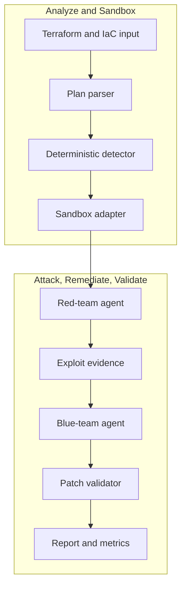

# nullstate

<!-- i18n-switcher:start -->
[English](../../../README.md) | [Español](../es/README.md) | [简体中文](../zh-CN/README.md) | [Français](../fr/README.md) | [日本語](README.md) | [Deutsch](../de/README.md) | [Português (Brasil)](../pt-BR/README.md)
<!-- i18n-switcher:end -->

証拠に基づく、Infrastructure-as-Code とデプロイ済み環境のクラウド攻撃経路検証。


`nullstate` はクラウドとインフラのセキュリティレビューを、発見、攻撃、修正、検証の反復可能なループにします。決定論的な IaC 分析と、AMD MI300X 上の vLLM などの OpenAI 互換エンドポイントによるモデル支援型のレッド/ブルーチーム推論を組み合わせます。

V1 デモはローカルサンドボックスでクラウドストレージの公開状態を立証し、Terraform による修正と再検証を行い、セキュリティ、クラウド、DevSecOps チームが確認できる証拠成果物を出力します。製品の方向性は、IaC と AWS/Azure の読み取り専用インベントリ、ID 関係、ネットワーク経路、実行時の検出結果、データ分類を関連付けてこのループを拡張することです。現在の公開版はローカル評価、デモ、貢献向けのアルファ版です。

<a id="what-it-does"></a>
## 処理の流れ

1. Terraform/IaC 入力を読み込みます。
2. 対応する悪用可能な設定不備を検出します。
3. シナリオを推定してサンドボックスバックエンドに振り分けます。
4. レッドチームモデルに攻撃経路の推論を依頼します。
5. 生成された制約付き攻撃スクリプトをローカル対象に実行します。
6. ブルーチームモデルに修正の説明を依頼します。
7. 決定論的な Terraform パッチを適用します。
8. 攻撃経路が遮断されたことを検証します。
9. ケーススタディ向けの証拠と指標を出力します。

ハッカソン V1 には、実行検証済み LocalStack AWS S3 経路、実行検証に LocalStack Azure の利用権がまだ必要なマニフェストベースの Azure Blob プローブ経路、Kubernetes、Docker Compose、オンプレミスのベースライン、汎用プランレビューの決定論的オフラインデモが含まれます。

<a id="why-this-exists"></a>
## プロジェクトの目的

静的 IaC スキャナーやクラウドセキュリティ態勢ツールは危険な設定を検出できますが、実際のリスクを決める運用上の疑問に常に答えられるとは限りません。

- 外部攻撃者、侵害されたワークロード、開発者、CI ID、AI エージェント、過剰権限のクラウドロールが経路を利用できるか？
- どのデータ、メタデータ、認証情報、サービス、権限に到達できるか？
- 一見無害な開口部から、ファイル名、テナント情報、内部トポロジー、ログ、バックアップ、ソース成果物など、後続攻撃を可能にする情報が漏れるか？
- 本番データとワークロードを危険にさらさず経路を再現できるか？
- 提案された修正は本当に同じ攻撃を遮断するか？

`nullstate` は宣言されたインフラと観測したクラウド状態を関連付け、ネットワーク、ID、サービス、データの関係を横断する攻撃経路を構築し、管理された環境で検証して修正後に再実行することを目指します。

<a id="why-not-attack-production-directly"></a>
### なぜ本番を直接攻撃しないのか？

読み取り専用の探索と慎重に範囲を限定した検証は本番に対して実施できますが、自律的な悪用を既定にすべきではありません。

- エクスプロイトは実際の顧客データを変更、削除、破損、公開する可能性があります。
- ネットワークや認証プローブは障害、制限、隔離、自動インシデント対応を引き起こす可能性があります。
- IAM や権限昇格テストはテスト後も残る永続的アクセスを作る可能性があります。
- 持ち出しテストはプライバシー、契約、規制、データ所在要件に違反する可能性があります。
- 本番の依存関係は承認範囲外の顧客や第三者に影響する可能性があります。
- クリーンアップで元の状態を完全に復元できるとは限りません。

そのため Nullstate は観測と悪用を分離します。読み取り専用アクセスで本番を探索・モデル化し、承認済みの場所で明示的に許可された非破壊的チェックを行い、使い捨ての AWS、Azure、エミュレーター、Kubernetes、コンテナ、VM 内で合成データを使って関連攻撃経路を再構築できます。サブスクリプションやアカウント全体の複製ではなく、攻撃仮説の立証または否定に必要な最小限のセキュリティ関連グラフの再現が目的です。

<a id="what-makes-it-different"></a>
### 違いは何か？

目指す価値はクラウド設定不備の一覧を増やすことではありません。Nullstate は次の関係を示す証拠を生成すべきです。

```text
attacker identity
-> reachable entry point
-> identity or privilege transition
-> accessible service
-> exposed data or capability
-> remediation
-> blocked replay
```

攻撃分析では ID を考慮します。匿名インターネット利用者、認証済みテナント利用者、開発者、CI ワークロード、侵害された計算 ID、マネージド ID、IAM ロール、AI エージェント ID、その他明示的に認可された主体を評価できます。AI エージェントでは、自身の ID とツール/実行環境の ID、人間から委任された権限を区別すべきです。報告には検証した ID と委任モードを記載し、設定上の露出と観測した機密データへのアクセスを区別すべきです。

外部ホストのエージェントは追加の信頼境界を作ります。有効なクラウド ID は、それを使うマシン、コンテナ、エージェントフレームワーク、メモリストア、コネクター、ホスティング事業者の安全性を証明しません。製品の方向性には、短命ワークロード ID、成果物の署名と来歴、不変デプロイダイジェスト、利用可能なホスト/実行環境のアテステーション、ネットワーク制限、ツール認可、監査可能性、証拠の鮮度、失効への備えを含む実行環境態勢検証があります。証拠の欠落は不明のままで、安全とは扱いません。

[製品と検証モデル](docs/product-validation-model.md)を参照してください。

<a id="demo-result"></a>
## デモ結果

最終 AMD MI300X/vLLM デモではレッド、ブルー両ロールに `nullstate-gemma4-26b-a4b` を使用しました。

| シナリオ | 対象 | 検出結果 | 結果 |
|---|---|---|---|
| `aws-public-s3` | LocalStack AWS | S3 パブリックアクセスブロック無効 | 実行時プローブで修正前のアクセスと修正後の遮断を観測 |
| `azure-public-blob` | LocalStack Azure/オフライン経路 | Blob コンテナへの匿名アクセス | マニフェストベースのプローブを生成。LocalStack Azure 実行検証はエミュレーター利用権待ち |

代表的なモデル指標：

| 実行 | ロール | 出力トークン数 | 遅延 | 出力速度 |
|---|---|---:|---:|---:|
| AWS S3 | レッド | 942 | 9.018s | 104.452 tok/s |
| AWS S3 | ブルー | 640 | 3.977s | 160.937 tok/s |
| Azure Blob | レッド | 709 | 4.112s | 172.424 tok/s |
| Azure Blob | ブルー | 794 | 4.548s | 174.586 tok/s |

<a id="architecture"></a>
## アーキテクチャ



[アーキテクチャ](docs/architecture.md)と[技術解説](docs/technical-walkthrough.md)を参照してください。

<a id="security-model"></a>
## セキュリティモデル

V1 は既定で実際のクラウド環境を対象にしません。サンドボックスは明示的に指定し、成果物はローカルに置き、元の Terraform ディレクトリではなくコピーされた実行ワークスペースで修正します。

レッドツールランナーは実行ディレクトリ内で生成された `attack.py` に制限されます。コマンド、stdout、stderr、終了コード、対象 URL、段階、開始・終了時刻、所要時間を `events.jsonl` に記録します。

[セキュリティモデル](docs/security-model.md)と[脅威モデル](docs/threat-model.md)を参照してください。

<a id="installation"></a>
## インストール

現在のソースからのインストール方法：

```powershell
git clone https://github.com/Ker102/nullstate-cli.git
cd nullstate-cli
python -m pip install -e .
```

パッケージの依存関係と `pyproject.toml` で宣言された `nullstate` コンソールコマンドをインストールします。

インストール後 `nullstate` が認識されない場合、Python の Scripts ディレクトリが `PATH` にありません。Python 経由で同じ CLI を実行できます。

```powershell
python -m nullstate doctor --offline
```

Python がコンソールスクリプトを配置した場所を確認するには：

```powershell
python -c "import sysconfig; print(sysconfig.get_path('scripts'))"
```

現在のプレリリースを GitHub から直接インストールするには：

```powershell
python -m pip install "git+https://github.com/Ker102/nullstate-cli.git@v0.1.0-alpha.2"
```

貢献作業では開発ツールもインストールしてください。

```powershell
python -m pip install -e ".[dev]"
python -m ruff check src tests
python -m mypy src
python -m unittest discover -s tests -v
```

<a id="quickstart"></a>
## クイックスタート

```powershell
nullstate
nullstate doctor --offline
nullstate status
nullstate init-demo azure-public-blob --output examples/azure-public-blob
nullstate run examples/azure-public-blob --offline
nullstate report
nullstate scrub
```

Docker、Terraform、LocalStack、モデルへのアクセスなしで、サニタイズ済み実行例を確認できます。

```powershell
nullstate report --runs-dir examples/sample-runs
nullstate summary --runs-dir examples/sample-runs --json
```

リポジトリ内の例には `run-bundle.json` と `dashboard.html` も含まれ、新たな成果物を生成せずポータブルバンドル契約とローカルダッシュボード出力を確認できます。

別のオフラインシナリオを実行するには：

```powershell
nullstate run examples/aws-public-s3 --offline
nullstate run examples/k8s-privileged-pod --offline
nullstate run examples/aws-public-s3 --offline --mock-agents --ci --fail-on-severity high
nullstate baseline --output nullstate-baseline.json
nullstate run examples/aws-public-s3 --offline --mock-agents --ci --baseline-file nullstate-baseline.json
nullstate policy-result --baseline-file nullstate-baseline.json
```

サンドボックスの探索：

```powershell
nullstate sandbox list
nullstate sandbox status localstack-azure
nullstate sandbox up localstack-azure --dry-run
nullstate scenarios list
nullstate scenarios status aws-public-s3
nullstate policy init --output nullstate-policy.json
nullstate policy init --scenario aws-public-s3 --output aws-policy.json
```

`status`、`init-demo`、`sandbox`、`run` は次に使う可能性の高いコマンドを短い `Next` 表に表示します。`run` の既定は `--scenario auto` と `--target auto` です。CLI が IaC の構造からシナリオを推定し対応バックエンドを選びます。特定デモ経路の記録やアダプターテストの場合だけ `--scenario` または `--target` を指定してください。

実行時攻撃プローブは既定でローカル限定です。将来の非ローカル HTTP(S) 対象には `--allow-live-cloud` が必要で、承認を `events.jsonl` に記録します。ポリシーに `allowed_target_hosts` がある場合、対象ホスト名も許可リストに一致する必要があります。現行組み込みシナリオは依然としてローカル/オフラインサンドボックス対象に解決されます。

GitHub Actions を初期化するには：

```powershell
nullstate init-ci github --scenario aws-public-s3 --iac-path examples/aws-public-s3
```

`.github/workflows/nullstate.yml` と `nullstate-policy.json` を生成し、テンプレートを手動コピーせず PR ゲートとして Nullstate を使えます。

外部 AI エージェント信頼のプレビュー：

```powershell
nullstate agent posture verify examples/agent-trust/external-agent-manifest.json
nullstate agent blast-radius examples/agent-trust/external-agent-manifest.json
```

これらはローカル外部エージェントマニフェストを検証し、実行環境態勢の証拠、証拠の鮮度、ID 種別、利用者からの委任権限、機密リソース、高リスク操作、想定攻撃経路クラスを要約します。外部エージェント信頼モデルの決定論的プレビューであり、まだプロバイダーのインベントリ収集や稼働中の第三者実行環境のアテステーションは行いません。

最新のレポートを開くには：

```powershell
nullstate report
```

名前付きフォルダーに実行を保存する場合、レポート検索を親ディレクトリに向けてください。

```powershell
nullstate report --runs-dir runs/live-aws-model
nullstate report 20260509-200601 --runs-dir runs
```

ポータブル実行バンドルまたは無料のローカル HTML ダッシュボードを作成するには：

```powershell
nullstate summary --json
nullstate bundle
nullstate dashboard --open
nullstate sarif
nullstate upload --dry-run
```

`summary --json` はコーディングエージェント、GitHub Actions ステップ、PR コメント自動化向けにコンパクトな機械可読オブジェクトを出力します。ダッシュボードは選択した実行の検出結果、修正ルール、バンドルスキーマ情報、成果物一覧、証拠タイムライン、レポート抜粋を要約します。

実行サマリーとバンドルはシナリオの証拠レベルを含み、自動処理で実行検証済み、決定論的オフライン、雛形、プランのみの証拠を区別できます。

読み取り専用クラウドコンテキストのプレビュー：

```powershell
nullstate context validate examples/cloud-context/aws-readonly-context.json
nullstate context summary examples/cloud-context/aws-readonly-context.json --json
```

コンテキストコマンドはローカルのクラウドインベントリマニフェストを検証・要約します。将来の AWS/Azure/GCP 読み取り専用収集器の安全な契約であり、まだクラウド API 呼び出しや認証情報要求は行いません。

評価指標：

```powershell
nullstate eval run examples/eval/iac-security-regression.json --output-dir eval-runs/iac-security-regression
```

評価ハーネスは反復可能なベンチマークケースを実行し、`eval-results.json` と `eval-report.md` を生成します。所要時間、検出数、最高重大度、攻撃前後の状態、総トークン数、成果物数、成功/失敗の期待値チェック、ベースライン比較などのケーススタディ証拠に使えます。付属例は透明な汎用 IaC のみのレビュー基準と比較し、攻撃再実行の証拠、修正後検証、トークン指標、構造化成果物の網羅性を追加できるか示します。Checkov、tfsec、Terrascan など外部スキャナーの評価はまだ行いません。

<a id="live-localstack-demo-path"></a>
## LocalStack 実行デモ経路

Docker、Terraform、LocalStack アクセス、モデルエンドポイント変数を設定してから使用してください。

AWS：

```powershell
nullstate sandbox up localstack-aws
nullstate sandbox status localstack-aws
nullstate run examples/aws-public-s3 --target localstack-aws
nullstate report
```

Azure：

```powershell
nullstate sandbox up localstack-azure
nullstate sandbox status localstack-azure
nullstate run examples/azure-public-blob --target localstack-azure
nullstate report
```

デモの Terraform プロバイダーには次を含みます。

```hcl
metadata_host = "localhost.localstack.cloud:4566"
```

これにより実際の Azure ではなく LocalStack Azure エミュレーターを対象にします。

`LOCALSTACK_AUTH_TOKEN` はシェル、`.env.local`、`.env` に置いてください。`nullstate sandbox up` は `.env.local`、`.env` の順で自動検出し、カスタムパスには `--env-file` も使えます。

Docker が `127.0.0.1:4566` の使用を報告する場合、残存 LocalStack コンテナが共有 edge ポートを確保している可能性があります。次を実行します。

```powershell
nullstate sandbox down localstack-aws
nullstate sandbox down localstack-azure
docker ps -a --filter name=localstack
```

Docker Compose による代替：

```powershell
$env:LOCALSTACK_AUTH_TOKEN = "<token>"
docker compose -f docker-compose.localstack-azure.yml up
```

または Compose ファイルの隣にローカル `.env` を作成します。

```env
LOCALSTACK_AUTH_TOKEN=your-token-here
```

`.env` と `.env.local` は Git の対象外です。トークンをコミットしないでください。

<a id="model-endpoint"></a>
## モデルエンドポイント

`nullstate` は OpenAI 互換モデルサーバーと通信します。自前の vLLM、SGLang、プライベートプロキシには custom プロバイダーと両ロール用の単一エンドポイントを使います。

```powershell
$env:NULLSTATE_LLM_PROVIDER = "custom"
$env:NULLSTATE_LLM_BASE_URL = "http://<mi300x-host>:8000"
$env:NULLSTATE_LLM_API_KEY = "<optional-token>"
nullstate run examples/azure-public-blob --blue-model gemma-4-31b-it --red-model qwen3-coder-next
```

Google AI Studio / Gemini ではプロバイダープリセットと API キーだけが必要です。`nullstate` が OpenAI 互換 Gemini ベース URL を提供します。

```powershell
$env:NULLSTATE_LLM_PROVIDER = "google"
$env:NULLSTATE_LLM_API_KEY = "<google-ai-studio-key>"
nullstate run examples/azure-public-blob --blue-model gemini-3.5-flash --red-model gemini-3.5-flash
```

Anthropic の OpenAI SDK 互換レイヤー経由で Claude を使う場合は Claude プリセットを選びます。実験的な互換経路であり、Claude 固有機能が必要な将来の本番用途にはネイティブアダプターが望まれます。

```powershell
$env:NULLSTATE_LLM_PROVIDER = "claude"
$env:NULLSTATE_LLM_API_KEY = "<anthropic-api-key>"
nullstate run examples/azure-public-blob --blue-model claude-sonnet-4-6 --red-model claude-sonnet-4-6
```

vLLM/SGLang コンテナまたは SSH トンネルが二つある場合はロール別エンドポイントを設定します。

```powershell
$env:NULLSTATE_LLM_PROVIDER = "custom"
$env:NULLSTATE_RED_LLM_BASE_URL = "http://127.0.0.1:8001"
$env:NULLSTATE_BLUE_LLM_BASE_URL = "http://127.0.0.1:8002"
$env:NULLSTATE_RED_LLM_API_KEY = "<optional-red-token>"
$env:NULLSTATE_BLUE_LLM_API_KEY = "<optional-blue-token>"
nullstate run examples/azure-public-blob --red-model nullstate-red --blue-model nullstate-blue
```

CLI は単発実行用に `--llm-provider`、`--red-provider`、`--blue-provider`、`--red-base-url`、`--blue-base-url` も受け付けます。現行プリセットは `google`、`claude`、`custom`、`openai-compatible` です。ロール設定未指定時は `NULLSTATE_LLM_PROVIDER`、`NULLSTATE_LLM_BASE_URL`、`NULLSTATE_LLM_API_KEY` にフォールバックします。明示的なベース URL が常に優先され、カスタムゲートウェイ、自前モデル、プロバイダープロキシを引き続き利用できます。

利用者がプロンプトを書く必要はありません。`nullstate` は内部レッド/ブルー指示とシナリオ証拠を送信します。あるロールのエンドポイントがなければ決定論的モック応答に切り替わり、モデルなしでもローカル/LocalStack デモを実行できます。`--offline` は Terraform/クラウド実行呼び出しを省略し静的 IaC 解析を使います。共有またはロール別エンドポイントが設定されていれば `--offline` でもそのモデルを呼びます。決定論的なモデルなし応答が必要なときだけ `--mock-agents` を追加してください。

<a id="sandbox-backends"></a>
## サンドボックスバックエンド

| バックエンド | モード | IaC 対象 | 状態 |
|---|---|---|---|
| `localstack-azure` | 実行可能 | Terraform AzureRM | 実行デモ対象 |
| `localstack-aws` | 実行可能 | Terraform AWS | 実行デモ対象 |
| `kind-kubernetes` | 実行可能 | Kubernetes YAML、Helm、Kustomize | アダプター雛形 |
| `docker-compose` | デジタルツイン | Docker Compose とアプリスタック | アダプター雛形 |
| `microvm-onprem` | デジタルツイン | Ansible、Linux 強化、libvirt/Proxmox 形式 Terraform | 設計済み代替案 |
| `plan-only` | プランのみ | 任意のエクスポート済みプラン/パーサー | 利用可能 |

<a id="scenarios"></a>
## シナリオ

`nullstate scenarios list` は明示的な証拠レベルを表示し、実行前に実証済みか、決定論的か、雛形かを確認できます。

| シナリオ | バックエンド | 証拠レベル | 状態 |
|---|---|---|---|
| `aws-public-s3` | `localstack-aws` | `live-validated` | LocalStack AWS S3 のデプロイと制約付き匿名オブジェクト読み取りプローブを修正前後に検証済み |
| `azure-public-blob` | `localstack-azure` | `offline-deterministic` | 静的 IaC 検出、修正、マニフェストベースのプローブ生成、オフラインレポート証拠を実装済み。Azure エミュレーター実行実証は未完了 |
| `k8s-privileged-pod` | `kind-kubernetes` | `scaffolded` | 決定論的オフライン検出と修正が利用可能。kind クラスター実行プローブは未完了 |
| `compose-exposed-admin` | `docker-compose` | `scaffolded` | 決定論的オフライン検出と修正が利用可能。コンテナ/ネットワーク実行プローブは未完了 |
| `onprem-ssh-password` | `microvm-onprem` | `scaffolded` | 決定論的オフライン検出と修正が利用可能。microVM デジタルツイン実行は未完了 |
| `generic-plan-review` | `plan-only` | `plan-only` | 静的プラン/設定レビューが利用可能。実行可能サンドボックスや実行時エクスプロイトプローブは試みない |

<a id="artifacts"></a>
## 成果物

各実行が出力するもの：

- `runs/<run-id>/events.jsonl`
- `runs/<run-id>/findings.json`
- `runs/<run-id>/metrics.json`
- `nullstate run --ci` 使用時の `runs/<run-id>/ci-summary.json`
- `nullstate policy-result` 使用時の `runs/<run-id>/policy-result.json`
- `/metrics` に到達可能な場合の `runs/<run-id>/vllm-metrics-before.prom`
- `/metrics` に到達可能な場合の `runs/<run-id>/vllm-metrics-after.prom`
- レッド/ブルーのエンドポイントが異なる場合の `runs/<run-id>/vllm-metrics-red-before.prom` とロール別変種
- `runs/<run-id>/attack.py`
- `runs/<run-id>/attack-manifest.json`
- `runs/<run-id>/remediation.json`
- `nullstate bundle` または `nullstate dashboard` 実行時の `runs/<run-id>/run-bundle.json`
- `nullstate dashboard` 実行時の `runs/<run-id>/dashboard.html`
- `nullstate sarif` 実行時の `runs/<run-id>/nullstate.sarif`
- `nullstate evidence-manifest` 実行時の `runs/<run-id>/evidence-manifest.json`
- `nullstate evidence-verify` 実行時の `runs/<run-id>/evidence-verification.json`
- `nullstate upload --dry-run` 実行時の `runs/<run-id>/upload-plan.json`
- `runs/<run-id>/remediation.patch`
- `runs/<run-id>/report.md`
- `nullstate scrub` 使用時の `scrubbed-runs/<run-id>/scrub-report.json`

証拠の共有前にサニタイズ済みコピーを作成してください。

```powershell
nullstate scrub
nullstate scrub 20260608-224625 --runs-dir runs --output-dir scrubbed-runs
```

`attack-manifest.json` は `docs/schemas/attack-manifest.schema.json` への `$schema` を含み、CLI は制約付きプローブ実行前に検証します。`events.jsonl` は修正前後の許可済み攻撃コマンドの `red-tool` 記録を含みます。`remediation.json` は決定論的ルールセットの版、シナリオ、変更ファイル、適用ルール ID を記録します。生成された修正メタデータは `docs/schemas/remediation-metadata.schema.json` への `$schema` を含み、報告、バンドル、実行成果物が利用する前に検証します。

`ci-summary.json` は `docs/schemas/ci-summary.schema.json` への `$schema` を含み、`nullstate run --ci` は書き込み前に CI 判定成果物を検証します。

`run-bundle.json` は `docs/schemas/run-bundle.schema.json` への `$schema` を含み、CLI は出力時に構造を検証します。ダッシュボード、CI アップロード、サポートバンドル、将来のクラウド取り込みのローカル契約として扱ってください。

CI やコードスキャン向けに検出結果をエクスポートするには：

```powershell
nullstate run examples/aws-public-s3 --offline --mock-agents --ci --fail-on-severity none
nullstate sarif
nullstate sarif 20260608-224625 --runs-dir runs --output artifacts/nullstate.sarif
```

該当する検出結果で CI を失敗させるには `--fail-on-severity high` または `--fail-on-severity critical` を使います。

レッドツールポリシーファイルを作成・使用するには：

```powershell
nullstate policy init --output nullstate-policy.json
nullstate policy init --scenario aws-public-s3 --output aws-policy.json
nullstate policy validate nullstate-policy.json --output policy-validation.json
nullstate run examples/aws-public-s3 --offline --mock-agents --policy-file nullstate-policy.json
```

生成ポリシーは `docs/schemas/nullstate-policy.schema.json` への `$schema` を含み、出力前に検証されます。シナリオ名、バックエンド名、段階、生成 `attack.py` のフラグ、`offline`、`local`、`local-http`、将来の `external-http` などの対象分類、`localhost.localstack.cloud` や `*.blob.core.windows.net` などのホスト名、`generated-attack-script-v1` などのコマンドポリシー ID、タイムアウト/出力取得上限を許可リスト化します。`policy init --scenario` は既知のシナリオ/バックエンド組み合わせ用のより狭いプリセットを作り、同じランナー制約を維持します。`nullstate policy validate` はシナリオを実行せず検証し、不正形式や無効なファイルではコード `2` で終了します。

チケット、ケーススタディ、サポートに実行を添付する前に証拠整合性マニフェストを作成してください。

```powershell
nullstate evidence-manifest
nullstate evidence-verify
nullstate evidence-manifest 20260608-224625 --runs-dir runs --output artifacts/evidence-manifest.json
nullstate evidence-verify 20260608-224625 --runs-dir runs --manifest artifacts/evidence-manifest.json
$env:NULLSTATE_EVIDENCE_SIGNING_KEY = "<secret>"
nullstate evidence-manifest --signing-key-env NULLSTATE_EVIDENCE_SIGNING_KEY
nullstate evidence-verify --signing-key-env NULLSTATE_EVIDENCE_SIGNING_KEY
```

マニフェストは `docs/schemas/evidence-manifest.schema.json` への `$schema` を含み、出力前に検証します。共有可能成果物を SHA-256 ハッシュで一覧化し、コピーされたワークスペースと Terraform 内部を除外し、任意で共有鍵 HMAC-SHA256 署名を追加します。`nullstate evidence-verify` はハッシュを再計算し、`--signing-key-env` 指定時は署名も確認して `evidence-verification.json` を出力します。成果物の欠落、変更、別実行からのコピー、無効な署名ではコード `2` で終了します。署名鍵は環境変数から読み込み、マニフェストに書きません。

既知の実行からベースラインを作り、CI が既知の検出を無視して新しい検出で失敗するようにできます。

```powershell
nullstate baseline --output nullstate-baseline.json
nullstate run examples/aws-public-s3 --offline --mock-agents --ci --baseline-file nullstate-baseline.json
nullstate policy-result --baseline-file nullstate-baseline.json
```

`policy-result.json` は再スキャンせず既存実行を評価します。CI と同じしきい値/ベースライン判定を独立 JSON として必要とする後続自動化に役立ちます。

データを送らず将来のクラウド取り込み用アップロード計画を準備するには：

```powershell
nullstate upload --dry-run
nullstate upload 20260608-224625 --runs-dir runs --endpoint https://api.nullstate.dev/v1/runs --dry-run
```

`upload-plan.json` は `docs/schemas/upload-plan.schema.json` への `$schema` を含み、出力前に検証します。対象エンドポイント、バンドルチェックサム、成果物数、トークン有無、サニタイズ事前確認状態を記録し、トークン値は保存しません。dry-run では未処理実行も許可しますが `upload_recommended: false` とします。共有や将来の取り込み前に `nullstate scrub` を実行し、`scrubbed-runs/` からアップロードしてください。

<a id="documentation"></a>
## ドキュメント

- [ケーススタディ](docs/case-study.md)
- [最初の 10 分](docs/quickstart-10-minutes.md)
- [技術解説](docs/technical-walkthrough.md)
- [アーキテクチャ](docs/architecture.md)
- [製品と検証モデル](docs/product-validation-model.md)
- [外部エージェントの信頼と実行環境態勢設計](docs/plans/2026-06-22-external-agent-trust-design.md)
- [外部エージェントマニフェストスキーマ](../../schemas/external-agent-manifest.schema.json)
- [クラウドコンテキストスキーマ](../../schemas/cloud-context.schema.json)
- [評価スイートスキーマ](../../schemas/eval-suite.schema.json)
- [実行サマリースキーマ](../../schemas/run-summary.schema.json)
- [セキュリティモデル](docs/security-model.md)
- [脅威モデル](docs/threat-model.md)
- [依存関係監査](docs/dependency-audit.md)
- [CI/CD](docs/ci-cd.md)
- [運用手順](docs/runbook.md)
- [モデル提供運用手順](docs/model-serving.md)
- [企業向けロードマップ](docs/enterprise-roadmap.md)
- [企業向け準備状況](docs/enterprise-readiness.md)
- [オープンソース準備マイルストーン](docs/open-source-readiness.md)
- [製品化の進捗](../../progress.md)
- [実サンドボックスのレッドチームコマンド計画](../../plans/2026-06-01-real-sandbox-red-team-commands.md)
- [プロジェクト引き継ぎ](../../handoff.md)
- [AMD 計算戦略](docs/compute-strategy.md)
- [障害モード](docs/failure-modes.md)
- [コスト報告](docs/cost-report.md)

<a id="release-model"></a>
## リリースモデル

`Media` プレリリースは README の素材を置くためだけに使います。製品リリースはバージョンタグを使うべきです。

| タグ | 目的 |
|---|---|
| `v0.1.0-alpha.1` | オフラインデモと整備済み文書を含む最初のハッカソンプレリリース |
| `v0.1.0-alpha.2` | 制約付きレッドランナー、CI 成果物、証拠バンドル、ローカルダッシュボード、ポリシー雛形、SBOM/来歴ワークフロー、リリース文書を含むオープンソース準備プレリリース |
| `v0.1.0-beta.1` | LocalStack Azure 実行検証経路が動作 |
| `v0.1.0` | デモ動画、ケーススタディ、指標証拠を含む最終ハッカソンリリース候補 |

GitHub リリース名はタグと同じでも、`nullstate v0.1.0-alpha.2` のような読みやすい名称でも構いません。

タグ付きリリースは wheel/sdist をビルドし、クリーン環境に wheel を試験インストールし、`doctor --offline` で `nullstate` を確認し、SHA-256 ダイジェスト付き `release-manifest.json` を公開します。クリーン環境のインストール済み wheel から `sbom.spdx.json` を生成・検証し、SPDX Python ツールで再検証し、パッケージ来歴と SBOM の GitHub 成果物アテステーションを作成し、鍵不要 Sigstore `.sigstore.json` 署名バンドルを隣接公開します。ダウンロードした wheel の検証方法：

```powershell
gh attestation verify dist/nullstate-*.whl -R Ker102/nullstate-cli
gh attestation verify dist/nullstate-*.whl -R Ker102/nullstate-cli --predicate-type https://spdx.dev/Document/v2.3
```

Sigstore 署名バンドルは `nullstate-...whl.sigstore.json` などの隣接リリース成果物として公開されます。

タグ作成前に `Release` ワークフローを `dry_run=true` で手動実行し、GitHub リリースを作らずビルド、SBOM 検証、アテステーション、署名、バンドル確認を予行してください。

ローカルタグ作成前に、ビルドした wheel がインストールでき `nullstate` コマンドを提供することを確認します。

```powershell
python scripts/release/install_smoke.py
```

プレリリースタグ公開後、公開 GitHub インストール経路も同じコマンドを提供することを確認します。

```powershell
python scripts/release/install_smoke.py --tag v0.1.0-alpha.2
```

Cosign で wheel と隣接バンドル、リリースワークフロー ID を対応させて署名を検証します。

```powershell
$wheel = Get-ChildItem dist\nullstate-*.whl | Select-Object -First 1
cosign verify-blob $wheel.FullName --bundle "$($wheel.FullName).sigstore.json" --certificate-identity "https://github.com/Ker102/nullstate-cli/.github/workflows/release.yml@refs/tags/v0.1.0" --certificate-oidc-issuer "https://token.actions.githubusercontent.com"
```

<a id="status"></a>
## 状態

現在動作：LocalStack AWS ストレージ実行検証、LocalStack Azure 実行利用権待ちのマニフェストベース Azure Blob プローブ生成、全記載シナリオの決定論的オフラインデモ、制約付きレッドコマンド実行、決定論的修正、サンドボックスレジストリ、レポートとモデル指標成果物、ブランド化 CLI 出力、DevSecOps リポジトリ構造。

実験的：より豊富なシナリオ別攻撃スクリプト、Kubernetes/Compose/オンプレミス実行アダプター、解決済み依存関係のより完全な SBOM、成果物の機密情報除去範囲の拡大。
