<a id="nullstate-architecture"></a>
# nullstate アーキテクチャ

<a id="goal"></a>
## 目標

IaC から始まり、観測した AWS/Azure 環境との関連付けへ発展する反復可能な紫チームワークフローを提供します。実クラウド悪用は既定にしません。

<a id="pipeline"></a>
## パイプライン

```mermaid
flowchart LR
    A[Terraform / IaC directory] --> B[Plan JSON or static parser]
    B --> C[Deterministic exposure detector]
    C --> S[Sandbox adapter]
    S --> D[Red-team agent instructions]
    D --> E[Constrained attack.py runner]
    E --> F[Exploit evidence]
    F --> G[Blue-team agent instructions]
    G --> H[Deterministic remediation]
    H --> I[Validation attack]
    I --> J[Run report and metrics]
```



<a id="design-choices"></a>
## 設計判断

- 決定論的検出器がデモの信頼性を担う正本です。
- IaC は意図した設定を記述し、将来の読み取り専用 AWS/Azure 探索が実配置とドリフトを提供します。
- 長期分析基盤はリソース、到達性、ID、権限、サービス、データ影響を網羅する正規化環境グラフです。
- 匿名利用者、開発者、CI、侵害された計算 ID、AWS ロール、Azure マネージド ID など明示的 ID から経路を評価します。
- 使い捨て検証環境はアカウント全体の複製でなく最小の関連経路を再構築すべきです。
- レッド/ブルー代理に内部指示と証拠を渡すため手動プロンプトは不要です。
- `run` の既定は `--scenario auto` と `--target auto` で、デモ/テストの明示指定も可能です。
- オフラインは静的 Terraform パーサーを使い、LocalStack、Terraform、GPU なしでもデモできます。
- オンラインは `init`、`plan -out=tfplan`、`show -json tfplan` に従います。
- バックエンドは実行可能、デジタルツイン、プランのみの明示的アダプターです。
- レッドランナーは実行ディレクトリの生成 `attack.py` のみ実行し、証拠を `events.jsonl` に記録します。

本番探索、ID 別分析、公開データ影響、忠実度、CI トリガー設計は[製品と検証モデル](product-validation-model.md)を参照してください。

<a id="sandbox-adapters"></a>
## サンドボックスアダプター

| バックエンド | モード | 対象 |
|---|---|---|
| `localstack-azure` | 実行可能 | Terraform AzureRM |
| `localstack-aws` | 実行可能 | Terraform AWS |
| `kind-kubernetes` | 実行可能 | Kubernetes YAML、Helm、Kustomize |
| `docker-compose` | デジタルツイン | Docker Compose とアプリスタック |
| `microvm-onprem` | デジタルツイン | オンプレミス Linux/VM/ネットワーク形式 IaC |
| `plan-only` | プランのみ | パーサー/エクスポート済みプランのある任意 IaC |

<a id="on-prem-sandboxing-model"></a>
## オンプレミスのサンドボックスモデル

通常オンプレミスは単一汎用クラウドエミュレーターでは模倣できません。nullstate は利用可能な最善の実行レベルを選びます。

- 使い捨て実行環境があれば実行可能サンドボックス
- ローカルコンテナ/VM にトポロジーを対応付けられればデジタルツイン
- 実行が危険または未対応ならプランのみの分析

<a id="current-rule"></a>
## 現行ルール

`AZURE_STORAGE_PUBLIC_BLOB` は `container_access_type` が `blob` または `container` の `azurerm_storage_container` を検出します。

修正は次を設定します。

```hcl
container_access_type = "private"
allow_nested_items_to_be_public = false
```

<a id="scenario-roadmap"></a>
## シナリオロードマップ

| シナリオ | 対象 | サンドボックス | 実行状態 |
|---|---|---|---|
| `azure-public-blob` | Terraform AzureRM | LocalStack Azure または将来の Azurite | マニフェスト/オフラインデモあり。実行検証は利用権待ち |
| `aws-public-s3` | Terraform AWS | LocalStack AWS | 実行デモあり |
| `k8s-privileged-pod` | Kubernetes YAML/Helm/Kustomize | kind | オフラインデモあり。実行は未完了 |
| `compose-exposed-admin` | Docker Compose | 隔離 Docker ネットワーク | オフラインデモあり。実行プローブは未完了 |
| `onprem-ssh-password` | Ansible/cloud-init/libvirt/Proxmox 形式 IaC | VM/コンテナラボのツイン | オフラインデモあり。microVM ツインは未完了 |
| `generic-plan-review` | 未対応 IaC エクスポート | なし | プランのみあり |
