<a id="nullstate-autonomous-purple-team-iac-sandbox-on-amd-mi300x"></a>
# nullstate：AMD MI300X の自律紫チーム IaC サンドボックス

<a id="1-executive-summary"></a>
## 1. 概要

AMD x lablab.ai ハッカソンで `nullstate` を構築し、静的検出を反復可能なレッド/ブルーへ広げられるか試しました。Terraform 読取、ローカルサンドボックス、ストレージ公開検出、レッド推論、制約生成攻撃、ブルー説明、決定論的パッチ、再検証、審査証拠を実施。最終構成は Terraform 自動化、LocalStack、Python Typer/Rich、OpenAI 互換 vLLM、ROCm、AMD Instinct MI300X droplet。判定を確定的、モデルを対抗推論/説明/報告とする設計です。公開アルファで AWS 実証、Azure マニフェストは実エミュレーター待ち、安定公開計画あり。

<a id="2-problem"></a>
## 2. 問題

静的スキャナーは危険そうな設定まで。次が必要です。

- この文脈で悪用可能か？
- どの証拠か？
- 正確な Terraform 修正は？
- 修正後に遮断されたか？
- 本番に触れず示せるか？

`nullstate` は検出、推論、修正、検証、報告の再現証拠を提供します。

IaC は全クラウドではなく意図/管理状態。読み取り AWS/Azure は実態、ID、経路、実行、変化。相関し ID のデータ/能力到達と最小検証経路を再構築。

<a id="why-not-attack-production-directly"></a>
### なぜ本番を攻撃しない？

- 実顧客データ変更/削除/破損/露出。
- ネットワーク/認証で停止、制限、ロック、隔離、対応。
- IAM で永続資格/信頼/権限。
- 持出がプライバシー、契約、法令、所在地違反。
- 範囲外第三者への依存影響。
- 元状態完全復旧不可。

読み取り発見、承認済み非破壊、合成の制御攻撃、確定修正、同攻撃再現を目指します。匿名以外に開発、CI、侵害計算、AWS IAM、Azure principal/managed ID も開始点。

AI は native ID、通常資格、別ツール実行 ID、人間委任。prompt、記憶、連携、MCP、plugin、下流資格侵害で資源だけの図に見えない権限。固有/委任/ツールを分け、到達データ/操作を示す。

外部は顧客が権限だけ管理しマシン非管理。有効 token は patch、隔離、承認物、信頼 tool、未盗難を証明しない。態勢と範囲分析で暗号検証、提供者、操作者、推測、不明を区別し、欠落を安心に変えない。

<a id="3-context-and-constraints"></a>
## 3. 制約

- 約 48 時間。
- 締切前の証拠、広い未完成でなく。
- ローカル優先、実 AWS/Azure 資格なし。
- MI300X vLLM/ROCm 自前。
- Azure 実行は LocalStack 利用権次第。
- CLI、完全 web ではない。
- vLLM、LocalStack、token、state、`.env` 非公開。
- モデルは合否正本でない。

<a id="4-requirements"></a>
## 4. 要求

<a id="functional-requirements"></a>
### 機能

- Terraform 分析。
- シナリオ推定/指定。
- ローカル起動/検査。
- 高リスク公開ストレージ。
- 自前赤推論。
- 前後の制約攻撃。
- 命令、stdout、stderr、終了、URL、段階、開始、終了、時間を `events.jsonl`。
- 自前青説明。
- 確定修正。
- 再検証。
- `report.md`、`findings.json`、`events.jsonl`、`metrics.json`、`attack.py`、`remediation.patch`、`remediation.json`。
- GPU/環境なしの offline/mock。

<a id="non-functional-requirements"></a>
### 非機能

- 既定実クラウドなし。
- V1 任意 shell なし、生成 `attack.py`。
- デモ圧力下の理解。
- 事例証拠。
- 秘密/state 非 Git。
- PR/依存/CodeQL/保護。

<a id="5-architecture"></a>
## 5. 構成

```mermaid
flowchart LR
    A[Terraform IaC input] --> B[Terraform init / plan / show JSON]
    B --> C[Deterministic detector]
    C --> D[Sandbox adapter]
    D --> E[Red-team model reasoning]
    E --> F[Attack evidence]
    F --> G[Blue-team model remediation]
    G --> H[Deterministic Terraform patch]
    H --> I[Re-plan and apply]
    I --> J[Validation attack]
    J --> K[Report and metrics artifacts]
```



判定と説明を分離：

- 実行 `terraform init -input=false`、`terraform plan -out=tfplan -input=false`、`terraform show -json tfplan`、`terraform apply -auto-approve -input=false tfplan`。
- config/plan JSON で確定検出。
- 赤は証拠から推論。
- 青は修正説明。
- 確定 patch。
- 残存検出/後攻撃記録。

<a id="6-what-the-red-agent-actually-does-today"></a>
## 6. 赤の実際

正確に説明。

モデルに shell はなく内部指示/検出で S3 読取/Azure `curl` の推論。

推論後、`nullstate` は実行ディレクトリ内で生成された `attack.py` のみを制約付きランナーで実行します。現行の Python インタープリターを直接呼び、`--target-url` と `--stage` のみを渡し、コマンド、stdout、stderr、終了コード、対象 URL、段階、開始時刻、終了時刻、所要時間を `events.jsonl` に記録します。

自由 shell より狭く、監査境界で実ローカル証拠。

<a id="7-security-model"></a>
## 7. 安全

| リスク | 制御 | 証拠 |
|---|---|---|
| 誤実クラウド | 既定 LocalStack/plan | adapter/command |
| 危険推奨 | 確定検出/規則 | `findings.json`、`remediation.patch`、`remediation.json` |
| 任意攻撃 | `attack.py` のみ | `red-tool`、`src/nullstate/attack_runner.py` |
| 漏洩 | `.env`/state 除外、画像除去 | 衛生/checklist |
| 公開モデル | SSH vLLM | droplet/tunnel |
| 未審コード | PR/保護/CI | GitHub |

<a id="8-deployment-and-devsecops-workflow"></a>
## 8. 配置

main 直接でなく branch/PR：

```text
feature branch
-> PR
-> unit tests, lint, type checks, dependency/security checks
-> review/merge
-> release tag / release notes
```

追加実務：

- Python metadata/entry。
- アーキテクチャ、手順、脅威、安全、CI、費用、故障。
- Actions。
- CodeQL/依存。
- Dependabot。
- 証拠 checklist は Git 外。
- tag 公開。

<a id="9-final-demo-results"></a>
## 9. 結果

<a id="open-source-readiness-status"></a>
## オープンソース準備

`nullstate` はアルファ、安定本番ではありません。

実証済み：

- AWS 実行、`attack.py` が前匿名読取、証拠、後阻止。
- 命令は生成 `attack.py` のみ、モデル shell なし。
- offline/CI/SARIF/policy/scrub/manifest/bundle/画面テスト。
- `nullstate agent posture verify`、`nullstate agent blast-radius` の local preview。古い/不明を保持、ID、委任、資源、危険、経路区別。
- `nullstate summary --json` 状態、検出、前後、token、成果物、限界。`nullstate context summary --json` 将来の読み取り契約。
- `nullstate eval run examples/eval/iac-security-regression.json` の `eval-results.json`、`eval-report.md` は時間、数、重大度、前後、token、成果物、期待と透明 IaC 比較。再実行/後検証/指標/網羅を示す。

未実証：

- Azure 未実検証、Emulator 利用権なし。
- Kubernetes/Compose/オンプレ/plan は offline/雛形。
- 外部 IA 実一覧/証明/gateway なし。
- context は契約、実 AWS/Azure/GCP 収集でない。
- 自分/確定基準のみ、Checkov/tfsec/Terrascan/人間/汎用 agent 未実行。
- 安定公開/初利用案内がなお必要。

目標は `docs/open-source-readiness.md`。

<a id="aws-public-s3-scenario"></a>
### AWS 公開 S3

成果物：

```text
runs/final-aws-gemma26b/20260510-170931
```

検出：

```text
HIGH AWS_S3_PUBLIC_ACCESS_BLOCK_DISABLED
Resource: aws_s3_bucket_public_access_block.public_logs
Evidence: block_public_acls, block_public_policy, ignore_public_acls, and restrict_public_buckets were disabled.
```

修正：

```diff
-  block_public_acls       = false
-  block_public_policy     = false
-  ignore_public_acls      = false
-  restrict_public_buckets = false
+  block_public_acls       = true
+  block_public_policy     = true
+  ignore_public_acls      = true
+  restrict_public_buckets = true
```

実結果：

```text
Red before: success
Red after: blocked
Verdict: Exploit blocked after remediation
```

`metrics.json`：

| ロール | モデル | token | 遅延 | 速度 |
|---|---:|---:|---:|---:|
| 赤 | `nullstate-gemma4-26b-a4b` | 942 | 9.018s | 104.452 tok/s |
| 青 | `nullstate-gemma4-26b-a4b` | 640 | 3.977s | 160.937 tok/s |

<a id="azure-public-blob-scenario"></a>
### Azure 公開 Blob

成果物：

```text
runs/final-azure-gemma26b/20260510-174858
```

検出：

```text
HIGH AZURE_STORAGE_PUBLIC_BLOB
Resource: azurerm_storage_container.secrets
Evidence: container_access_type is "container"; storage account allows nested items to be public.
```

修正：

```diff
-  allow_nested_items_to_be_public  = true
+  allow_nested_items_to_be_public  = false

-  container_access_type = "container"
+  container_access_type = "private"
```

現状態：

```text
Deterministic finding: present before remediation
Deterministic remediation: patch generated and validated
Runtime probe: generated from attack-manifest.json
Live LocalStack Azure validation: blocked by LocalStack Azure Emulator entitlement
```

`metrics.json`：

| ロール | モデル | token | 遅延 | 速度 |
|---|---:|---:|---:|---:|
| 赤 | `nullstate-gemma4-26b-a4b` | 709 | 4.112s | 172.424 tok/s |
| 青 | `nullstate-gemma4-26b-a4b` | 794 | 4.548s | 174.586 tok/s |

<a id="10-evidence-artifacts"></a>
## 10. 成果物

各実行：

- `events.jsonl`：Terraform、分析、命令、赤青、検証。
- `findings.json`：構造。
- `attack.py`：生成攻撃。
- `remediation.patch`：確定差分。
- `remediation.json`：版/ファイル/ID。
- `metrics.json`：token/遅延/速度/URL。
- `report.md`：可読。
- `run-bundle.json`：schema 契約、画面/支援/CI/未来。
- `dashboard.html`：無料単 run。
- `workspace/`：再現 copy。

公開前画像：

- `nullstate` logo/次命令。
- `nullstate run`。
- `report.md` の `Exploit blocked after remediation`。
- MI300X GPU ページ。
- vLLM `/v1/models` と `nullstate-gemma4-26b-a4b`。
- `/metrics` または `metrics.json`。
- GitHub PR/check/release。

<a id="11-cost-analysis"></a>
## 11. 費用

主費用 GPU MI300X。LocalStack/Terraform ローカル、AWS/Azure 有料資源不要。実 cloud 除外、GPU は証拠/最終指標だけ。

最終記載：

- DO credits。
- 稼働時間。
- 証拠後廃棄。
- 失敗起動消費。

<a id="12-tradeoffs"></a>
## 12. 取捨

| 判断 | 代替 | 理由 | 欠点 |
|---|---|---|---|
| CLI | Next.js | 速さ/terminal | 視覚弱 |
| 確定核 | LLM | 合否/修正再現 | V1 狭い |
| LocalStack | 実 cloud | 安全/資格なし | 差異/設定 |
| 共用大 model | 分役 | dual VRAM/runtime 回避 | 特化低 |
| 互換 preset | SDK | vLLM/SGLang/Gemini/Claude/proxy | native 後 |
| 制約 runner | free shell | 実証拠/任意 tool なし | 狭い script |

<a id="13-failure-modes-and-lessons-learned"></a>
## 13. 失敗学習

- DO access 遅延。
- `4566` 占有、回復案内。
- Azure 起動停止で CLI 失敗/権利案内。
- path 変化で editable 壊れ、production entry。
- dual MI300X VRAM/cache。
- Gemma AITER fused-MoE 失敗、単大 model。
- SGLang/Qwen3.5 import で後回し。
- Windows は remote `amd-smi` 直接不可、endpoint/画像で補う。

<a id="14-what-i-would-improve-next"></a>
## 14. 改善

- `attack.py` 強化。
- Python 外 allowlist。
- `nullstate run --auto-sandbox`。
- custom port AWS/Azure 並列。
- 除去範囲。
- SBOM/署名/来歴。
- 追加 cloud/Kubernetes/Compose/オンプレ。
- 作品画像/図/動画。
- Azure 権利/Azurite/明示 offline。

<a id="15-enterprise-next-iteration"></a>
## 15. 企業次

アーキテクチャを実証：確定検出、LocalStack、赤青、制約、確定修正、証拠。

次は深い命令。境界/log あり、script 狭い。設定+probe から観測 exploit+確定検証へ。

S3 は公開証拠 object、前匿名/後遮断、両出力。Azure API 対応時同様、不可なら制限明記。

悪用成功は実命令、offline/模倣は明記。信頼性の核心。

<a id="16-repository-and-demo-links"></a>
## 16. リンク

- GitHub：<https://github.com/Ker102/nullstate-cli>
- slug：`/case-studies/nullstate-autonomous-purple-team-iac-sandbox`
- 動画：未完
- AWS：`runs/final-aws-gemma26b/20260510-170931/report.md`
- Azure：`runs/final-azure-gemma26b/20260510-174858/report.md`（歴史、現 docs は実検証待ち）

<a id="17-interview-explanation"></a>
## 17. 面接

検出だけでは悪用/修正を証明せず `nullstate` を作りました。計画、ローカル環境、確定検出、制約 script、自前 model で反復。重要は確定合否と生成 `attack.py` のみ。広い未裏付 automation より信頼限定証拠。次はシナリオ allowlist と Azure を安定させ実検証と主張。

<a id="18-resume-bullets"></a>
## 18. 履歴書

- Python `nullstate` Terraform 赤青、確定修正、証拠。
- MI300X vLLM/ROCm、AWS/Azure token/遅延/速度/URL。
- Terraform、LocalStack、成果物、報告、CI、脅威、手順、release PR。
- AWS 公開修正/遮断実証、Azure offline/権利待ちと記載。
