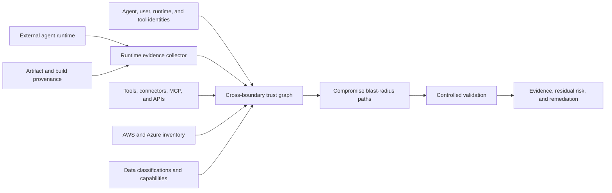

<a id="external-agent-trust-and-runtime-posture-design"></a>
# 外部エージェントの信頼と実行環境態勢

<a id="goal"></a>
## 目標

顧客クラウド外、別チーム運用、第三者管理の AI がもたらす実効テナントリスクを評価します。

外部実行環境の侵害を想定し、検証可能態勢、ID/委任、ツール、データ到達性、制御模擬を組み合わせます。

<a id="problem"></a>
## 問題

IAM は操作要求者を示すだけで、マシン、コンテナ、フレームワーク、ツールサーバー、記憶、ホストの安全性を証明しません。

正常認証でも次があり得ます。

- 脆弱/未修正ソフト
- 公開管理
- 盗まれた長期資格
- 未署名/追跡不能成果物
- 悪意プラグイン、連携、MCP、取得内容
- 弱いテナント隔離
- 広いネットワーク
- 共有実行 ID
- 不十分ログ/失効

侵害時、攻撃者は自身の権限、利用者委任、ツール ID、下流資格を継承できます。

<a id="architecture"></a>
## 構成



区別すべきもの：

1. **実行態勢：** 場所/実行方法の検証は？
2. **ID 態勢：** 使用 ID/委任権は？
3. **ツール連鎖：** ツール、連携、MCP、gateway、資格は？
4. **到達性：** サービス、データ、特権操作は？
5. **封じ込め：** 侵害時の被害制限は？
6. **検出/復旧：** 迅速な帰属、失効、更新、調査は？

<a id="runtime-evidence-model"></a>
## 証拠モデル

各主張に記録：

- 名称
- 観測値
- 出典
- 収集時刻
- 新鮮度/期限
- 検証方式
- 発行者
- 信頼分類
- hash/提供者資源 ID
- 未対応/検証不能仮定

分類：

| 分類 | 意味 |
|---|---|
| `cryptographically-verified` | 署名、来歴、workload ID、ハード証明検証済み |
| `provider-observed` | 認証 cloud/ID/runtime/security API 取得 |
| `operator-attested` | 管理者提供、独立検証なし |
| `inferred` | 他証拠から導出 |
| `unknown` | 必要証拠なし |

不明は残余不確実性を増やし、暗黙の適合にしてはいけません。

<a id="runtime-posture-dimensions"></a>
## 態勢次元

<a id="workload-identity"></a>
### ワークロード ID

- 各エージェント/配備別 ID。
- 短命連携資格。
- audience/発行者制限。
- 属性と ID の結合。
- image、記憶、設定、log に再利用資格なし。

SPIFFE/SPIRE は cloud instance ID、Kubernetes namespace/service account、process/container 属性に結合できます。提供者ネイティブ連携も併用します。

<a id="artifact-integrity"></a>
### 成果物整合性

- 署名容器/配備。
- 可変 tag でなく不変 digest。
- ソース/ビルド来歴。
- 承認 builder/repo。
- 依存一覧/脆弱状態。
- 配備 digest が承認物に一致。

SLSA は場所/時刻/構築法を記述し供給信頼を強めますが、ホスト/アプリ安全の単独証明ではありません。

<a id="runtime-and-host-integrity"></a>
### ホスト/実行整合性

- 対応済み修正 OS/runtime。
- 強化 container、VM、confidential computing。
- 利用可能ハード証明。
- 制限管理。
- 無関係テナント/負荷から隔離。
- セキュリティ telemetry。

Azure Confidential VM guest attestation、AWS NitroTPM、Nitro Enclaves は対応環境でハード証拠。confidential computing 不在は自動失敗でなく証拠の弱化です。

<a id="network-posture"></a>
### ネットワーク

- 不要公開管理なし。
- 明示入出ポリシー。
- テナント API は管理 gateway。
- DNS、proxy、certificate。
- 出先は承認 model/tool/service。
- 任意ツールによる流出防止。

<a id="agent-execution-posture"></a>
### エージェント実行

- 承認 model、system 指示、version。
- 許可 tool/parameter 認可。
- sandbox code。
- 記憶来歴/保留。
- 検索出典信頼境界。
- injection 対策/非信頼表示。
- 高影響の人間承認。
- 広い session でなく action 単位。

<a id="logging-and-recovery"></a>
### ログ/復旧

- 人間、agent、runtime、tool、cloud を相関。
- 不変監査。
- 異常 tool/権限検出。
- 緊急停止。
- token/credential 失効。
- 自動権限縮小/隔離。
- incident owner/検証済み復旧。

<a id="authorization-gateway"></a>
## 認可ゲートウェイ

広いテナント資格を直接外部へ渡さない設計：

```text
external agent
-> tenant-controlled authorization gateway
-> agent identity verification
-> runtime posture and evidence freshness check
-> user/delegation validation
-> task and tool policy
-> optional approval
-> narrowly scoped short-lived credential
-> cloud operation
```

実効権は次で限定：

```text
agent permission
intersection delegated-user permission
intersection approved task
intersection tool policy
intersection environment policy
intersection runtime trust policy
```

証拠の欠落、期限切れ、不正、必要強度不足なら拒否/降権します。

<a id="trust-and-risk-output"></a>
## 信頼/リスク出力

不透明な点数だけにしません。

- 各態勢の証拠強度
- 侵害影響範囲
- 到達データ機密度
- 破壊/特権変更操作
- 封じ込め
- 検出/失効準備
- 証拠新鮮度
- 未解決不確実性

総評は有用ですが元次元/経路を表示します。

例：

```text
Runtime evidence: weak
Identity scope: high
Delegated authority: privileged
Tool-chain exposure: medium
Reachable data: production customer records
Destructive capability: resource deletion
Revocation readiness: partial
Overall decision: deny production write access
```

<a id="controlled-validation"></a>
## 制御検証

実ホストを侵害せず「外部 runtime 侵害済み」を検証。

使用：

- 等範囲の合成 agent ID
- 権限級別合成委任ユーザー
- 制御 injection/tool confusion fixture
- 合成秘密/データ marker
- 使い捨て AWS、Azure、cluster、twin
- 許可 tool/有界出力

ID、委任、tool、digest、態勢、target、data class を記録。

<a id="product-surface"></a>
## 製品表面

候補コマンド：

```text
nullstate agent register
nullstate agent posture collect
nullstate agent posture verify
nullstate agent graph
nullstate agent blast-radius
nullstate agent validate --assume-compromised
nullstate agent monitor
```

公開 CLI はローカル収集、schema、graph、顧客連携。Team/Enterprise は連続 ingest、hosted history、policy、管理検証、alert、approval、support、agent 間画面。

<a id="failure-handling"></a>
## 失敗処理

- 欠落は不明、通過ではない。
- 古い証明は鮮度必須 policy に不適合。
- ID/runtime 結合失敗は高影響を阻止。
- 未対応ホストは操作者証言に低信頼回帰。
- cleanup/失効失敗は攻撃完了でも実行失敗。
- ハード証明でアプリ正確性、prompt 安全、脆弱性ゼロを主張しない。

<a id="initial-scope"></a>
## 初期範囲

小さく開始：

1. 外部 manifest schema。
2. agent/runtime/委任/tool ID/credential/target/data node。
3. 操作者態勢と検証 digest/ID config。
4. 決定論的影響報告。
5. AWS/Azure を順次収集。
6. graph/証拠契約安定後ハード/継続連携。

<a id="testing-strategy"></a>
## テスト

- policy が署名要求なら不正/未署名拒否。
- 欠落/古いものを不明/失敗。
- 権限の共通部分外権限なし。
- reach を広げる委任検出。
- 低権 ID の背後に高権 tool 検出。
- 機密データと基本到達を分離。
- 合成/許可対象だけで模擬。
- source、confidence、timestamp、freshness を記録。

<a id="primary-references"></a>
## 主要参照

- [Microsoft Entra Agent ID](https://learn.microsoft.com/en-us/entra/agent-id/)
- [Azure workload identity federation](https://learn.microsoft.com/en-us/entra/workload-id/workload-identity-federation)
- [Azure Conditional Access for workload identities](https://learn.microsoft.com/en-us/entra/identity/conditional-access/workload-identity)
- [Azure Confidential VM guest attestation](https://learn.microsoft.com/en-us/azure/confidential-computing/guest-attestation-confidential-vms)
- [AWS AgentCore Identity](https://docs.aws.amazon.com/bedrock-agentcore/latest/devguide/identity-overview.html)
- [AWS IAM Roles Anywhere](https://docs.aws.amazon.com/rolesanywhere/latest/userguide/introduction.html)
- [AWS NitroTPM attestation](https://docs.aws.amazon.com/AWSEC2/latest/UserGuide/attestation-get-doc.html)
- [AWS Nitro Enclaves attestation](https://docs.aws.amazon.com/enclaves/latest/user/set-up-attestation.html)
- [SLSA build provenance](https://slsa.dev/spec/v1.2/build-provenance)
- [SPIFFE and SPIRE workload identity](https://spiffe.io/docs/latest/spiffe-about/overview/)
