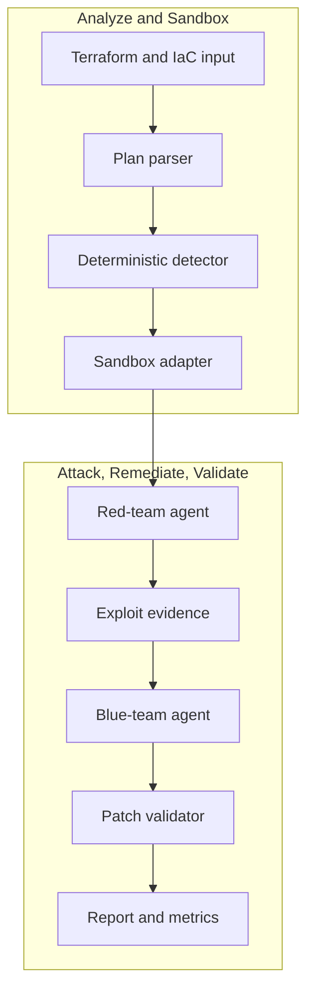

# nullstate

<!-- i18n-switcher:start -->
[English](../../../README.md) | [Español](../es/README.md) | [简体中文](../zh-CN/README.md) | [Français](../fr/README.md) | [日本語](../ja/README.md) | [Deutsch](../de/README.md) | [Português (Brasil)](README.md)
<!-- i18n-switcher:end -->

Validação de caminhos de ataque na nuvem baseada em evidências para infraestrutura como código e ambientes implantados.


`nullstate` transforma a revisão de segurança de nuvem e infraestrutura em um ciclo repetível de descoberta, ataque, correção e validação. Combina análise determinística de IaC com raciocínio de equipes vermelha e azul assistido por modelos em endpoints compatíveis com OpenAI, como vLLM em AMD MI300X.

A demo V1 comprova exposição pública de armazenamento em sandboxes locais, aplica correção Terraform, repete a validação e grava evidências revisáveis pelas equipes de segurança, nuvem e DevSecOps. A direção do produto amplia esse ciclo correlacionando IaC com inventários somente leitura de AWS e Azure, relações de identidade, caminhos de rede, achados em execução e classificações de dados. A versão pública atual é alfa, destinada a avaliação local, demos e contribuições.

<a id="what-it-does"></a>
## O que faz

1. Lê entradas Terraform/IaC.
2. Detecta configurações incorretas exploráveis compatíveis.
3. Infere o cenário e o encaminha a um backend de sandbox.
4. Pede ao modelo da equipe vermelha que analise o caminho de ataque.
5. Executa um script de ataque gerado e restrito contra o alvo local.
6. Pede ao modelo da equipe azul que explique a correção.
7. Aplica um patch Terraform determinístico.
8. Valida que o caminho de ataque foi bloqueado.
9. Grava evidências e métricas prontas para um estudo de caso.

A V1 do hackathon inclui um caminho LocalStack AWS S3 validado em execução, um caminho de sondagem Azure Blob baseado em manifesto que ainda precisa de habilitação LocalStack Azure para validação em execução, além de demos determinísticas offline para Kubernetes, Docker Compose, baselines on-premises e revisão genérica de planos.

<a id="why-this-exists"></a>
## Por que existe

Scanners estáticos de IaC e ferramentas de postura de nuvem identificam configurações arriscadas, mas nem sempre respondem às questões operacionais que determinam o risco real:

- Um atacante externo, workload comprometido, desenvolvedor, identidade CI, agente de IA ou papel de nuvem com privilégios excessivos pode usar o caminho?
- Quais dados, metadados, credenciais, serviços ou privilégios ficam acessíveis?
- Uma abertura aparentemente inofensiva expõe nomes de arquivos, detalhes de tenants, topologia interna, logs, backups, artefatos de código-fonte ou outras informações que permitam um ataque posterior?
- É possível reproduzir o caminho sem colocar dados e workloads de produção em risco?
- A correção proposta realmente bloqueia o mesmo ataque?

`nullstate` pretende correlacionar infraestrutura declarada com estado observado da nuvem, construir caminhos de ataque entre relações de rede, identidade, serviço e dados, validar caminhos relevantes em ambiente controlado e repeti-los após a correção.

<a id="why-not-attack-production-directly"></a>
### Por que não atacar produção diretamente?

Descoberta somente leitura e validação cuidadosamente delimitada podem atuar sobre produção, mas exploração autônoma não deve ser o padrão:

- Exploits podem modificar, excluir, corromper ou expor dados reais de clientes.
- Sondagens de rede e autenticação podem causar indisponibilidade, limitação de requisições, quarentena ou resposta automática a incidentes.
- Testes de IAM e escalada de privilégios podem criar acesso persistente após o teste.
- Testes de exfiltração podem violar requisitos de privacidade, contratuais, regulatórios ou de residência de dados.
- Dependências de produção podem afetar clientes e terceiros fora do escopo aprovado.
- A limpeza nem sempre restaura exatamente o estado original.

Por isso, Nullstate separa observação de exploração. Pode descobrir e modelar produção com acesso somente leitura, executar verificações não destrutivas explicitamente permitidas onde aprovadas e reconstruir o caminho relevante com dados sintéticos em ambiente descartável AWS, Azure, emulador, Kubernetes, contêiner ou VM. O objetivo não é clonar uma assinatura ou conta inteira, mas reproduzir o menor grafo relevante à segurança para comprovar ou rejeitar uma hipótese de ataque.

<a id="what-makes-it-different"></a>
### O que o diferencia?

O valor pretendido não é outra lista de configurações incorretas de nuvem. Nullstate deve produzir evidências conectando:

```text
attacker identity
-> reachable entry point
-> identity or privilege transition
-> accessible service
-> exposed data or capability
-> remediation
-> blocked replay
```

A análise considera identidades. Uma execução pode avaliar usuário anônimo da internet, usuário autenticado do tenant, desenvolvedor, workload CI, identidade de computação comprometida, identidade gerenciada, papel IAM, identidade de agente de IA ou outro principal explicitamente autorizado. Para agentes de IA, Nullstate deve distinguir a identidade própria do agente da identidade da ferramenta/runtime e da autoridade delegada por uma pessoa. Relatórios devem indicar identidade e modo de delegação testados e distinguir exposição de configuração de acesso observado a dados sensíveis.

Agentes hospedados externamente criam outra fronteira de confiança. Uma identidade de nuvem válida não comprova segurança da máquina, contêiner, framework de agentes, armazenamento de memória, conector ou provedor de hospedagem que a utiliza. A direção do produto inclui verificação da postura em execução: identidade de workload de curta duração, assinaturas e proveniência de artefatos, digests imutáveis de implantação, atestação de host/runtime quando disponível, restrições de rede, autorização de ferramentas, auditabilidade, atualidade das evidências e prontidão para revogação. Evidência ausente permanece desconhecida, não é considerada segura.

Veja [Modelo de produto e validação](docs/product-validation-model.md).

<a id="demo-result"></a>
## Resultado da demo

As demos finais AMD MI300X/vLLM usaram `nullstate-gemma4-26b-a4b` para os papéis vermelho e azul:

| Cenário | Alvo | Achado | Resultado |
|---|---|---|---|
| `aws-public-s3` | LocalStack AWS | Bloqueio de acesso público S3 desativado | Sondagem em execução observou acesso antes da correção e acesso bloqueado depois |
| `azure-public-blob` | LocalStack Azure/caminho offline | Acesso anônimo a contêiner Blob | Sondagem baseada em manifesto gerada; validação em execução LocalStack Azure aguarda habilitação do emulador |

Métricas representativas do modelo:

| Execução | Papel | Tokens de resposta | Latência | Velocidade de saída |
|---|---|---:|---:|---:|
| AWS S3 | Vermelho | 942 | 9.018s | 104.452 tok/s |
| AWS S3 | Azul | 640 | 3.977s | 160.937 tok/s |
| Azure Blob | Vermelho | 709 | 4.112s | 172.424 tok/s |
| Azure Blob | Azul | 794 | 4.548s | 174.586 tok/s |

<a id="architecture"></a>
## Arquitetura



Veja [Arquitetura](docs/architecture.md) e [Guia técnico](docs/technical-walkthrough.md).

<a id="security-model"></a>
## Modelo de segurança

V1 não mira ambientes reais de nuvem por padrão. Sandboxes são explícitos, artefatos são locais e a correção ocorre em uma cópia do workspace da execução, sem modificar o diretório Terraform original.

O executor de ferramentas vermelho fica restrito aos scripts `attack.py` gerados no diretório da execução. Registra comando, stdout, stderr, código de retorno, URL alvo, etapa, início, fim e duração em `events.jsonl`.

Veja [Modelo de segurança](docs/security-model.md) e [Modelo de ameaças](docs/threat-model.md).

<a id="installation"></a>
## Instalação

Instalação atual a partir do código-fonte:

```powershell
git clone https://github.com/Ker102/nullstate-cli.git
cd nullstate-cli
python -m pip install -e .
```

Isso instala dependências do pacote e o comando de console `nullstate` declarado em `pyproject.toml`.

Se `nullstate` não for reconhecido após instalar, o diretório Scripts do Python não está em `PATH`. A mesma CLI pode ser executada via Python:

```powershell
python -m nullstate doctor --offline
```

Para localizar os scripts de console instalados pelo Python:

```powershell
python -c "import sysconfig; print(sysconfig.get_path('scripts'))"
```

Instale a pré-versão atual diretamente do GitHub:

```powershell
python -m pip install "git+https://github.com/Ker102/nullstate-cli.git@v0.1.0-alpha.2"
```

Para contribuir, instale também ferramentas de desenvolvimento:

```powershell
python -m pip install -e ".[dev]"
python -m ruff check src tests
python -m mypy src
python -m unittest discover -s tests -v
```

<a id="quickstart"></a>
## Início rápido

```powershell
nullstate
nullstate doctor --offline
nullstate status
nullstate init-demo azure-public-blob --output examples/azure-public-blob
nullstate run examples/azure-public-blob --offline
nullstate report
nullstate scrub
```

Inspecione uma execução de exemplo sanitizada sem Docker, Terraform, LocalStack nem acesso a modelos:

```powershell
nullstate report --runs-dir examples/sample-runs
nullstate summary --runs-dir examples/sample-runs --json
```

O exemplo versionado também inclui `run-bundle.json` e `dashboard.html` para revisar o contrato do pacote portátil e a saída do painel local sem gerar novos artefatos.

Execute outro cenário offline:

```powershell
nullstate run examples/aws-public-s3 --offline
nullstate run examples/k8s-privileged-pod --offline
nullstate run examples/aws-public-s3 --offline --mock-agents --ci --fail-on-severity high
nullstate baseline --output nullstate-baseline.json
nullstate run examples/aws-public-s3 --offline --mock-agents --ci --baseline-file nullstate-baseline.json
nullstate policy-result --baseline-file nullstate-baseline.json
```

Descoberta de sandboxes:

```powershell
nullstate sandbox list
nullstate sandbox status localstack-azure
nullstate sandbox up localstack-azure --dry-run
nullstate scenarios list
nullstate scenarios status aws-public-s3
nullstate policy init --output nullstate-policy.json
nullstate policy init --scenario aws-public-s3 --output aws-policy.json
```

`status`, `init-demo`, `sandbox` e `run` imprimem uma tabela curta `Next` com os próximos comandos prováveis. `run` usa `--scenario auto` e `--target auto` por padrão; a CLI infere o cenário pela estrutura IaC e seleciona o backend correspondente. Passe `--scenario` ou `--target` somente ao gravar uma demo específica ou testar um adaptador.

Sondagens de ataque em execução ficam locais por padrão. Futuros alvos HTTP(S) não locais exigem `--allow-live-cloud`, e a aprovação é registrada em `events.jsonl`; quando a política inclui `allowed_target_hosts`, o hostname também deve corresponder à lista permitida. Os cenários integrados atuais ainda resolvem para alvos locais/offline de sandbox.

Inicialize GitHub Actions:

```powershell
nullstate init-ci github --scenario aws-public-s3 --iac-path examples/aws-public-s3
```

Isso grava `.github/workflows/nullstate.yml` e `nullstate-policy.json` para usar Nullstate como gate de pull requests sem copiar manualmente o template.

Prévia de confiança de agentes de IA externos:

```powershell
nullstate agent posture verify examples/agent-trust/external-agent-manifest.json
nullstate agent blast-radius examples/agent-trust/external-agent-manifest.json
```

Esses comandos validam um manifesto local de agente externo e resumem evidências de postura em execução, atualidade das evidências, tipos de identidade, autoridade delegada do usuário, recursos sensíveis, ações de alto risco e classes prováveis de caminhos de ataque. É uma prévia determinística do modelo de confiança externo; ainda não coleta inventário de provedores nem atesta um runtime de terceiros ao vivo.

Abra o relatório mais recente:

```powershell
nullstate report
```

Se as execuções ficam em uma pasta nomeada, aponte a busca de relatórios para a pasta pai:

```powershell
nullstate report --runs-dir runs/live-aws-model
nullstate report 20260509-200601 --runs-dir runs
```

Crie um pacote portátil da execução ou um painel HTML local gratuito:

```powershell
nullstate summary --json
nullstate bundle
nullstate dashboard --open
nullstate sarif
nullstate upload --dry-run
```

`summary --json` emite um objeto compacto legível por máquina para agentes de programação, etapas GitHub Actions e automação de comentários de PR. O painel resume achados, regras de correção, metadados do esquema do pacote, inventário de artefatos, linha do tempo das evidências e trecho do relatório selecionado.

Resumos e pacotes incluem o nível de evidência do cenário, permitindo distinguir execuções validadas ao vivo de evidências determinísticas offline, implementações preliminares ou análise apenas de planos.

Prévia de contexto de nuvem somente leitura:

```powershell
nullstate context validate examples/cloud-context/aws-readonly-context.json
nullstate context summary examples/cloud-context/aws-readonly-context.json --json
```

O comando de contexto valida e resume um manifesto local de inventário de nuvem. É o contrato seguro para futuros coletores AWS/Azure/GCP somente leitura; ainda não chama APIs de nuvem nem solicita credenciais.

Métricas de avaliação:

```powershell
nullstate eval run examples/eval/iac-security-regression.json --output-dir eval-runs/iac-security-regression
```

O harness de avaliação executa casos de benchmark repetíveis e grava `eval-results.json` e `eval-report.md`. Use-o para evidências de estudo de caso: duração, quantidade de achados, maior severidade, estado do ataque antes/depois, totais de tokens, quantidade de artefatos, verificações de expectativas de sucesso/falha e comparação de baseline. O exemplo compara Nullstate com uma baseline transparente de revisão genérica somente IaC, mostrando evidências adicionais de repetição do ataque, validação após correção, métricas de tokens e cobertura estruturada de artefatos. Ainda não compara scanners externos como Checkov, tfsec ou Terrascan.

<a id="live-localstack-demo-path"></a>
## Caminho de demo LocalStack em execução

Use após configurar Docker, Terraform, acesso LocalStack e variáveis do endpoint de modelo.

AWS:

```powershell
nullstate sandbox up localstack-aws
nullstate sandbox status localstack-aws
nullstate run examples/aws-public-s3 --target localstack-aws
nullstate report
```

Azure:

```powershell
nullstate sandbox up localstack-azure
nullstate sandbox status localstack-azure
nullstate run examples/azure-public-blob --target localstack-azure
nullstate report
```

O provider Terraform da demo inclui:

```hcl
metadata_host = "localhost.localstack.cloud:4566"
```

Isso mantém Terraform apontado para o emulador LocalStack Azure, não para Azure real.

Mantenha `LOCALSTACK_AUTH_TOKEN` no shell, `.env.local` ou `.env`. `nullstate sandbox up` descobre automaticamente `.env.local` primeiro e `.env` depois; `--env-file` continua disponível para outro caminho.

Se Docker informar que `127.0.0.1:4566` já está alocado, provavelmente um contêiner LocalStack remanescente reserva a porta edge compartilhada. Execute:

```powershell
nullstate sandbox down localstack-aws
nullstate sandbox down localstack-azure
docker ps -a --filter name=localstack
```

Alternativa Docker Compose:

```powershell
$env:LOCALSTACK_AUTH_TOKEN = "<token>"
docker compose -f docker-compose.localstack-azure.yml up
```

Ou crie um `.env` local ao lado do arquivo Compose:

```env
LOCALSTACK_AUTH_TOKEN=your-token-here
```

Git ignora `.env` e `.env.local`. Não faça commit do token.

<a id="model-endpoint"></a>
## Endpoint de modelo

`nullstate` conversa com servidores de modelos compatíveis com OpenAI. Para vLLM, SGLang ou proxy privado auto-hospedados, use o provider custom e um endpoint para ambos os papéis:

```powershell
$env:NULLSTATE_LLM_PROVIDER = "custom"
$env:NULLSTATE_LLM_BASE_URL = "http://<mi300x-host>:8000"
$env:NULLSTATE_LLM_API_KEY = "<optional-token>"
nullstate run examples/azure-public-blob --blue-model gemma-4-31b-it --red-model qwen3-coder-next
```

Para Google AI Studio / Gemini, bastam preset do provider e API key; `nullstate` fornece a URL base Gemini compatível com OpenAI:

```powershell
$env:NULLSTATE_LLM_PROVIDER = "google"
$env:NULLSTATE_LLM_API_KEY = "<google-ai-studio-key>"
nullstate run examples/azure-public-blob --blue-model gemini-3.5-flash --red-model gemini-3.5-flash
```

Para Claude pela camada de compatibilidade OpenAI SDK da Anthropic, use o preset Claude. Essa compatibilidade é experimental; um adaptador nativo continua sendo o melhor caminho futuro de produção para recursos específicos de Claude:

```powershell
$env:NULLSTATE_LLM_PROVIDER = "claude"
$env:NULLSTATE_LLM_API_KEY = "<anthropic-api-key>"
nullstate run examples/azure-public-blob --blue-model claude-sonnet-4-6 --red-model claude-sonnet-4-6
```

Para dois contêineres vLLM/SGLang ou dois túneis SSH, configure endpoints por papel:

```powershell
$env:NULLSTATE_LLM_PROVIDER = "custom"
$env:NULLSTATE_RED_LLM_BASE_URL = "http://127.0.0.1:8001"
$env:NULLSTATE_BLUE_LLM_BASE_URL = "http://127.0.0.1:8002"
$env:NULLSTATE_RED_LLM_API_KEY = "<optional-red-token>"
$env:NULLSTATE_BLUE_LLM_API_KEY = "<optional-blue-token>"
nullstate run examples/azure-public-blob --red-model nullstate-red --blue-model nullstate-blue
```

A CLI também aceita `--llm-provider`, `--red-provider`, `--blue-provider`, `--red-base-url` e `--blue-base-url` para execuções pontuais. Presets atuais incluem `google`, `claude`, `custom` e `openai-compatible`. Configurações por papel não definidas usam `NULLSTATE_LLM_PROVIDER`, `NULLSTATE_LLM_BASE_URL` e `NULLSTATE_LLM_API_KEY`. URLs base explícitas sempre prevalecem, mantendo suporte a gateways customizados, modelos auto-hospedados e proxies de provedores.

Usuários não precisam escrever prompts. `nullstate` envia instruções internas dos agentes vermelho/azul e evidências do cenário. Sem endpoint para um papel, ele usa resposta mock determinística, permitindo demos locais e LocalStack sem modelo. `--offline` pula chamadas Terraform/runtime de nuvem e usa análise estática IaC. Se houver endpoint compartilhado ou por papel configurado, `--offline` ainda o usa; adicione `--mock-agents` somente para respostas determinísticas sem modelo.

<a id="sandbox-backends"></a>
## Backends de sandbox

| Backend | Modo | Alvo IaC | Status |
|---|---|---|---|
| `localstack-azure` | executável | Terraform AzureRM | alvo de demo em execução |
| `localstack-aws` | executável | Terraform AWS | alvo de demo em execução |
| `kind-kubernetes` | executável | Kubernetes YAML, Helm, Kustomize | esqueleto de adaptador |
| `docker-compose` | gêmeo digital | Docker Compose e stacks de aplicações | esqueleto de adaptador |
| `microvm-onprem` | gêmeo digital | Ansible, hardening Linux, Terraform estilo libvirt/Proxmox | alternativa com projeto pronto |
| `plan-only` | apenas plano | qualquer plano exportado/parser | disponível |

<a id="scenarios"></a>
## Cenários

`nullstate scenarios list` mostra o nível de evidência explicitamente, permitindo ver antes de executar o que foi comprovado ao vivo, é determinístico ou apenas preliminar.

| Cenário | Backend | Nível de evidência | Status |
|---|---|---|---|
| `aws-public-s3` | `localstack-aws` | `live-validated` | Implantação S3 LocalStack AWS e sondagem restrita de leitura anônima de objeto validadas antes e depois da correção |
| `azure-public-blob` | `localstack-azure` | `offline-deterministic` | Detecção estática IaC, correção, geração de sondagem com manifesto e evidências offline implementadas; comprovação ao vivo do emulador Azure pendente |
| `k8s-privileged-pod` | `kind-kubernetes` | `scaffolded` | Detecção e correção determinísticas offline disponíveis; sondagem ao vivo do cluster kind pendente |
| `compose-exposed-admin` | `docker-compose` | `scaffolded` | Detecção e correção determinísticas offline disponíveis; sondagem ao vivo de contêiner/rede pendente |
| `onprem-ssh-password` | `microvm-onprem` | `scaffolded` | Detecção e correção determinísticas offline disponíveis; execução do gêmeo microVM pendente |
| `generic-plan-review` | `plan-only` | `plan-only` | Revisão estática de plano/configuração disponível; nenhum sandbox executável ou sondagem de exploit em execução é tentado |

<a id="artifacts"></a>
## Artefatos

Cada execução grava:

- `runs/<run-id>/events.jsonl`
- `runs/<run-id>/findings.json`
- `runs/<run-id>/metrics.json`
- `runs/<run-id>/ci-summary.json` quando `nullstate run --ci` é usado
- `runs/<run-id>/policy-result.json` quando `nullstate policy-result` é usado
- `runs/<run-id>/vllm-metrics-before.prom` quando `/metrics` é acessível
- `runs/<run-id>/vllm-metrics-after.prom` quando `/metrics` é acessível
- `runs/<run-id>/vllm-metrics-red-before.prom` e variantes por papel quando endpoints vermelho/azul diferem
- `runs/<run-id>/attack.py`
- `runs/<run-id>/attack-manifest.json`
- `runs/<run-id>/remediation.json`
- `runs/<run-id>/run-bundle.json` quando `nullstate bundle` ou `nullstate dashboard` é executado
- `runs/<run-id>/dashboard.html` quando `nullstate dashboard` é executado
- `runs/<run-id>/nullstate.sarif` quando `nullstate sarif` é executado
- `runs/<run-id>/evidence-manifest.json` quando `nullstate evidence-manifest` é executado
- `runs/<run-id>/evidence-verification.json` quando `nullstate evidence-verify` é executado
- `runs/<run-id>/upload-plan.json` quando `nullstate upload --dry-run` é executado
- `runs/<run-id>/remediation.patch`
- `runs/<run-id>/report.md`
- `scrubbed-runs/<run-id>/scrub-report.json` quando `nullstate scrub` é usado

Crie uma cópia sanitizada antes de compartilhar evidências:

```powershell
nullstate scrub
nullstate scrub 20260608-224625 --runs-dir runs --output-dir scrubbed-runs
```

`attack-manifest.json` inclui ponteiro `$schema` para `docs/schemas/attack-manifest.schema.json`; a CLI valida o manifesto antes de executar a sondagem restrita. `events.jsonl` inclui entradas `red-tool` para o comando permitido antes/depois da correção. `remediation.json` registra versão das regras determinísticas, cenário, arquivos alterados e IDs de regras aplicadas. Metadados gerados incluem ponteiro `$schema` para `docs/schemas/remediation-metadata.schema.json` e são validados antes de serem consumidos por relatórios, pacotes e artefatos.

`ci-summary.json` inclui ponteiro `$schema` para `docs/schemas/ci-summary.schema.json`; `nullstate run --ci` valida a decisão CI antes de gravá-la.

`run-bundle.json` inclui ponteiro `$schema` para `docs/schemas/run-bundle.schema.json` e sua estrutura é validada ao gravar. Trate o esquema como contrato local para painéis, uploads CI, pacotes de suporte e futura ingestão em nuvem.

Exporte achados para CI ou upload de análise de código:

```powershell
nullstate run examples/aws-public-s3 --offline --mock-agents --ci --fail-on-severity none
nullstate sarif
nullstate sarif 20260608-224625 --runs-dir runs --output artifacts/nullstate.sarif
```

Use `--fail-on-severity high` ou `--fail-on-severity critical` quando o job CI deve falhar por achados correspondentes.

Crie e use um arquivo de política das ferramentas vermelhas:

```powershell
nullstate policy init --output nullstate-policy.json
nullstate policy init --scenario aws-public-s3 --output aws-policy.json
nullstate policy validate nullstate-policy.json --output policy-validation.json
nullstate run examples/aws-public-s3 --offline --mock-agents --policy-file nullstate-policy.json
```

A política gerada inclui ponteiro `$schema` para `docs/schemas/nullstate-policy.schema.json` e é validada antes de gravar. Permite nomes de cenários/backends, etapas, flags do `attack.py` gerado, classificações `offline`, `local`, `local-http` e futura `external-http`, hostnames como `localhost.localstack.cloud` ou `*.blob.core.windows.net`, IDs de política como `generated-attack-script-v1` e limites de timeout/captura. `policy init --scenario` cria um preset mais restrito para um par conhecido cenário/backend, mantendo as restrições do executor. `nullstate policy validate` verifica sem executar cenário e sai com código `2` para arquivo malformado ou inválido.

Crie um manifesto de integridade antes de anexar a execução a ticket, estudo de caso ou suporte:

```powershell
nullstate evidence-manifest
nullstate evidence-verify
nullstate evidence-manifest 20260608-224625 --runs-dir runs --output artifacts/evidence-manifest.json
nullstate evidence-verify 20260608-224625 --runs-dir runs --manifest artifacts/evidence-manifest.json
$env:NULLSTATE_EVIDENCE_SIGNING_KEY = "<secret>"
nullstate evidence-manifest --signing-key-env NULLSTATE_EVIDENCE_SIGNING_KEY
nullstate evidence-verify --signing-key-env NULLSTATE_EVIDENCE_SIGNING_KEY
```

O manifesto inclui ponteiro `$schema` para `docs/schemas/evidence-manifest.schema.json` e é validado antes de gravar. Lista artefatos compartilháveis com hashes SHA-256, exclui workspaces copiados e internos Terraform e permite assinatura opcional HMAC-SHA256 com chave compartilhada. `nullstate evidence-verify` recalcula hashes, verifica manifestos assinados com `--signing-key-env`, grava `evidence-verification.json` e sai com código `2` se um artefato faltar, mudar, vier de outra execução ou tiver assinatura inválida. Chaves são lidas do ambiente e nunca gravadas no manifesto.

Crie uma baseline de execução conhecida para CI ignorar achados conhecidos e falhar pelos novos:

```powershell
nullstate baseline --output nullstate-baseline.json
nullstate run examples/aws-public-s3 --offline --mock-agents --ci --baseline-file nullstate-baseline.json
nullstate policy-result --baseline-file nullstate-baseline.json
```

`policy-result.json` avalia uma execução existente sem repetir o scan. Fornece à automação posterior a mesma decisão de limiar e baseline do CI em um artefato JSON independente.

Prepare um futuro plano de upload para ingestão em nuvem sem enviar dados:

```powershell
nullstate upload --dry-run
nullstate upload 20260608-224625 --runs-dir runs --endpoint https://api.nullstate.dev/v1/runs --dry-run
```

`upload-plan.json` inclui ponteiro `$schema` para `docs/schemas/upload-plan.schema.json` e é validado antes de gravar. Registra endpoint alvo, checksum do pacote, número de artefatos, presença de token e estado da pré-verificação de sanitização; nunca armazena valores de tokens. Execuções brutas são permitidas em dry-run, mas marcadas `upload_recommended: false`; execute `nullstate scrub` primeiro e envie de `scrubbed-runs/` antes de compartilhar ou de futura ingestão.

<a id="documentation"></a>
## Documentação

- [Estudo de caso](docs/case-study.md)
- [Primeiros 10 minutos](docs/quickstart-10-minutes.md)
- [Guia técnico](docs/technical-walkthrough.md)
- [Arquitetura](docs/architecture.md)
- [Modelo de produto e validação](docs/product-validation-model.md)
- [Projeto de confiança e postura de agentes externos](docs/plans/2026-06-22-external-agent-trust-design.md)
- [Esquema do manifesto de agentes externos](../../schemas/external-agent-manifest.schema.json)
- [Esquema de contexto de nuvem](../../schemas/cloud-context.schema.json)
- [Esquema da suite de avaliação](../../schemas/eval-suite.schema.json)
- [Esquema do resumo da execução](../../schemas/run-summary.schema.json)
- [Modelo de segurança](docs/security-model.md)
- [Modelo de ameaças](docs/threat-model.md)
- [Auditoria de dependências](docs/dependency-audit.md)
- [CI/CD](docs/ci-cd.md)
- [Manual de operação](docs/runbook.md)
- [Manual de serving de modelos](docs/model-serving.md)
- [Roadmap empresarial](docs/enterprise-roadmap.md)
- [Prontidão empresarial](docs/enterprise-readiness.md)
- [Marcos de prontidão open source](docs/open-source-readiness.md)
- [Progresso de produtização](../../progress.md)
- [Plano de comandos vermelhos em sandbox real](../../plans/2026-06-01-real-sandbox-red-team-commands.md)
- [Transferência do projeto](../../handoff.md)
- [Estratégia de computação AMD](docs/compute-strategy.md)
- [Modos de falha](docs/failure-modes.md)
- [Relatório de custos](docs/cost-report.md)

<a id="release-model"></a>
## Modelo de releases

A pré-versão `Media` serve apenas para hospedar recursos do README. Releases de produto devem usar tags de versão:

| Tag | Propósito |
|---|---|
| `v0.1.0-alpha.1` | Primeira pré-versão do hackathon com demos offline e documentação refinada |
| `v0.1.0-alpha.2` | Pré-versão de prontidão open source com executor vermelho restrito, artefatos CI, pacotes de evidências, painel local, esqueletos de políticas, workflow SBOM/proveniência e documentação de releases |
| `v0.1.0-beta.1` | Caminho de validação em execução LocalStack Azure funcionando |
| `v0.1.0` | Candidato final do hackathon com vídeo de demo, estudo de caso e evidências métricas |

O título do release GitHub pode corresponder à tag ou usar um título legível como `nullstate v0.1.0-alpha.2`.

Releases com tags constroem wheel/sdist, instalam o wheel em ambiente limpo para smoke test, verificam `nullstate` com `doctor --offline`, enviam `release-manifest.json` com digests SHA-256, geram e validam `sbom.spdx.json` do wheel instalado em ambiente limpo, revalidam com ferramentas Python SPDX, criam atestações GitHub de proveniência e SBOM e publicam pacotes de assinatura Sigstore sem chave `.sigstore.json` junto aos artefatos. Verifique um wheel baixado com:

```powershell
gh attestation verify dist/nullstate-*.whl -R Ker102/nullstate-cli
gh attestation verify dist/nullstate-*.whl -R Ker102/nullstate-cli --predicate-type https://spdx.dev/Document/v2.3
```

Pacotes Sigstore são enviados como artefatos adjacentes, por exemplo `nullstate-...whl.sigstore.json`.

Antes da tag, execute manualmente o workflow `Release` com `dry_run=true` para ensaiar build, validação SBOM, atestações, assinatura e verificações dos pacotes sem criar release GitHub.

Antes de criar tag localmente, verifique que o wheel construído instala e expõe o comando `nullstate`:

```powershell
python scripts/release/install_smoke.py
```

Após publicar uma tag de pré-versão, verifique que a instalação pública via GitHub expõe o mesmo comando:

```powershell
python scripts/release/install_smoke.py --tag v0.1.0-alpha.2
```

Verifique a assinatura de um wheel com Cosign, associando-o ao pacote adjacente e à identidade do workflow de release:

```powershell
$wheel = Get-ChildItem dist\nullstate-*.whl | Select-Object -First 1
cosign verify-blob $wheel.FullName --bundle "$($wheel.FullName).sigstore.json" --certificate-identity "https://github.com/Ker102/nullstate-cli/.github/workflows/release.yml@refs/tags/v0.1.0" --certificate-oidc-issuer "https://token.actions.githubusercontent.com"
```

<a id="status"></a>
## Status

Funciona agora: validação de armazenamento LocalStack AWS em execução, geração de sondagem Azure Blob com manifesto aguardando habilitação LocalStack Azure ao vivo, demos determinísticas offline de todos os cenários listados, comandos vermelhos restritos, correção determinística, registro de sandboxes, artefatos de relatórios e métricas de modelos, saída CLI com identidade visual e estrutura DevSecOps.

Experimental: scripts de ataque mais ricos por cenário, adaptadores Kubernetes/Compose/on-premises ao vivo, SBOMs de dependências resolvidas mais completos e cobertura ampliada de remoção de informações sensíveis dos artefatos.
