<a id="nullstate-architecture"></a>
# Arquitetura nullstate

<a id="goal"></a>
## Objetivo

Entregar um fluxo purple-team repetível que começa com IaC e evolui para correlação com AWS e Azure observados, sem tornar exploração real de nuvem o padrão.

<a id="pipeline"></a>
## Pipeline

```mermaid
flowchart LR
    A[Terraform / IaC directory] --> B[Plan JSON or static parser]
    B --> C[Deterministic exposure detector]
    C --> S[Sandbox adapter]
    S --> D[Red-team agent instructions]
    D --> E[Constrained attack.py runner]
    E --> F[Exploit evidence]
    F --> G[Blue-team agent instructions]
    G --> H[Deterministic remediation]
    H --> I[Validation attack]
    I --> J[Run report and metrics]
```



<a id="design-choices"></a>
## Decisões de projeto

- O detector determinístico é a fonte de verdade para demos confiáveis.
- IaC descreve configuração desejada; futura descoberta AWS/Azure somente leitura fornece estado implantado e drift.
- A base de análise futura é um grafo normalizado com recursos, alcance de rede, identidades, privilégios, serviços e impacto em dados.
- Caminhos são avaliados a partir de identidades explícitas: anônimos, desenvolvedores, CI, computação comprometida, papéis AWS e identidades gerenciadas Azure.
- Ambientes descartáveis devem reconstruir o menor caminho relevante, não clonar contas/assinaturas inteiras.
- Agentes vermelho/azul recebem instruções internas e evidências; prompts manuais são desnecessários.
- `run` usa `--scenario auto` e `--target auto`; valores explícitos continuam disponíveis para demos/testes.
- Offline usa parser Terraform estático para funcionar sem LocalStack, Terraform ou GPUs.
- Online segue comandos Terraform: `init`, `plan -out=tfplan` e `show -json tfplan`.
- Backends são adaptadores explícitos: executável, gêmeo digital ou somente plano.
- O executor vermelho só executa `attack.py` gerado no diretório da execução e registra evidências em `events.jsonl`.

Veja [Modelo de produto e validação](product-validation-model.md) para descoberta de produção, análise por identidade, impacto de dados, fidelidade e gatilhos CI.

<a id="sandbox-adapters"></a>
## Adaptadores de sandbox

| Backend | Modo | Alvo |
|---|---|---|
| `localstack-azure` | executável | Terraform AzureRM |
| `localstack-aws` | executável | Terraform AWS |
| `kind-kubernetes` | executável | Kubernetes YAML, Helm, Kustomize |
| `docker-compose` | gêmeo digital | Docker Compose e stacks de aplicações |
| `microvm-onprem` | gêmeo digital | IaC on-premises estilo Linux/VM/rede |
| `plan-only` | apenas plano | qualquer IaC com parser/plano exportado |

<a id="on-prem-sandboxing-model"></a>
## Modelo de sandbox on-premises

Infraestrutura on-premises geralmente não pode ser emulada por um único emulador universal. nullstate escolhe o melhor nível disponível:

- sandbox executável quando há runtime descartável
- gêmeo digital se a topologia mapeia para contêineres/VMs locais
- análise de plano se executar for inseguro ou não suportado

<a id="current-rule"></a>
## Regra atual

`AZURE_STORAGE_PUBLIC_BLOB` marca recursos `azurerm_storage_container` com `container_access_type` igual a `blob` ou `container`.

A correção define:

```hcl
container_access_type = "private"
allow_nested_items_to_be_public = false
```

<a id="scenario-roadmap"></a>
## Roadmap de cenários

| Cenário | Alvo | Sandbox | Status de execução |
|---|---|---|---|
| `azure-public-blob` | Terraform AzureRM | LocalStack Azure ou futuro fallback Azurite | demo com manifesto/offline disponível; validação ao vivo aguarda habilitação |
| `aws-public-s3` | Terraform AWS | LocalStack AWS | demo em execução disponível |
| `k8s-privileged-pod` | Kubernetes YAML/Helm/Kustomize | kind | demo offline disponível; execução ao vivo pendente |
| `compose-exposed-admin` | Docker Compose | rede Docker isolada | demo offline disponível; sondagem ao vivo pendente |
| `onprem-ssh-password` | IaC estilo Ansible/cloud-init/libvirt/Proxmox | gêmeo de laboratório VM/contêiner | demo offline disponível; gêmeo microVM pendente |
| `generic-plan-review` | exports IaC não suportados | nenhum | somente plano disponível |
