<a id="nullstate-autonomous-purple-team-iac-sandbox-on-amd-mi300x"></a>
# nullstate: Sandbox IaC purple-team autônomo em AMD MI300X

<a id="1-executive-summary"></a>
## 1. Resumo executivo

Construí `nullstate` no hackathon AMD x lablab.ai para testar validação além de achados estáticos, em ciclo vermelho/azul repetível. CLI lê Terraform, inicia sandbox local, detecta exposição de armazenamento, pede raciocínio vermelho, executa script gerado restrito, pede explicação azul, aplica patch determinístico, revalida e grava evidência para jurados. Demo final usou automação Terraform, LocalStack, Python Typer/Rich, vLLM compatível OpenAI, ROCm e droplet AMD Instinct MI300X. Decisão central: veredicto determinístico e modelo para raciocínio adversarial, explicação e relatórios. Resultado alfa aberta com AWS ao vivo validado, Azure Blob com manifesto aguardando emulador e roadmap de release estável.

<a id="2-problem"></a>
## 2. Problema

Scanners úteis param em configuração arriscada. Restam perguntas:

- Explorável neste contexto?
- Qual prova da exposição?
- Qual mudança Terraform exata?
- Ataque falhou após patch?
- Demonstrável sem produção?

`nullstate` preenche com trilha reproduzível: achado, raciocínio, correção, validação, relatório para segurança/cloud/DevSecOps.

IaC não é toda a nuvem: intenção/gerenciado mais descoberta AWS/Azure somente leitura para realidade, identidades, redes, runtime, drift. Correlacionar grafo, identidades com dados/capacidades e caminho mínimo controlado.

<a id="why-not-attack-production-directly"></a>
### Por que não produção?

- Exploits alteram/excluem/corrompem/expõem dados reais.
- Rede/auth causam queda, throttling, lockout, quarentena, resposta.
- IAM cria credenciais, confiança, privilégios persistentes.
- Exfiltração viola privacidade, contrato, regulação, residência.
- Dependências atingem terceiros fora do escopo.
- Cleanup nem sempre restaura exatamente.

Fluxo desejado: descoberta leitura, checks aprovados não destrutivos, exploração sintética, correção determinística, replay. Além de anônimo: dev, CI, compute comprometido, IAM AWS, principal Azure, identidade gerenciada.

IA pode ter identidade nativa, principal/IAM convencional, runtime tool separado ou delegação humana. Prompt, memória, conector, MCP, plugin ou credencial comprometidos dão acesso invisível em grafo só de recursos. Separar permissões próprias, delegadas, tool e reportar dados/operações.

Externo: cliente controla permissões, não máquina. Token válido não prova patch, isolamento, artefato, tools, ausência de roubo. Próximo design adiciona postura/raio, separando verificação criptográfica, observação provider, operador, inferência, desconhecido para não gerar falsa segurança.

<a id="3-context-and-constraints"></a>
## 3. Contexto

- Cerca de 48 horas.
- Evidência antes do prazo, não plataforma ampla inacabada.
- Local primeiro sem credencial AWS/Azure real padrão.
- MI300X auto-hospedado vLLM/ROCm.
- LocalStack, Azure depende de habilitação Emulator.
- CLI primeiro, não web completo.
- Não expor vLLM, LocalStack, tokens, state, `.env`.
- Modelo não decide sucesso/falha.

<a id="4-requirements"></a>
## 4. Requisitos

<a id="functional-requirements"></a>
### Funcionais

- Analisar Terraform.
- Inferir/aceitar cenário.
- Iniciar/inspecionar local.
- Exposição pública alto risco.
- Modelo próprio vermelho.
- Script restrito antes/depois.
- Comando/stdout/stderr/retorno/URL/etapa/início/fim/duração em `events.jsonl`.
- Modelo próprio azul.
- Corrigir determinístico.
- Revalidar.
- `report.md`, `findings.json`, `events.jsonl`, `metrics.json`, `attack.py`, `remediation.patch`, `remediation.json`.
- Offline/mock sem GPU/sandbox.

<a id="non-functional-requirements"></a>
### Não funcionais

- Sem cloud real padrão.
- Sem shell vermelho arbitrário V1, só `attack.py` no run.
- Comandos claros sob pressão.
- Artefatos adequados ao caso.
- Secrets/state fora Git.
- PR, review, CodeQL, proteção.

<a id="5-architecture"></a>
## 5. Arquitetura

```mermaid
flowchart LR
    A[Terraform IaC input] --> B[Terraform init / plan / show JSON]
    B --> C[Deterministic detector]
    C --> D[Sandbox adapter]
    D --> E[Red-team model reasoning]
    E --> F[Attack evidence]
    F --> G[Blue-team model remediation]
    G --> H[Deterministic Terraform patch]
    H --> I[Re-plan and apply]
    I --> J[Validation attack]
    J --> K[Report and metrics artifacts]
```



Decisões confiáveis separadas do modelo:

- Ao vivo `terraform init -input=false`, `terraform plan -out=tfplan -input=false`, `terraform show -json tfplan`, `terraform apply -auto-approve -input=false tfplan`.
- Detector config/plan JSON.
- Vermelho recebe evidência/raciocina.
- Azul recebe evidência/explica.
- Motor aplica patch.
- Validador verifica restante/ataque depois.

<a id="6-what-the-red-agent-actually-does-today"></a>
## 6. O vermelho real

Descrever com precisão.

Modelo sem shell: prompt interno e achados, raciocínio S3 anônimo/Azure `curl`.

`nullstate` depois executa somente `attack.py` gerado no diretório. Python direto, só `--target-url`, `--stage`, grava comando/stdout/stderr/retorno/URL/etapa/tempos em `events.jsonl`.

Mais estreito que shell livre, com evidência real local e fronteira auditável.

<a id="7-security-model"></a>
## 7. Segurança

| Risco | Controle | Evidência |
|---|---|---|
| Cloud acidental | LocalStack/plano padrão | adaptadores/comandos |
| Recomendação insegura | detector/correção versionada determinísticos | `findings.json`, `remediation.patch`, `remediation.json` |
| Exploit arbitrário | só `attack.py` | `red-tool`, `src/nullstate/attack_runner.py` |
| Vazamento | `.env`/state ignorados, capturas sanitizadas | higiene/checklist |
| Modelo público | vLLM SSH, sem ingress | droplet/túnel |
| Código sem revisão | PR/proteção/CI | checks |

<a id="8-deployment-and-devsecops-workflow"></a>
## 8. Deploy

Branches/PRs, não main direto:

```text
feature branch
-> PR
-> unit tests, lint, type checks, dependency/security checks
-> review/merge
-> release tag / release notes
```

Práticas:

- Metadata Python/entry.
- Arquitetura, runbook, ameaça, segurança, CI, custos, falhas.
- Actions qualidade.
- CodeQL/dependências.
- Higiene Dependabot.
- Checklist evidência fora Git.
- Release por tags.

<a id="9-final-demo-results"></a>
## 9. Resultados

<a id="open-source-readiness-status"></a>
## Prontidão aberta

`nullstate` pronto alfa, não produção estável.

Comprovado:

- AWS ao vivo: `attack.py` lê anônimo antes, registra e bloqueia após correção.
- Comandos reais só por `attack.py` gerado, modelo sem shell.
- Testes offline/CI/SARIF/policy/scrub/manifesto/bundle/painel.
- `nullstate agent posture verify`, `nullstate agent blast-radius`: postura local, obsoleto/desconhecido visível; identidade, delegação, recursos, ações, caminhos separados.
- `nullstate summary --json` status, achados, antes/depois, tokens, artefatos, limites; `nullstate context summary --json` contrato futuro local leitura.
- `nullstate eval run examples/eval/iac-security-regression.json` grava `eval-results.json`, `eval-report.md` com duração, achados, severidade, ataque, tokens, contagem, expectativa, baseline IaC transparente. Mostra replay, pós-validação, métricas, cobertura.

Não comprovado:

- Azure Blob não ao vivo; conta/workspace sem habilitação.
- Kubernetes/Compose/on-prem/plano offline/esqueleto salvo documentação.
- IA externa sem inventário ao vivo/atestação/gateway.
- Contexto manifesto, não coletor AWS/Azure/GCP.
- Avaliação própria/baseline, não Checkov/tfsec/Terrascan/manual/agente genérico.
- Release estável e guia inicial ainda necessários.

Marcos em `docs/open-source-readiness.md`.

<a id="aws-public-s3-scenario"></a>
### AWS S3 público

Artefato:

```text
runs/final-aws-gemma26b/20260510-170931
```

Achado:

```text
HIGH AWS_S3_PUBLIC_ACCESS_BLOCK_DISABLED
Resource: aws_s3_bucket_public_access_block.public_logs
Evidence: block_public_acls, block_public_policy, ignore_public_acls, and restrict_public_buckets were disabled.
```

Patch:

```diff
-  block_public_acls       = false
-  block_public_policy     = false
-  ignore_public_acls      = false
-  restrict_public_buckets = false
+  block_public_acls       = true
+  block_public_policy     = true
+  ignore_public_acls      = true
+  restrict_public_buckets = true
```

Runtime:

```text
Red before: success
Red after: blocked
Verdict: Exploit blocked after remediation
```

`metrics.json`:

| Papel | Modelo | Tokens | Latência | Velocidade |
|---|---:|---:|---:|---:|
| Vermelho | `nullstate-gemma4-26b-a4b` | 942 | 9.018s | 104.452 tok/s |
| Azul | `nullstate-gemma4-26b-a4b` | 640 | 3.977s | 160.937 tok/s |

<a id="azure-public-blob-scenario"></a>
### Azure Blob público

Artefato:

```text
runs/final-azure-gemma26b/20260510-174858
```

Achado:

```text
HIGH AZURE_STORAGE_PUBLIC_BLOB
Resource: azurerm_storage_container.secrets
Evidence: container_access_type is "container"; storage account allows nested items to be public.
```

Patch:

```diff
-  allow_nested_items_to_be_public  = true
+  allow_nested_items_to_be_public  = false

-  container_access_type = "container"
+  container_access_type = "private"
```

Validação atual:

```text
Deterministic finding: present before remediation
Deterministic remediation: patch generated and validated
Runtime probe: generated from attack-manifest.json
Live LocalStack Azure validation: blocked by LocalStack Azure Emulator entitlement
```

`metrics.json`:

| Papel | Modelo | Tokens | Latência | Velocidade |
|---|---:|---:|---:|---:|
| Vermelho | `nullstate-gemma4-26b-a4b` | 709 | 4.112s | 172.424 tok/s |
| Azul | `nullstate-gemma4-26b-a4b` | 794 | 4.548s | 174.586 tok/s |

<a id="10-evidence-artifacts"></a>
## 10. Artefatos

Cada run:

- `events.jsonl`: Terraform, análise, tool, vermelho/azul, validação.
- `findings.json`: achados.
- `attack.py`: script.
- `remediation.patch`: diff determinístico.
- `remediation.json`: versão/arquivos/IDs.
- `metrics.json`: tokens, latência, throughput, endpoint.
- `report.md`: relatório humano.
- `run-bundle.json`: contrato com schema para painel/suporte/CI/nuvem.
- `dashboard.html`: grátis local único run.
- `workspace/`: cópia reproduzível.

Capturas antes de publicar:

- raiz `nullstate`, logo/sugestões.
- `nullstate run` AWS/Azure.
- `report.md` com `Exploit blocked after remediation`.
- página GPU MI300X.
- vLLM `/v1/models`, `nullstate-gemma4-26b-a4b`.
- `/metrics` ou `metrics.json`.
- PR/checks/release.

<a id="11-cost-analysis"></a>
## 11. Custos

GPU MI300X principal. LocalStack/Terraform locais, sem AWS/Azure pago necessário. Cloud real fora escopo, GPU apenas tempo de evidência/métricas finais.

Portfolio final inclui:

- créditos DO.
- horas.
- se destruiu.
- tentativas falhas.

<a id="12-tradeoffs"></a>
## 12. Tradeoffs

| Decisão | Alternativa | Motivo | Desvantagem |
|---|---|---|---|
| CLI | Next.js | rapidez/terminal | menos visual |
| Determinístico | LLM puro | decisão/patch reproduzível | V1 estreito |
| LocalStack | real | seguro/sem credenciais | diferenças/setup |
| Grande compartilhado | separados | evita dual VRAM/runtime | menos especialização |
| Compatível/presets | SDK específico | vLLM/SGLang/Gemini/Claude/proxies | nativo precisa adaptador |
| Executor restrito | shell livre | evidência sem tools arbitrários | scripts estreitos |

<a id="13-failure-modes-and-lessons-learned"></a>
## 13. Falhas/lições

- DO bloqueou acesso inicial, GPU atrasou.
- Contêiner reserva `4566`, dica CLI.
- Azure inicia/para sem direito; CLI falha/orienta.
- Editable quebra ao mover repo, usar entry produção.
- Dois modelos MI300X pressionam VRAM/cache.
- ROCm AITER fused-MoE Gemma falhou, final único grande.
- SGLang/Qwen3.5 despriorizado por imports.
- Windows não captura `amd-smi` remoto direto; endpoint/capturas suprem.

<a id="14-what-i-would-improve-next"></a>
## 14. Melhorias

- Enriquecer `attack.py`.
- Allowlists além Python.
- `nullstate run --auto-sandbox`.
- Portas custom AWS/Azure juntas.
- Sanitização ampliada.
- SBOM/assinatura/proveniência.
- Mais cloud/Kubernetes/Compose/on-prem.
- Portfolio com capturas/diagrama/vídeo.
- Azure direito/Azurite ou offline explícito.

<a id="15-enterprise-next-iteration"></a>
## 15. Enterprise

Arquitetura provada: IaC determinístico, LocalStack, modelos, execução restrita, correção, evidências.

Próximo: aprofundar comandos. Fronteira/logs existem, scripts estreitos; de configuração+probe a exploit observado+validação.

S3: objeto exposto, ler anônimo antes, bloquear depois, saídas no relatório. Azure onde APIs disponíveis; senão limites claros.

« Explorado » precisa comando observado; offline/limite = simulado/inconclusivo. Isso dá credibilidade.

<a id="16-repository-and-demo-links"></a>
## 16. Links

- GitHub: <https://github.com/Ker102/nullstate-cli>
- Slug: `/case-studies/nullstate-autonomous-purple-team-iac-sandbox`
- Vídeo: pendente
- AWS: `runs/final-aws-gemma26b/20260510-170931/report.md`
- Azure: `runs/final-azure-gemma26b/20260510-174858/report.md` (histórico hackathon; docs atuais devem marcar ao vivo pendente)

<a id="17-interview-explanation"></a>
## 17. Entrevista

Construí `nullstate` porque achados não provam exploração/correção. Planos, sandboxes, determinismo, scripts restritos e modelos próprios repetem purple-team. Essencial: decisão determinística, `attack.py` gerado, não shell. Tradeoff: evidência confiável limitada versus automação ampla sem suporte. Expandiria allowlists e estabilizaria Azure antes de chamá-lo validado ao vivo.

<a id="18-resume-bullets"></a>
## 18. Currículo

- CLI Python `nullstate` Terraform com vermelho/azul, correção e evidências.
- Modelo grande MI300X vLLM/ROCm, tokens/latência/throughput/endpoints AWS/Azure.
- Terraform, LocalStack, artefatos, relatórios, CI, ameaças, runbook, PR release.
- AWS ao vivo corrigido/bloqueado; Azure determinístico/offline aguardando direito.
