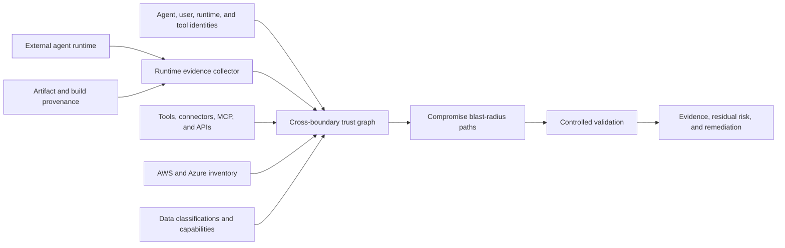

<a id="external-agent-trust-and-runtime-posture-design"></a>
# Confiança e postura runtime de agentes externos

<a id="goal"></a>
## Objetivo

Avaliar risco efetivo do tenant de IA hospedada fora da nuvem cliente, por outra equipe ou terceiro.

Assume runtime comprometido: postura verificável, identidade/delegação, cadeia de ferramentas, alcance de dados, simulação controlada.

<a id="problem"></a>
## Problema

IAM diz quem pode pedir operação, não comprova segurança da máquina, contêiner, framework, servidor, memória ou host.

Autenticação correta pode coexistir com:

- software vulnerável/sem patch
- administração exposta
- credenciais duradouras roubadas
- artefatos sem assinatura/rastreio
- plugins, conectores, MCP ou conteúdo maliciosos
- isolamento fraco
- rede ampla
- identidades runtime compartilhadas
- logs/revogação insuficientes

Atacante pode herdar permissões próprias, delegação, identidade tool e credenciais posteriores.

<a id="architecture"></a>
## Arquitetura



Separar:

1. **Runtime:** O que se verifica sobre local/execução?
2. **Identidade:** Quais identidades/delegações?
3. **Ferramentas:** Quais tools, conectores, MCP, gateways e credenciais?
4. **Alcance:** Serviços, dados, operações privilegiadas?
5. **Contenção:** Limite de danos após compromisso?
6. **Detecção/recuperação:** Atribuir, revogar, rotacionar, investigar rápido?

<a id="runtime-evidence-model"></a>
## Evidência runtime

Cada alegação registra:

- nome
- valor observado
- fonte
- timestamp
- atualidade/expiração
- método
- emissor
- classificação confiança
- hash/ID recurso
- suposições não suportadas/verificáveis

Classificações:

| Classe | Significado |
|---|---|
| `cryptographically-verified` | Assinatura, proveniência, identidade ou atestação hardware verificada |
| `provider-observed` | API autenticada cloud/identidade/runtime/segurança |
| `operator-attested` | Administrador sem verificação independente |
| `inferred` | Derivada de outras evidências |
| `unknown` | Evidência exigida indisponível |

Desconhecido aumenta incerteza residual, nunca conformidade silenciosa.

<a id="runtime-posture-dimensions"></a>
## Dimensões

<a id="workload-identity"></a>
### Identidade workload

- Distinta por agente/deploy.
- Federação curta.
- Restrições audience/emissor.
- Vincular identidade/atributos.
- Sem credencial reutilizável em imagem, memória, config, logs.

SPIFFE/SPIRE vincula seletores de instância cloud, namespace/service account Kubernetes, processo/container. Suportar também federação nativa.

<a id="artifact-integrity"></a>
### Integridade artefato

- Container/artefato assinado.
- Digest imutável, não tag mutável.
- Fonte/build proveniência.
- Builder/repo aprovado.
- Inventário/vulnerabilidades.
- Deploy corresponde ao aprovado.

SLSA descreve onde/quando/como build, fortalece supply chain, não prova host/aplicação seguros sozinho.

<a id="runtime-and-host-integrity"></a>
### Host/runtime

- OS/runtime suportado e atualizado.
- Container/VM/computação confidencial endurecidos.
- Atestação hardware disponível.
- Admin restrito.
- Isolamento outros tenants/workloads.
- Telemetria de segurança.

Azure Confidential VM guest attestation, AWS NitroTPM/Nitro Enclaves dão evidência hardware onde suportados. Ausência de computação confidencial não falha automática, reduz força.

<a id="network-posture"></a>
### Rede

- Sem gestão pública desnecessária.
- Entrada/saída explícita.
- API tenant via gateway.
- DNS/proxy/certificados.
- Egress só modelos/tools/serviços aprovados.
- Bloquear exfiltração por tools arbitrários.

<a id="agent-execution-posture"></a>
### Execução agente

- Modelo/instruções/versão aprovados.
- Allowlist e autorização por parâmetro.
- Código sandbox.
- Proveniência/retenção memória.
- Fronteiras retrieval.
- Defesas prompt injection/rótulo não confiável.
- Aprovação humana alto impacto.
- Autorização por ação, não sessão ampla.

<a id="logging-and-recovery"></a>
### Logs/recuperação

- IDs ligam usuário, agente, runtime, tool, cloud.
- Audit imutável.
- Anomalias de tools/permissões.
- Desabilitar emergência.
- Revogar tokens/credenciais.
- Reduzir papéis/quarentena.
- Dono de incidente/recuperação testada.

<a id="authorization-gateway"></a>
## Gateway

Não dar credenciais amplas diretamente ao externo:

```text
external agent
-> tenant-controlled authorization gateway
-> agent identity verification
-> runtime posture and evidence freshness check
-> user/delegation validation
-> task and tool policy
-> optional approval
-> narrowly scoped short-lived credential
-> cloud operation
```

Permissão efetiva limitada por:

```text
agent permission
intersection delegated-user permission
intersection approved task
intersection tool policy
intersection environment policy
intersection runtime trust policy
```

Negar/reduzir quando evidência faltar, expirar, inválida ou abaixo da política.

<a id="trust-and-risk-output"></a>
## Confiança/risco

Não só score opaco. Mostrar:

- força por dimensão
- raio de compromisso
- sensibilidade alcançável
- destruição/mudança de privilégios
- contenção
- detecção/revogação
- atualidade
- incerteza restante

Nota resumo pode ajudar, mas dimensões/caminhos visíveis.

Exemplo:

```text
Runtime evidence: weak
Identity scope: high
Delegated authority: privileged
Tool-chain exposure: medium
Reachable data: production customer records
Destructive capability: resource deletion
Revocation readiness: partial
Overall decision: deny production write access
```

<a id="controlled-validation"></a>
## Validação controlada

Testar « runtime externo comprometido » sem comprometer o real.

Usa:

- identidade sintética equivalente e limitada
- usuários delegados sintéticos por classe
- fixtures controlados de injection/confusão
- segredos/marcadores sintéticos
- conta AWS, assinatura Azure, cluster/twin descartável
- tools permitidos/saídas limitadas

Gravar identidade, delegação, ferramenta, digest, postura, alvo, classe.

<a id="product-surface"></a>
## Produto

Comandos possíveis:

```text
nullstate agent register
nullstate agent posture collect
nullstate agent posture verify
nullstate agent graph
nullstate agent blast-radius
nullstate agent validate --assume-compromised
nullstate agent monitor
```

CLI suporta coleta local, schemas, grafos, integração cliente. Team/Enterprise agrega ingestão contínua, histórico hospedado, políticas, validação gerenciada, alertas, aprovações, suporte, painéis interagentes.

<a id="failure-handling"></a>
## Falhas

- Ausência é desconhecida, não aprovada.
- Antiga falha políticas de atualidade.
- Binding inválido bloqueia alto impacto.
- Host não suportado usa operador com menor confiança.
- Cleanup/revogação falha torna run malsucedido mesmo com ataque concluído.
- Hardware não prova correção app, segurança prompt, ausência de vulnerabilidade.

<a id="initial-scope"></a>
## Escopo inicial

Primeiro pequeno:

1. Schema do manifesto.
2. Nós agente, runtime, usuário, tool, credencial, alvo, dados.
3. Postura operador e digests/config verificáveis.
4. Relatório determinístico de raio.
5. Coletores AWS/Azure incrementais.
6. Hardware/contínuo após contratos estáveis.

<a id="testing-strategy"></a>
## Testes

- Rejeitar malformado/sem assinatura quando exigida.
- Falta/obsoleto desconhecido/falho conforme política.
- Sem herdar fora da interseção.
- Detectar delegação que expande alcance.
- Tool privilegiado por trás de agente fraco.
- Separar dado sensível de recurso básico.
- Simulações só sintéticas/permitidas.
- Fonte, confiança, timestamp, atualidade.

<a id="primary-references"></a>
## Referências primárias

- [Microsoft Entra Agent ID](https://learn.microsoft.com/en-us/entra/agent-id/)
- [Azure workload identity federation](https://learn.microsoft.com/en-us/entra/workload-id/workload-identity-federation)
- [Azure Conditional Access for workload identities](https://learn.microsoft.com/en-us/entra/identity/conditional-access/workload-identity)
- [Azure Confidential VM guest attestation](https://learn.microsoft.com/en-us/azure/confidential-computing/guest-attestation-confidential-vms)
- [AWS AgentCore Identity](https://docs.aws.amazon.com/bedrock-agentcore/latest/devguide/identity-overview.html)
- [AWS IAM Roles Anywhere](https://docs.aws.amazon.com/rolesanywhere/latest/userguide/introduction.html)
- [AWS NitroTPM attestation](https://docs.aws.amazon.com/AWSEC2/latest/UserGuide/attestation-get-doc.html)
- [AWS Nitro Enclaves attestation](https://docs.aws.amazon.com/enclaves/latest/user/set-up-attestation.html)
- [SLSA build provenance](https://slsa.dev/spec/v1.2/build-provenance)
- [SPIFFE and SPIRE workload identity](https://spiffe.io/docs/latest/spiffe-about/overview/)
