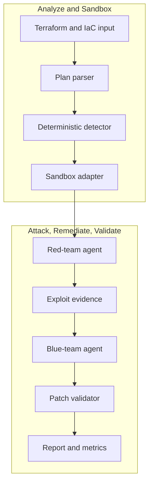

# nullstate

<!-- i18n-switcher:start -->
[English](../../../README.md) | [Español](../es/README.md) | [简体中文](README.md) | [Français](../fr/README.md) | [日本語](../ja/README.md) | [Deutsch](../de/README.md) | [Português (Brasil)](../pt-BR/README.md)
<!-- i18n-switcher:end -->

为基础设施即代码与已部署环境提供有证据支持的云攻击路径验证。


`nullstate` 将云与基础设施安全审查转化为可重复的发现、攻击、修补和验证循环。它结合确定性 IaC 分析，以及通过 OpenAI 兼容端点（例如运行在 AMD MI300X 上的 vLLM）进行的模型辅助红队、蓝队推理。

V1 演示在本地沙箱中证明云存储公开暴露，应用 Terraform 修复，重新验证，并生成供安全、云和 DevSecOps 团队审阅的证据产物。产品方向是将 IaC 与 AWS、Azure 只读清单、身份关系、网络路径、运行时发现和数据分类关联，扩展该循环。当前公开版本为 alpha，面向本地评估、演示和贡献。

<a id="what-it-does"></a>
## 功能流程

1. 读取 Terraform/IaC 输入。
2. 检测受支持的可利用错误配置。
3. 推断场景并路由到沙箱后端。
4. 请红队模型分析攻击路径。
5. 对本地目标执行受限的生成攻击脚本。
6. 请蓝队模型解释修复措施。
7. 应用确定性 Terraform 补丁。
8. 验证攻击路径已被阻断。
9. 生成可用于案例研究的证据与指标。

黑客松 V1 包含已通过实际运行验证的 LocalStack AWS S3 路径、由清单约束的 Azure Blob 探测路径（仍需 LocalStack Azure 实际运行授权才能验证），以及 Kubernetes、Docker Compose、本地部署基线和通用计划审查的离线确定性演示。

<a id="why-this-exists"></a>
## 项目缘由

静态 IaC 扫描器和云安全态势工具可以发现风险配置，但不一定能回答决定实际风险的操作性问题：

- 外部攻击者、受入侵工作负载、开发者、CI 身份、AI 代理或权限过大的云角色能否使用该路径？
- 哪些数据、元数据、凭据、服务或权限会变得可访问？
- 看似无害的入口是否暴露文件名、租户详情、内部拓扑、日志、备份、源代码产物，或帮助后续攻击的其他信息？
- 能否在不危及生产数据和工作负载的情况下复现路径？
- 建议的修复能否真正阻断同一攻击？

`nullstate` 的目标是关联声明的基础设施与观察到的云状态，跨网络、身份、服务和数据关系构建攻击路径，在受控环境中验证相关路径，并在修复后重放。

<a id="why-not-attack-production-directly"></a>
### 为何不直接攻击生产环境？

只读发现与严格限定的验证可以针对生产环境进行，但自主漏洞利用不应成为默认方式：

- 漏洞利用可能修改、删除、损坏或暴露真实客户数据。
- 网络和认证探测可能触发中断、限流、隔离或自动事件响应。
- IAM 和提权测试可能创建在测试结束后仍存在的持久访问。
- 数据外传测试可能违反隐私、合同、监管或数据驻留要求。
- 生产依赖可能影响批准测试范围外的客户和第三方。
- 清理不总能恢复到完全相同的原始状态。

因此 Nullstate 将观察与利用分离。它可以通过只读访问发现和建模生产环境，在获批处进行明确列入允许清单的非破坏性检查，并在一次性 AWS、Azure、模拟器、Kubernetes、容器或 VM 环境中用合成数据重建相关攻击路径。目标不是克隆整个订阅或账户，而是复现证明或否定攻击假设所需的最小安全相关图。

<a id="what-makes-it-different"></a>
### 有何不同？

预期价值不是再生成一份云错误配置列表。Nullstate 应提供将以下环节连接起来的证据：

```text
attacker identity
-> reachable entry point
-> identity or privilege transition
-> accessible service
-> exposed data or capability
-> remediation
-> blocked replay
```

攻击分析考虑身份。一次运行可以评估匿名互联网用户、认证租户用户、开发者、CI 工作负载、受入侵计算身份、托管身份、IAM 角色、AI 代理身份或其他明确授权主体。对于 AI 代理，Nullstate 应区分代理自身身份、工具/运行时身份和人类用户委托的权限。报告应说明测试的身份和委托模式，并区分配置暴露与观察到的敏感数据访问。

外部托管代理引入额外信任边界。有效云身份并不能证明使用它的机器、容器、代理框架、记忆存储、连接器或托管商安全。因此产品方向包括运行时态势验证：短期工作负载身份、产物签名与来源、不可变部署摘要、可用时的主机/运行时证明、网络限制、工具授权、可审计性、证据新鲜度和撤销准备。缺失证据仍标为未知，不视为安全。

参见[产品与验证模型](docs/product-validation-model.md)。

<a id="demo-result"></a>
## 演示结果

最终 AMD MI300X/vLLM 演示的红队和蓝队均使用 `nullstate-gemma4-26b-a4b`：

| 场景 | 目标 | 发现 | 结果 |
|---|---|---|---|
| `aws-public-s3` | LocalStack AWS | S3 公共访问阻止已关闭 | 实际运行探测观察到修复前可访问、修复后访问被阻断 |
| `azure-public-blob` | LocalStack Azure/离线路径 | Blob 容器匿名访问 | 已生成清单约束探测；LocalStack Azure 实际运行验证等待模拟器授权 |

代表性模型指标：

| 运行 | 角色 | 生成 token 数 | 延迟 | 输出速度 |
|---|---|---:|---:|---:|
| AWS S3 | 红队 | 942 | 9.018s | 104.452 tok/s |
| AWS S3 | 蓝队 | 640 | 3.977s | 160.937 tok/s |
| Azure Blob | 红队 | 709 | 4.112s | 172.424 tok/s |
| Azure Blob | 蓝队 | 794 | 4.548s | 174.586 tok/s |

<a id="architecture"></a>
## 架构



参见[架构](docs/architecture.md)和[技术详解](docs/technical-walkthrough.md)。

<a id="security-model"></a>
## 安全模型

V1 默认不针对真实云环境。沙箱需明确指定，运行产物保存在本地，修复发生在复制的运行工作区中，不修改原始 Terraform 目录。

红队工具执行器仅执行运行目录内生成的 `attack.py`。它在 `events.jsonl` 中记录命令、stdout、stderr、返回码、目标 URL、阶段、开始时间、结束时间和持续时间。

参见[安全模型](docs/security-model.md)和[威胁模型](docs/threat-model.md)。

<a id="installation"></a>
## 安装

当前源码安装方式：

```powershell
git clone https://github.com/Ker102/nullstate-cli.git
cd nullstate-cli
python -m pip install -e .
```

这会安装包依赖以及 `pyproject.toml` 声明的 `nullstate` 控制台命令。

若安装后无法识别 `nullstate`，说明 Python Scripts 目录不在 `PATH` 中。仍可通过 Python 运行同一 CLI：

```powershell
python -m nullstate doctor --offline
```

查看 Python 安装控制台脚本的位置：

```powershell
python -c "import sysconfig; print(sysconfig.get_path('scripts'))"
```

直接从 GitHub 安装当前预发布版：

```powershell
python -m pip install "git+https://github.com/Ker102/nullstate-cli.git@v0.1.0-alpha.2"
```

贡献开发时还需安装开发工具：

```powershell
python -m pip install -e ".[dev]"
python -m ruff check src tests
python -m mypy src
python -m unittest discover -s tests -v
```

<a id="quickstart"></a>
## 快速入门

```powershell
nullstate
nullstate doctor --offline
nullstate status
nullstate init-demo azure-public-blob --output examples/azure-public-blob
nullstate run examples/azure-public-blob --offline
nullstate report
nullstate scrub
```

无需 Docker、Terraform、LocalStack 或模型访问，即可检查已脱敏的示例运行：

```powershell
nullstate report --runs-dir examples/sample-runs
nullstate summary --runs-dir examples/sample-runs --json
```

仓库中的示例还包含 `run-bundle.json` 和 `dashboard.html`，可在不生成新产物的情况下审查可移植包契约和本地仪表板输出。

运行另一个离线场景：

```powershell
nullstate run examples/aws-public-s3 --offline
nullstate run examples/k8s-privileged-pod --offline
nullstate run examples/aws-public-s3 --offline --mock-agents --ci --fail-on-severity high
nullstate baseline --output nullstate-baseline.json
nullstate run examples/aws-public-s3 --offline --mock-agents --ci --baseline-file nullstate-baseline.json
nullstate policy-result --baseline-file nullstate-baseline.json
```

沙箱发现：

```powershell
nullstate sandbox list
nullstate sandbox status localstack-azure
nullstate sandbox up localstack-azure --dry-run
nullstate scenarios list
nullstate scenarios status aws-public-s3
nullstate policy init --output nullstate-policy.json
nullstate policy init --scenario aws-public-s3 --output aws-policy.json
```

`status`、`init-demo`、`sandbox` 和 `run` 会打印简短的 `Next` 表，列出最可能的后续命令。`run` 默认使用 `--scenario auto` 和 `--target auto`；CLI 从 IaC 结构推断场景并选择匹配后端。仅在记录特定演示路径或测试适配器时传入 `--scenario` 或 `--target`。

运行时攻击探测默认仅限本地。未来非本地 HTTP(S) 探测目标需要 `--allow-live-cloud`，批准记录到 `events.jsonl`；策略含 `allowed_target_hosts` 时，目标主机名还必须符合允许清单。当前内置场景仍解析到本地/离线沙箱目标。

初始化 GitHub Actions：

```powershell
nullstate init-ci github --scenario aws-public-s3 --iac-path examples/aws-public-s3
```

这会写入 `.github/workflows/nullstate.yml` 和 `nullstate-policy.json`，让仓库将 Nullstate 用作 pull request 门禁，无需手动复制 workflow 模板。

外部 AI 代理信任预览：

```powershell
nullstate agent posture verify examples/agent-trust/external-agent-manifest.json
nullstate agent blast-radius examples/agent-trust/external-agent-manifest.json
```

这些命令验证本地外部代理清单，并汇总运行时态势证据、证据新鲜度、身份类型、用户委托权限、敏感资源、高风险操作和可能的攻击路径类别。这是外部代理信任模型的确定性预览功能，尚不收集提供商清单，也不证明实时第三方运行时。

打开最新报告：

```powershell
nullstate report
```

若运行保存在命名文件夹内，将报告查找指向父目录：

```powershell
nullstate report --runs-dir runs/live-aws-model
nullstate report 20260509-200601 --runs-dir runs
```

创建可移植运行包或免费的本地 HTML 仪表板：

```powershell
nullstate summary --json
nullstate bundle
nullstate dashboard --open
nullstate sarif
nullstate upload --dry-run
```

`summary --json` 输出紧凑的机器可读对象，供编程代理、GitHub Actions 步骤和 PR 评论自动化使用。仪表板汇总所选运行的发现、修复规则、包模式元数据、产物清单、证据时间线与报告摘录。

运行摘要和包包含场景证据级别，使自动化能区分实际运行验证、离线确定性、脚手架或仅计划证据。

只读云上下文预览：

```powershell
nullstate context validate examples/cloud-context/aws-readonly-context.json
nullstate context summary examples/cloud-context/aws-readonly-context.json --json
```

上下文命令验证并汇总本地云清单。它是未来 AWS/Azure/GCP 只读收集器的安全契约；尚不调用云 API 或请求凭据。

评估指标：

```powershell
nullstate eval run examples/eval/iac-security-regression.json --output-dir eval-runs/iac-security-regression
```

评估框架运行可重复基准案例，写入 `eval-results.json` 和 `eval-report.md`。可用于案例研究证据，包括时长、发现数、最高严重度、攻击前后状态、token 总数、产物数、通过/失败预期检查和基线比较。示例将 Nullstate 与透明的通用纯 IaC 审查基线比较，展示是否增加攻击重放证据、修复后验证、token 指标和结构化产物覆盖。尚未对 Checkov、tfsec 或 Terrascan 等外部扫描器进行基准测试。

<a id="live-localstack-demo-path"></a>
## LocalStack 实际运行演示路径

配置 Docker、Terraform、LocalStack 访问和模型端点变量后使用。

AWS：

```powershell
nullstate sandbox up localstack-aws
nullstate sandbox status localstack-aws
nullstate run examples/aws-public-s3 --target localstack-aws
nullstate report
```

Azure：

```powershell
nullstate sandbox up localstack-azure
nullstate sandbox status localstack-azure
nullstate run examples/azure-public-blob --target localstack-azure
nullstate report
```

演示 Terraform provider 包含：

```hcl
metadata_host = "localhost.localstack.cloud:4566"
```

这让 Terraform 指向 LocalStack Azure 模拟器，而不是真实 Azure。

将 `LOCALSTACK_AUTH_TOKEN` 保存在 shell、`.env.local` 或 `.env`。`nullstate sandbox up` 先自动发现 `.env.local`，再发现 `.env`；仍可用 `--env-file` 指定自定义路径。

若 Docker 报告 `127.0.0.1:4566` 已被占用，可能是遗留 LocalStack 容器占据共享 edge 端口。运行：

```powershell
nullstate sandbox down localstack-aws
nullstate sandbox down localstack-azure
docker ps -a --filter name=localstack
```

Docker Compose 替代方式：

```powershell
$env:LOCALSTACK_AUTH_TOKEN = "<token>"
docker compose -f docker-compose.localstack-azure.yml up
```

或在 Compose 文件旁创建本地 `.env`：

```env
LOCALSTACK_AUTH_TOKEN=your-token-here
```

Git 忽略 `.env` 和 `.env.local`。不要提交 token。

<a id="model-endpoint"></a>
## 模型端点

`nullstate` 与 OpenAI 兼容模型服务器通信。自托管 vLLM、SGLang 或私有代理时，使用 custom 提供商和一个服务两个角色的端点：

```powershell
$env:NULLSTATE_LLM_PROVIDER = "custom"
$env:NULLSTATE_LLM_BASE_URL = "http://<mi300x-host>:8000"
$env:NULLSTATE_LLM_API_KEY = "<optional-token>"
nullstate run examples/azure-public-blob --blue-model gemma-4-31b-it --red-model qwen3-coder-next
```

Google AI Studio / Gemini 用户只需提供商预设和 API key；`nullstate` 提供 OpenAI 兼容 Gemini base URL：

```powershell
$env:NULLSTATE_LLM_PROVIDER = "google"
$env:NULLSTATE_LLM_API_KEY = "<google-ai-studio-key>"
nullstate run examples/azure-public-blob --blue-model gemini-3.5-flash --red-model gemini-3.5-flash
```

通过 Anthropic 的 OpenAI SDK 兼容层使用 Claude 时，选用 Claude 预设。该兼容路径是实验性的；若需要 Claude 专属功能，未来生产路径仍宜采用原生 Claude 适配器：

```powershell
$env:NULLSTATE_LLM_PROVIDER = "claude"
$env:NULLSTATE_LLM_API_KEY = "<anthropic-api-key>"
nullstate run examples/azure-public-blob --blue-model claude-sonnet-4-6 --red-model claude-sonnet-4-6
```

使用两个 vLLM/SGLang 容器或两个 SSH 隧道时，设置各角色端点：

```powershell
$env:NULLSTATE_LLM_PROVIDER = "custom"
$env:NULLSTATE_RED_LLM_BASE_URL = "http://127.0.0.1:8001"
$env:NULLSTATE_BLUE_LLM_BASE_URL = "http://127.0.0.1:8002"
$env:NULLSTATE_RED_LLM_API_KEY = "<optional-red-token>"
$env:NULLSTATE_BLUE_LLM_API_KEY = "<optional-blue-token>"
nullstate run examples/azure-public-blob --red-model nullstate-red --blue-model nullstate-blue
```

CLI 还接受 `--llm-provider`、`--red-provider`、`--blue-provider`、`--red-base-url` 和 `--blue-base-url` 供单次运行使用。当前预设包括 `google`、`claude`、`custom` 和 `openai-compatible`。未设置角色配置时回退到 `NULLSTATE_LLM_PROVIDER`、`NULLSTATE_LLM_BASE_URL` 和 `NULLSTATE_LLM_API_KEY`。明确指定的 base URL 始终优先，因此仍支持自定义网关、自托管模型和提供商代理。

用户无需编写提示词。`nullstate` 发送内部红队、蓝队代理指令和场景证据。某角色缺少端点时，该角色回退到确定性模拟响应，因此本地和 LocalStack 演示可无模型运行。`--offline` 跳过 Terraform/云运行时调用并使用静态 IaC 解析。若已配置共享或角色端点，`--offline` 仍使用该模型端点；仅在需要确定性无模型响应时加上 `--mock-agents`。

<a id="sandbox-backends"></a>
## 沙箱后端

| 后端 | 模式 | IaC 目标 | 状态 |
|---|---|---|---|
| `localstack-azure` | 可执行 | Terraform AzureRM | 实际运行演示目标 |
| `localstack-aws` | 可执行 | Terraform AWS | 实际运行演示目标 |
| `kind-kubernetes` | 可执行 | Kubernetes YAML、Helm、Kustomize | 适配器脚手架 |
| `docker-compose` | 数字孪生 | Docker Compose 与应用栈 | 适配器脚手架 |
| `microvm-onprem` | 数字孪生 | Ansible、Linux 加固、libvirt/Proxmox 风格 Terraform | 已有设计的备用路径 |
| `plan-only` | 仅计划 | 任意导出计划/解析器 | 可用 |

<a id="scenarios"></a>
## 场景

`nullstate scenarios list` 打印明确的证据级别，便于运行前区分实际运行已证明、确定性实现和脚手架。

| 场景 | 后端 | 证据级别 | 状态 |
|---|---|---|---|
| `aws-public-s3` | `localstack-aws` | `live-validated` | LocalStack AWS S3 部署和受限匿名对象读取探测已在修复前后验证 |
| `azure-public-blob` | `localstack-azure` | `offline-deterministic` | 已实现静态 IaC 检测、修复、清单约束探测生成和离线报告证据；Azure 模拟器实际运行证明仍待完成 |
| `k8s-privileged-pod` | `kind-kubernetes` | `scaffolded` | 离线确定性检测和修复流程可用；实际 kind 集群探测仍待完成 |
| `compose-exposed-admin` | `docker-compose` | `scaffolded` | 离线确定性检测和修复流程可用；实际容器/网络探测仍待完成 |
| `onprem-ssh-password` | `microvm-onprem` | `scaffolded` | 离线确定性检测和修复流程可用；microVM 数字孪生执行仍待完成 |
| `generic-plan-review` | `plan-only` | `plan-only` | 静态计划/配置审查可用；不尝试可执行沙箱或运行时漏洞利用探测 |

<a id="artifacts"></a>
## 产物

每次运行写入：

- `runs/<run-id>/events.jsonl`
- `runs/<run-id>/findings.json`
- `runs/<run-id>/metrics.json`
- 使用 `nullstate run --ci` 时的 `runs/<run-id>/ci-summary.json`
- 使用 `nullstate policy-result` 时的 `runs/<run-id>/policy-result.json`
- `/metrics` 可访问时的 `runs/<run-id>/vllm-metrics-before.prom`
- `/metrics` 可访问时的 `runs/<run-id>/vllm-metrics-after.prom`
- 红队/蓝队端点不同时的 `runs/<run-id>/vllm-metrics-red-before.prom` 及各角色变体
- `runs/<run-id>/attack.py`
- `runs/<run-id>/attack-manifest.json`
- `runs/<run-id>/remediation.json`
- 运行 `nullstate bundle` 或 `nullstate dashboard` 时的 `runs/<run-id>/run-bundle.json`
- 运行 `nullstate dashboard` 时的 `runs/<run-id>/dashboard.html`
- 运行 `nullstate sarif` 时的 `runs/<run-id>/nullstate.sarif`
- 运行 `nullstate evidence-manifest` 时的 `runs/<run-id>/evidence-manifest.json`
- 运行 `nullstate evidence-verify` 时的 `runs/<run-id>/evidence-verification.json`
- 运行 `nullstate upload --dry-run` 时的 `runs/<run-id>/upload-plan.json`
- `runs/<run-id>/remediation.patch`
- `runs/<run-id>/report.md`
- 使用 `nullstate scrub` 时的 `scrubbed-runs/<run-id>/scrub-report.json`

分享证据前创建脱敏副本：

```powershell
nullstate scrub
nullstate scrub 20260608-224625 --runs-dir runs --output-dir scrubbed-runs
```

`attack-manifest.json` 含指向 `docs/schemas/attack-manifest.schema.json` 的 `$schema`，CLI 在受限探测执行前验证生成清单。`events.jsonl` 含修复前后允许攻击命令的 `red-tool` 条目。`remediation.json` 记录确定性修复规则集版本、场景、修改文件和所应用规则 ID。生成修复元数据含指向 `docs/schemas/remediation-metadata.schema.json` 的 `$schema`，CLI 在报告、包和运行产物使用它之前进行验证。

`ci-summary.json` 含指向 `docs/schemas/ci-summary.schema.json` 的 `$schema`；`nullstate run --ci` 写入前验证 CI 决策产物。

`run-bundle.json` 含指向 `docs/schemas/run-bundle.schema.json` 的 `$schema`，CLI 写入时验证包结构。该模式是仪表板、CI 上传、支持包和未来云接收的本地契约。

导出发现供 CI 或代码扫描上传：

```powershell
nullstate run examples/aws-public-s3 --offline --mock-agents --ci --fail-on-severity none
nullstate sarif
nullstate sarif 20260608-224625 --runs-dir runs --output artifacts/nullstate.sarif
```

CI 作业需因相应发现失败时，使用 `--fail-on-severity high` 或 `--fail-on-severity critical`。

创建并使用红队工具策略文件：

```powershell
nullstate policy init --output nullstate-policy.json
nullstate policy init --scenario aws-public-s3 --output aws-policy.json
nullstate policy validate nullstate-policy.json --output policy-validation.json
nullstate run examples/aws-public-s3 --offline --mock-agents --policy-file nullstate-policy.json
```

生成策略含指向 `docs/schemas/nullstate-policy.schema.json` 的 `$schema`，写入前验证。它列出允许的场景名、后端名、阶段、生成 `attack.py` 的参数、`offline`、`local`、`local-http` 和未来 `external-http` 等目标分类、`localhost.localstack.cloud` 或 `*.blob.core.windows.net` 等目标主机名、`generated-attack-script-v1` 等命令策略 ID，以及超时/输出捕获上限。`policy init --scenario` 为一个已知场景/后端组合创建更窄预设，并保留执行器约束。`nullstate policy validate` 不运行场景；文件格式错误或无效时以代码 `2` 退出。

将运行附到工单、案例研究或支持流程前，创建证据完整性清单：

```powershell
nullstate evidence-manifest
nullstate evidence-verify
nullstate evidence-manifest 20260608-224625 --runs-dir runs --output artifacts/evidence-manifest.json
nullstate evidence-verify 20260608-224625 --runs-dir runs --manifest artifacts/evidence-manifest.json
$env:NULLSTATE_EVIDENCE_SIGNING_KEY = "<secret>"
nullstate evidence-manifest --signing-key-env NULLSTATE_EVIDENCE_SIGNING_KEY
nullstate evidence-verify --signing-key-env NULLSTATE_EVIDENCE_SIGNING_KEY
```

清单含指向 `docs/schemas/evidence-manifest.schema.json` 的 `$schema`，写入前验证。它用 SHA-256 哈希列出可分享产物，排除复制工作区与 Terraform 内部文件，可选附加共享密钥 HMAC-SHA256 证据签名。`nullstate evidence-verify` 重算哈希，提供 `--signing-key-env` 时检查签名清单，写入 `evidence-verification.json`；记录产物缺失、改变、来自其他运行或签名无效时以代码 `2` 退出。签名密钥从环境变量读取，绝不写入清单。

从已知运行创建基线，让 CI 忽略已知发现并因新发现失败：

```powershell
nullstate baseline --output nullstate-baseline.json
nullstate run examples/aws-public-s3 --offline --mock-agents --ci --baseline-file nullstate-baseline.json
nullstate policy-result --baseline-file nullstate-baseline.json
```

`policy-result.json` 不重新扫描即可评估现有运行。它为下游自动化提供与 CI 相同的阈值和基线决策，形式是独立 JSON 产物。

在不发送数据的情况下准备未来云接收上传计划：

```powershell
nullstate upload --dry-run
nullstate upload 20260608-224625 --runs-dir runs --endpoint https://api.nullstate.dev/v1/runs --dry-run
```

`upload-plan.json` 含指向 `docs/schemas/upload-plan.schema.json` 的 `$schema`，写入前验证。它记录目标端点、包校验和、产物数、token 是否存在与脱敏预检状态，绝不保存 token 值。dry-run 允许原始运行，但标记 `upload_recommended: false`；分享或未来云接收前先运行 `nullstate scrub`，从 `scrubbed-runs/` 上传。

<a id="documentation"></a>
## 文档

- [案例研究](docs/case-study.md)
- [最初 10 分钟](docs/quickstart-10-minutes.md)
- [技术详解](docs/technical-walkthrough.md)
- [架构](docs/architecture.md)
- [产品与验证模型](docs/product-validation-model.md)
- [外部代理信任与运行时态势设计](docs/plans/2026-06-22-external-agent-trust-design.md)
- [外部代理清单模式](../../schemas/external-agent-manifest.schema.json)
- [云上下文模式](../../schemas/cloud-context.schema.json)
- [评估套件模式](../../schemas/eval-suite.schema.json)
- [运行摘要模式](../../schemas/run-summary.schema.json)
- [安全模型](docs/security-model.md)
- [威胁模型](docs/threat-model.md)
- [依赖审计](docs/dependency-audit.md)
- [CI/CD](docs/ci-cd.md)
- [运维手册](docs/runbook.md)
- [模型服务运维手册](docs/model-serving.md)
- [企业路线图](docs/enterprise-roadmap.md)
- [企业就绪性](docs/enterprise-readiness.md)
- [开源就绪里程碑](docs/open-source-readiness.md)
- [产品化进度](../../progress.md)
- [真实沙箱红队命令计划](../../plans/2026-06-01-real-sandbox-red-team-commands.md)
- [项目交接](../../handoff.md)
- [AMD 计算策略](docs/compute-strategy.md)
- [故障模式](docs/failure-modes.md)
- [成本报告](docs/cost-report.md)

<a id="release-model"></a>
## 发布模型

`Media` 预发布仅用于托管 README 资源。产品发布应使用版本标签：

| 标签 | 用途 |
|---|---|
| `v0.1.0-alpha.1` | 黑客松首个预发布，含离线演示和完善文档 |
| `v0.1.0-alpha.2` | 开源就绪预发布，含受限红队执行器、CI 产物、证据包、本地仪表板、策略脚手架、SBOM/来源 workflow 和发布文档 |
| `v0.1.0-beta.1` | LocalStack Azure 实际运行验证路径可用 |
| `v0.1.0` | 黑客松最终发布候选，含演示视频、案例研究和指标证据 |

GitHub 发布标题可与标签相同，也可使用 `nullstate v0.1.0-alpha.2` 等易读标题。

标签发布构建 wheel/sdist，在干净环境试装 wheel，用 `doctor --offline` 验证 `nullstate` 控制台命令，上传带 SHA-256 摘要的 `release-manifest.json`，从干净环境已安装的 wheel 生成并验证 `sbom.spdx.json`，用 SPDX Python 工具再次验证 SBOM，创建包来源和 SBOM 的 GitHub 产物证明，并在发布资源旁提供无密钥 Sigstore `.sigstore.json` 签名包。验证下载的 wheel：

```powershell
gh attestation verify dist/nullstate-*.whl -R Ker102/nullstate-cli
gh attestation verify dist/nullstate-*.whl -R Ker102/nullstate-cli --predicate-type https://spdx.dev/Document/v2.3
```

Sigstore 签名包作为相邻发布资源上传，例如 `nullstate-...whl.sigstore.json`。

打标签前手动运行 `Release` workflow，设置 `dry_run=true`，演练构建、SBOM 验证、证明、签名和签名包检查，不创建 GitHub 发布。

本地打标签前，验证构建 wheel 能安装并提供 `nullstate` 控制台命令：

```powershell
python scripts/release/install_smoke.py
```

发布预发布标签后，验证公开 GitHub 安装路径提供同一控制台命令：

```powershell
python scripts/release/install_smoke.py --tag v0.1.0-alpha.2
```

使用 Cosign，将 wheel 与相邻签名包和发布 workflow 身份匹配来验证签名：

```powershell
$wheel = Get-ChildItem dist\nullstate-*.whl | Select-Object -First 1
cosign verify-blob $wheel.FullName --bundle "$($wheel.FullName).sigstore.json" --certificate-identity "https://github.com/Ker102/nullstate-cli/.github/workflows/release.yml@refs/tags/v0.1.0" --certificate-oidc-issuer "https://token.actions.githubusercontent.com"
```

<a id="status"></a>
## 状态

现已可用：LocalStack AWS 存储实际运行验证、等待 LocalStack Azure 实际运行授权的清单约束 Azure Blob 探测生成、全部列出场景的离线确定性演示、受限红队命令执行、确定性修复、沙箱注册表、报告产物、模型指标产物、品牌化 CLI 输出及 DevSecOps 仓库结构。

实验性：更丰富的场景攻击脚本、实际运行 Kubernetes/Compose/本地部署适配器、更完整的已解析依赖 SBOM，以及更广的产物脱敏覆盖。
