<a id="nullstate-architecture"></a>
# nullstate 架构

<a id="goal"></a>
## 目标

提供可重复紫队流程，从基础设施即代码起步，逐渐关联观察到的 AWS 和 Azure 环境，而不默认执行真实云漏洞利用。

<a id="pipeline"></a>
## 流水线

```mermaid
flowchart LR
    A[Terraform / IaC directory] --> B[Plan JSON or static parser]
    B --> C[Deterministic exposure detector]
    C --> S[Sandbox adapter]
    S --> D[Red-team agent instructions]
    D --> E[Constrained attack.py runner]
    E --> F[Exploit evidence]
    F --> G[Blue-team agent instructions]
    G --> H[Deterministic remediation]
    H --> I[Validation attack]
    I --> J[Run report and metrics]
```



<a id="design-choices"></a>
## 设计选择

- 确定性检测器是演示可靠性的权威依据。
- IaC 描述预期配置；未来 AWS/Azure 只读发现提供已部署状态和漂移。
- 长期分析基础是涵盖资源、网络可达性、身份、权限、服务和数据影响的规范化环境图。
- 从匿名用户、开发者、CI 工作负载、受入侵计算身份、AWS 角色、Azure 托管身份等明确身份评估攻击路径。
- 一次性验证环境应重建最小相关路径，而非克隆整个账户或订阅。
- 红/蓝代理接收内部角色指令和场景证据，用户无需手动提示模型。
- `run` 默认 `--scenario auto` 和 `--target auto`；演示和测试仍可明确指定。
- 离线模式使用静态 Terraform 解析器，无 LocalStack、Terraform 或 GPU 仍可演示。
- 在线模式遵循 Terraform 自动化命令：`init`、`plan -out=tfplan` 和 `show -json tfplan`。
- 沙箱后端是明确适配器：可执行、数字孪生或仅计划。
- 红队执行器仅运行运行目录生成的 `attack.py`，将命令证据写入 `events.jsonl`。

生产发现、身份感知分析、暴露数据影响、保真级别和 CI 触发设计见[产品与验证模型](product-validation-model.md)。

<a id="sandbox-adapters"></a>
## 沙箱适配器

| 后端 | 模式 | 目标 |
|---|---|---|
| `localstack-azure` | 可执行 | Terraform AzureRM |
| `localstack-aws` | 可执行 | Terraform AWS |
| `kind-kubernetes` | 可执行 | Kubernetes YAML、Helm、Kustomize |
| `docker-compose` | 数字孪生 | Docker Compose 与应用栈 |
| `microvm-onprem` | 数字孪生 | 本地部署 Linux/VM/网络风格 IaC |
| `plan-only` | 仅计划 | 有解析器/导出计划的任意 IaC |

<a id="on-prem-sandboxing-model"></a>
## 本地部署沙箱模型

本地部署基础设施通常不能由单一通用云模拟器模拟。nullstate 选择最佳可用执行级别：

- 有一次性运行时时使用可执行沙箱
- 拓扑可映射到本地容器或 VM 时使用数字孪生
- 执行不安全或不支持时仅分析计划

<a id="current-rule"></a>
## 当前规则

`AZURE_STORAGE_PUBLIC_BLOB` 标记 `container_access_type` 为 `blob` 或 `container` 的 `azurerm_storage_container` 资源。

修复设置：

```hcl
container_access_type = "private"
allow_nested_items_to_be_public = false
```

<a id="scenario-roadmap"></a>
## 场景路线图

| 场景 | 目标 | 沙箱 | 执行状态 |
|---|---|---|---|
| `azure-public-blob` | Terraform AzureRM | LocalStack Azure 或未来 Azurite 备用 | 清单约束/离线演示可用；实际 LocalStack Azure 验证等待模拟器授权 |
| `aws-public-s3` | Terraform AWS | LocalStack AWS | 实际运行演示可用 |
| `k8s-privileged-pod` | Kubernetes YAML/Helm/Kustomize | kind | 离线演示可用；实际执行待完成 |
| `compose-exposed-admin` | Docker Compose | 隔离 Docker 网络 | 离线演示可用；实际探测待完成 |
| `onprem-ssh-password` | Ansible/cloud-init/libvirt/Proxmox 风格 IaC | VM/容器实验室数字孪生 | 离线演示可用；microVM 孪生待完成 |
| `generic-plan-review` | 不支持的 IaC 导出 | 无 | 仅计划可用 |
