<a id="nullstate-autonomous-purple-team-iac-sandbox-on-amd-mi300x"></a>
# nullstate：AMD MI300X 自主紫队 IaC 沙箱

<a id="1-executive-summary"></a>
## 1. 执行摘要

我在 AMD x lablab.ai 黑客松构建 `nullstate`，研究安全验证能否从静态发现变为重复红/蓝循环。CLI 读 Terraform、启本地沙箱、检测存储暴露、红队推理、受限生成攻击、蓝队解释、确定性补丁、复验并给评委证据。最终用 Terraform 自动化、LocalStack、Python Typer/Rich、兼容 vLLM、ROCm、AMD Instinct MI300X droplet。关键是确定性判定、模型辅助对抗推理/解释/报告。开源 alpha 已验证本地 AWS，Azure 清单路径等实际模拟器，且有稳定发布路线图。

<a id="2-problem"></a>
## 2. 问题

IaC 扫描常停在风险配置，工程师仍需回答：

- 当前可利用吗？
- 什么证据？
- 哪个精确补丁？
- 修复后失败了吗？
- 不触生产可展示吗？

`nullstate` 让项目产生可复现发现、推理、修复、验证和团队可审报告。

方向不假定 IaC 是全云：意图/管理状态加只读 AWS/Azure 现实、身份、网络、运行证据、漂移。关联图判断身份可达数据/能力，仅重建最低相关路径。

<a id="why-not-attack-production-directly"></a>
### 为什么不直接攻击生产？

- 真实客户数据修改、删除、损坏、暴露。
- 网络认证导致中断、限流、锁定、隔离、响应。
- IAM 创建长期凭据、信任、权限。
- 外传违反隐私、合同、监管、驻留。
- 依赖影响范围外第三方。
- 清理未必完全恢复。

预期只读发现、批准非破坏、合成利用、确定修复、同攻击重放。起点也包括开发者、CI、受入侵计算、AWS IAM、Azure 服务主体/托管身份。

AI 可用原生 ID、常规服务主体/IAM、独立运行时工具、用户委托。提示、记忆、连接器、MCP、插件、下游凭据入侵继承普通资源图难见权限。分开原生、委托、工具，并报告数据/特权路径。

外部宿主不受租户控制。有效 token 不证明补丁、隔离、批准物、可信工具、无被盗凭据。下设计添加态势和影响分析，区分密码验证、提供商观察、操作者断言、推断、未知，避免无可见性成假保证。

<a id="3-context-and-constraints"></a>
## 3. 背景约束

- 约 48 小时。
- 截止前有效证据，不是广但未完平台。
- 默认本地无真实 AWS/Azure 凭据。
- MI300X 自托管 vLLM/ROCm。
- AWS/Azure LocalStack，Azure 需 Emulator 授权。
- CLI 优先非完整网页。
- 不公开 vLLM、LocalStack、token、state、`.env`。
- 模型不是真实合否依据。

<a id="4-requirements"></a>
## 4. 要求

<a id="functional-requirements"></a>
### 功能

- Terraform 分析。
- 推断/接受场景。
- 启动检查沙箱。
- 高风险公共存储检测。
- 自托管红队推理。
- 修复前后受限脚本。
- `events.jsonl` 记录命令、stdout、stderr、返回、URL、阶段、开始/结束/时长。
- 自托管蓝队解释。
- 确定修复。
- 复验。
- 生成 `report.md`、`findings.json`、`events.jsonl`、`metrics.json`、`attack.py`、`remediation.patch`、`remediation.json`。
- 无 GPU/沙箱的离线模拟。

<a id="non-functional-requirements"></a>
### 非功能

- 默认无实云。
- V1 非任意 shell，仅运行内 `attack.py`。
- 演示压力下易懂命令。
- 可用于后续案例。
- 秘密/state 不入 Git。
- PR、依赖、CodeQL、保护。

<a id="5-architecture"></a>
## 5. 架构

```mermaid
flowchart LR
    A[Terraform IaC input] --> B[Terraform init / plan / show JSON]
    B --> C[Deterministic detector]
    C --> D[Sandbox adapter]
    D --> E[Red-team model reasoning]
    E --> F[Attack evidence]
    F --> G[Blue-team model remediation]
    G --> H[Deterministic Terraform patch]
    H --> I[Re-plan and apply]
    I --> J[Validation attack]
    J --> K[Report and metrics artifacts]
```



确定判断与模型解释分开：

- 实际运行 `terraform init -input=false`、`terraform plan -out=tfplan -input=false`、`terraform show -json tfplan`、`terraform apply -auto-approve -input=false tfplan`。
- 配置/计划 JSON 确定检测。
- 红队证据推理。
- 蓝队证据指导。
- 确定补丁。
- 检查残留和修复后攻击。

<a id="6-what-the-red-agent-actually-does-today"></a>
## 6. 红队实际行为

须准确。

模型无 shell，仅内部提示/场景发现，返回匿名 S3 或 Azure `curl` 推理。

`nullstate` 之后仅运行目录生成 `attack.py`，直接 Python，只 `--target-url`、`--stage`，`events.jsonl` 记命令、stdout、stderr、返回、URL、阶段、起止/时长。

比自由 shell 狭窄，提供真实本地证据和可审计边界。

<a id="7-security-model"></a>
## 7. 安全

| 风险 | 控制 | 证据 |
|---|---|---|
| 误攻击实云 | 默认 LocalStack/仅计划 | 适配器/命令 |
| 不安全模型 | 确定检测/版本规则权威 | `findings.json`、`remediation.patch`、`remediation.json` |
| 任意利用 | 仅 `attack.py` | `red-tool`、`src/nullstate/attack_runner.py` |
| 秘密漏 | 忽略 `.env`/state，截图脱敏 | 仓库/提交清单 |
| 模型公开 | vLLM SSH 非公共入站 | droplet/隧道 |
| 未审代码 | PR/保护/CI | GitHub |

<a id="8-deployment-and-devsecops-workflow"></a>
## 8. 部署/DevSecOps

用分支 PR，而非直接 main：

```text
feature branch
-> PR
-> unit tests, lint, type checks, dependency/security checks
-> review/merge
-> release tag / release notes
```

新增实践：

- Python 元数据/入口。
- 架构、手册、威胁、安全、CI、成本、故障。
- Actions 质量。
- CodeQL/依赖审查。
- Dependabot 式卫生。
- 证据清单不入 Git。
- 标签发布流程。

<a id="9-final-demo-results"></a>
## 9. 最终结果

<a id="open-source-readiness-status"></a>
## 开源就绪

`nullstate` 是 alpha，不是稳定生产。

已证明：

- AWS 实际验证，`attack.py` 前匿名读、记录、后确定阻断。
- 实命令仅生成目录 `attack.py`，模型无任意 shell。
- 测试覆盖离线、CI、SARIF、策略、脱敏、清单、包、仪表板。
- `nullstate agent posture verify`、`nullstate agent blast-radius` 本地预览，旧/未知可见，分身份、委托、敏感、高风险、路径。
- `nullstate summary --json` 输出状态、发现、前后、token、产物、限制；`nullstate context summary --json` 是未来收集器本地只读契约。
- `nullstate eval run examples/eval/iac-security-regression.json` 写 `eval-results.json`、`eval-report.md`：时长、发现、严重、前后、token、数、预期与透明 IaC 基准。显示重放、后验、指标、结构覆盖价值。

未证明：

- Azure 无实际验证，账户/workspace 缺授权。
- Kubernetes/Compose/本地部署/通用计划离线脚手架，除非另有说明。
- 外部信任无实收集、第三方证明、租户网关。
- 上下文是验证摘要非实 AWS/Azure/GCP。
- 仅自场景/确定 IaC；未运行 Checkov、tfsec、Terrascan、人工/通用代理基准。
- 稳定产物/初次指南仍需完善再称稳定。

里程碑在 `docs/open-source-readiness.md`。

<a id="aws-public-s3-scenario"></a>
### AWS 公共 S3

产物：

```text
runs/final-aws-gemma26b/20260510-170931
```

发现：

```text
HIGH AWS_S3_PUBLIC_ACCESS_BLOCK_DISABLED
Resource: aws_s3_bucket_public_access_block.public_logs
Evidence: block_public_acls, block_public_policy, ignore_public_acls, and restrict_public_buckets were disabled.
```

补丁：

```diff
-  block_public_acls       = false
-  block_public_policy     = false
-  ignore_public_acls      = false
-  restrict_public_buckets = false
+  block_public_acls       = true
+  block_public_policy     = true
+  ignore_public_acls      = true
+  restrict_public_buckets = true
```

实际结果：

```text
Red before: success
Red after: blocked
Verdict: Exploit blocked after remediation
```

`metrics.json` 模型指标：

| 角色 | 模型 | token | 延迟 | 速度 |
|---|---:|---:|---:|---:|
| 红队 | `nullstate-gemma4-26b-a4b` | 942 | 9.018s | 104.452 tok/s |
| 蓝队 | `nullstate-gemma4-26b-a4b` | 640 | 3.977s | 160.937 tok/s |

<a id="azure-public-blob-scenario"></a>
### Azure 公共 Blob

产物：

```text
runs/final-azure-gemma26b/20260510-174858
```

发现：

```text
HIGH AZURE_STORAGE_PUBLIC_BLOB
Resource: azurerm_storage_container.secrets
Evidence: container_access_type is "container"; storage account allows nested items to be public.
```

补丁：

```diff
-  allow_nested_items_to_be_public  = true
+  allow_nested_items_to_be_public  = false

-  container_access_type = "container"
+  container_access_type = "private"
```

当前验证：

```text
Deterministic finding: present before remediation
Deterministic remediation: patch generated and validated
Runtime probe: generated from attack-manifest.json
Live LocalStack Azure validation: blocked by LocalStack Azure Emulator entitlement
```

`metrics.json` 模型指标：

| 角色 | 模型 | token | 延迟 | 速度 |
|---|---:|---:|---:|---:|
| 红队 | `nullstate-gemma4-26b-a4b` | 709 | 4.112s | 172.424 tok/s |
| 蓝队 | `nullstate-gemma4-26b-a4b` | 794 | 4.548s | 174.586 tok/s |

<a id="10-evidence-artifacts"></a>
## 10. 证据

每次：

- `events.jsonl`：Terraform、分析、工具、红蓝、验证。
- `findings.json`：结构发现。
- `attack.py`：场景攻击。
- `remediation.patch`：确定差异。
- `remediation.json`：版本、文件、ID。
- `metrics.json`：token、延迟、吞吐、端点。
- `report.md`：可读案例。
- `run-bundle.json`：模式契约，画面/支持/CI/未来接收。
- `dashboard.html`：免费单运行本地。
- `workspace/`：复制可复现。

发布前截图：

- `nullstate` logo/后续。
- `nullstate run` AWS/Azure。
- `report.md` 的 `Exploit blocked after remediation`。
- MI300X GPU 页面。
- vLLM `/v1/models` 的 `nullstate-gemma4-26b-a4b`。
- `/metrics` 或 `metrics.json` 吞吐。
- GitHub PR/check/release。

<a id="11-cost-analysis"></a>
## 11. 成本

主要 MI300X 模型 droplet。LocalStack/Terraform 本地，无需付费 AWS/Azure 基础设施。排除实云、GPU 只采证据/最终指标控制成本。

最终应含：

- DigitalOcean credits。
- droplet 小时。
- 是否销毁。
- 失败启动/模型耗时。

<a id="12-tradeoffs"></a>
## 12. 取舍

| 决策 | 替代 | 理由 | 缺点 |
|---|---|---|---|
| CLI | Next.js | 快/终端证据 | 非技术视觉弱 |
| 确定核心 | 纯 LLM | 合否/补丁重现 | V1 场景窄 |
| LocalStack | 实云 | 安全无生产凭据 | 差异/设置 |
| 共用大模型 | 分角色 | 避双容器 VRAM/runtime | 特化弱 |
| 兼容预设 | 各 SDK | vLLM/SGLang/Gemini/Claude/proxy | 原生后需适配 |
| 受限红队 | 自由 shell | 实证据无任意工具 | 窄场景 |

<a id="13-failure-modes-and-lessons-learned"></a>
## 13. 故障教训

- DO 账户阻碍早期 GPU。
- 容器占 `4566`，现有恢复提示。
- Azure 无授权启动退出，CLI 明确失败/提示。
- 移动 repo 破坏 editable，生产用入口。
- 双模型 MI300X VRAM/cache 失败。
- Gemma ROCm AITER fused-MoE 失败，改单大模型。
- SGLang/Qwen3.5 因 imports 降优先。
- Windows 无法直接抓远端 `amd-smi`，端点/截图补。

<a id="14-what-i-would-improve-next"></a>
## 14. 改进

- `attack.py` 更丰富允许探测。
- Python 外逐场景允许命令。
- `nullstate run --auto-sandbox`。
- 自定义 LocalStack 端口并行。
- 更广脱敏。
- 更强 SBOM/签名/来源。
- 更多云/Kubernetes/Compose/本地孪生。
- 截图/架构/视频作品页。
- 解决 Azure、Azurite 或明确离线。

<a id="15-enterprise-next-iteration"></a>
## 15. 企业后续

黑客松证明架构：确定检测、LocalStack、红蓝模型、受限执行、修复、证据。

下一步深化命令。边界和日志已有，脚本仍窄。从配置+受限探测到观察利用+确定验证。

S3 创建暴露证据对象，前匿名读、后阻、两输出报告。Azure 按支持 API，否则明确限制不夸大。

称已利用需观察命令。离线或模拟限制标模拟/不确定，才可信。

<a id="16-repository-and-demo-links"></a>
## 16. 仓库链接

- GitHub：<https://github.com/Ker102/nullstate-cli>
- 建议 slug：`/case-studies/nullstate-autonomous-purple-team-iac-sandbox`
- 视频：待完成
- AWS：`runs/final-aws-gemma26b/20260510-170931/report.md`
- Azure：`runs/final-azure-gemma26b/20260510-174858/report.md`（历史黑客松；当前应标实际 Azure 待验证）

<a id="17-interview-explanation"></a>
## 17. 面试说明

构建 `nullstate` 因发现不证明利用/修复。计划、本地沙箱、确定检测、受限脚本、自模型构成重复循环。最关键确定判定且仅生成 `attack.py`，非任意 shell。困难是可靠限定证据优于广泛无依据自动化。重建会扩场景允许工具，并稳定 Azure 模拟后再称实验证。

<a id="18-resume-bullets"></a>
## 18. 简历

- Python `nullstate` 用本地红蓝验证 IaC，确定修复/证据。
- MI300X vLLM/ROCm 大模型，最终 AWS/Azure token、延迟、吞吐、端点。
- 实现 Terraform、LocalStack、产物、报告、CI、威胁、手册、发布 PR。
- AWS 公共读修复阻断证据，Azure 明确离线待授权。
