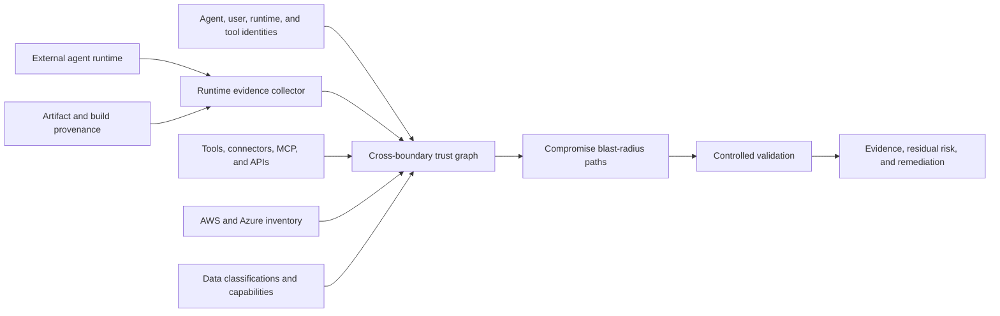

<a id="external-agent-trust-and-runtime-posture-design"></a>
# 外部代理信任与运行时态势设计

<a id="goal"></a>
## 目标

让 Nullstate 评估外部托管、其他团队运营或第三方控制 AI 代理造成的实际租户风险。

假设外部运行时可被入侵，结合可验证态势、身份/委托、工具链、数据可达性和受控模拟。

<a id="problem"></a>
## 问题

IAM 说明谁可请求操作，不证明宿主、容器、框架、工具服务器、记忆、提供商安全。

有效认证的代理也可能有：

- 漏洞/未修补软件
- 暴露管理界面
- 被盗长期凭据
- 无签名/来源部署
- 恶意插件、连接器、MCP、检索内容
- 弱租户隔离
- 广泛网络
- 共享运行时身份
- 不足日志/撤销

入侵后攻击者继承其云权限、用户委托、工具身份、下游凭据。

<a id="architecture"></a>
## 架构



应分离：

1. **运行态势：** 可证明在哪、如何运行？
2. **身份态势：** 使用哪些身份/委托？
3. **工具链：** 可调用工具、连接器、MCP、网关、凭据？
4. **可达性：** 租户服务、数据、特权操作？
5. **遏制：** 入侵后如何限制损害？
6. **检测/恢复：** 能否快速归因、撤销、轮换、调查？

<a id="runtime-evidence-model"></a>
## 运行时证据

每项主张记录：

- 名称
- 观察值
- 来源
- 收集时间
- 新鲜度/到期
- 验证方法
- 签发者
- 置信分类
- 哈希/提供商资源 ID
- 未支持/无法验证假设

分类：

| 类别 | 意义 |
|---|---|
| `cryptographically-verified` | 签名、来源、身份或硬件证明已验证 |
| `provider-observed` | 认证云、身份、运行时或安全 API 获取 |
| `operator-attested` | 管理者提供，无独立验证 |
| `inferred` | 从其他证据推断 |
| `unknown` | 所需证据不可用 |

未知必须增加残余不确定性，绝不能默认为合规。

<a id="runtime-posture-dimensions"></a>
## 态势维度

<a id="workload-identity"></a>
### 工作负载身份

- 每代理/部署独立身份。
- 短期联合凭据。
- audience/签发者限制。
- 身份绑定属性。
- 镜像、记忆、配置、日志无可复用凭据。

SPIFFE/SPIRE 可绑定云实例、Kubernetes namespace/service account、进程/容器选择器；同时支持原生联合。

<a id="artifact-integrity"></a>
### 产物完整性

- 签名容器/产物。
- 不可变摘要替代可变 tag。
- 源码/构建来源。
- 获批构建者/仓库。
- 依赖及漏洞清单。
- 部署摘要匹配批准物。

SLSA 说明何处何时如何构建，增强供应链信任，不单独证明宿主或应用行为安全。

<a id="runtime-and-host-integrity"></a>
### 宿主/运行完整性

- 受支持并修补系统。
- 加固容器、VM、机密计算。
- 可用硬件证明。
- 限制管理访问。
- 与无关租户/负载隔离。
- 安全遥测。

Azure Confidential VM guest attestation、AWS NitroTPM/Nitro Enclaves 在支持环境提供硬件证据。没有机密计算不自动失败，但证据强度降低。

<a id="network-posture"></a>
### 网络

- 无多余公共管理端点。
- 明确进出策略。
- 租户 API 经受控网关。
- DNS、代理、证书控制。
- 出站仅获批模型/工具/服务。
- 防任意工具调用外传。

<a id="agent-execution-posture"></a>
### 代理执行

- 获批模型、系统指令、版本。
- 工具允许清单/参数授权。
- 沙箱代码。
- 记忆来源/保留。
- 检索信任边界。
- 提示注入防御/不可信标记。
- 高影响人类批准。
- 每操作授权而非宽会话。

<a id="logging-and-recovery"></a>
### 日志/恢复

- 用户、代理、运行、工具、云关联 ID。
- 不可变审计。
- 异常工具/权限检测。
- 紧急禁用。
- token/凭据撤销。
- 自动降权/隔离。
- 响应负责人/已测试恢复。

<a id="authorization-gateway"></a>
## 授权网关

优选架构不直接给外部代理广泛凭据：

```text
external agent
-> tenant-controlled authorization gateway
-> agent identity verification
-> runtime posture and evidence freshness check
-> user/delegation validation
-> task and tool policy
-> optional approval
-> narrowly scoped short-lived credential
-> cloud operation
```

有效权限应受以下约束：

```text
agent permission
intersection delegated-user permission
intersection approved task
intersection tool policy
intersection environment policy
intersection runtime trust policy
```

证据缺失、过期、无效、达不到操作策略时，网关拒绝或降权。

<a id="trust-and-risk-output"></a>
## 信任/风险输出

不要只有黑箱分数。展示：

- 各维证据强度
- 入侵影响范围
- 可达数据敏感度
- 可达破坏/提权
- 遏制质量
- 检测/撤销准备
- 证据新鲜度
- 未解决不确定性

摘要等级可用，但维度和路径仍可见。

示例：

```text
Runtime evidence: weak
Identity scope: high
Delegated authority: privileged
Tool-chain exposure: medium
Reachable data: production customer records
Destructive capability: resource deletion
Revocation readiness: partial
Overall decision: deny production write access
```

<a id="controlled-validation"></a>
## 受控验证

验证外部运行时已入侵假设，不入侵真实运行时。

使用：

- 等范围权限合成代理
- 各权限类别合成委托用户
- 受控提示注入/工具混淆 fixture
- 合成秘密/数据标记
- 一次性 AWS 账户、Azure 订阅、集群、孪生
- 允许工具/有界输出

记录身份、委托、工具、摘要、态势、目标、数据类。

<a id="product-surface"></a>
## 产品界面

潜在命令：

```text
nullstate agent register
nullstate agent posture collect
nullstate agent posture verify
nullstate agent graph
nullstate agent blast-radius
nullstate agent validate --assume-compromised
nullstate agent monitor
```

开源可支持本地收集、模式、图、客户集成；Team/Enterprise 增加持续摄取、托管历史、策略、受管验证、警报、审批、支持、跨代理仪表板。

<a id="failure-handling"></a>
## 失败处理

- 无证据是未知，不是通过。
- 旧证明/来源在新鲜度策略下失败。
- 身份绑定失败阻止高影响验证。
- 未支持托管回退操作者证明并降置信。
- 清理/撤销失败让整体失败，即使攻击完成。
- 不把硬件证明当作应用正确、提示安全、无漏洞证明。

<a id="initial-scope"></a>
## 初始范围

首次保持小：

1. 外部清单模式。
2. 代理、运行、委托、工具身份、凭据、目标、数据类节点。
3. 操作者态势和可验证摘要/身份配置。
4. 确定性入侵影响报告。
5. 逐步 AWS/Azure 收集器。
6. 图/证据契约稳定后再加硬件及持续集成。

<a id="testing-strategy"></a>
## 测试

- 要求签名时拒绝格式错/未签。
- 缺失/旧按策略未知或失败。
- 不超配置交集权限。
- 检测扩大范围的委托。
- 检测低权代理后的高权工具。
- 区分敏感数据与基本资源可达。
- 模拟仅合成目标/允许工具。
- 输出来源、置信、时间、新鲜度。

<a id="primary-references"></a>
## 主要参考

- [Microsoft Entra Agent ID](https://learn.microsoft.com/en-us/entra/agent-id/)
- [Azure workload identity federation](https://learn.microsoft.com/en-us/entra/workload-id/workload-identity-federation)
- [Azure Conditional Access for workload identities](https://learn.microsoft.com/en-us/entra/identity/conditional-access/workload-identity)
- [Azure Confidential VM guest attestation](https://learn.microsoft.com/en-us/azure/confidential-computing/guest-attestation-confidential-vms)
- [AWS AgentCore Identity](https://docs.aws.amazon.com/bedrock-agentcore/latest/devguide/identity-overview.html)
- [AWS IAM Roles Anywhere](https://docs.aws.amazon.com/rolesanywhere/latest/userguide/introduction.html)
- [AWS NitroTPM attestation](https://docs.aws.amazon.com/AWSEC2/latest/UserGuide/attestation-get-doc.html)
- [AWS Nitro Enclaves attestation](https://docs.aws.amazon.com/enclaves/latest/user/set-up-attestation.html)
- [SLSA build provenance](https://slsa.dev/spec/v1.2/build-provenance)
- [SPIFFE and SPIRE workload identity](https://spiffe.io/docs/latest/spiffe-about/overview/)
