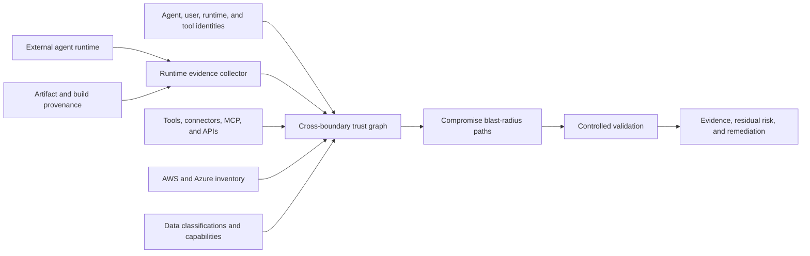

# External Agent Trust and Runtime Posture Design

## Goal

Allow Nullstate to assess the effective tenant risk created by an AI agent whose runtime may be hosted outside the customer's cloud, operated by another team, or controlled by a third-party provider.

The design assumes the external runtime can be compromised. It combines verifiable runtime posture, identity and delegation analysis, tool-chain inspection, reachable-data analysis, and controlled compromise simulation.

## Problem

Cloud IAM answers which principal may request an operation. It does not prove that the machine, container, agent framework, tool server, memory store, or hosting provider using that principal is secure.

An external agent may authenticate correctly while running in an environment with:

- vulnerable or unpatched software
- exposed management interfaces
- stolen long-lived credentials
- unsigned or untraceable deployment artifacts
- malicious plugins, connectors, MCP servers, or retrieved content
- weak tenant isolation
- broad network access
- shared runtime identities
- insufficient logs or revocation controls

If the agent is compromised, an attacker can inherit its own cloud permissions, delegated user authority, tool identities, and downstream credentials.

## Architecture



Nullstate should separate:

1. **Runtime posture:** What can be verified about where and how the agent is running?
2. **Identity posture:** Which identities and delegated permissions can the runtime use?
3. **Tool-chain posture:** Which tools, connectors, MCP servers, gateways, and credentials can it invoke?
4. **Reachability:** Which tenant services, data, and privileged operations are reachable?
5. **Containment:** What limits damage when the runtime is compromised?
6. **Detectability and recovery:** Can the tenant attribute, revoke, rotate, and investigate the agent quickly?

## Runtime Evidence Model

Every posture claim must record:

- claim name
- observed value
- evidence source
- collection timestamp
- freshness or expiry
- verification method
- evidence issuer
- confidence classification
- artifact hash or provider resource identifier
- unsupported or unverifiable assumptions

Evidence classifications:

| Classification | Meaning |
|---|---|
| `cryptographically-verified` | Signature, provenance, workload identity, or hardware attestation was verified |
| `provider-observed` | Retrieved from an authenticated cloud, identity, runtime, or security API |
| `operator-attested` | Supplied by an administrator but not independently verified |
| `inferred` | Derived from other evidence |
| `unknown` | Required evidence was unavailable |

Unknown evidence must increase residual uncertainty. It must never be silently treated as compliant.

## Runtime Posture Dimensions

### Workload identity

- Distinct identity per agent or deployment.
- Short-lived federated credentials.
- Token audience and issuer restrictions.
- Binding between identity and workload attributes.
- No reusable credentials embedded in images, memory, configuration, or logs.

SPIFFE/SPIRE-style workload attestation can bind identities to selectors such as cloud instance identity, Kubernetes namespace/service account, process, or container attributes. Provider-native federation should be supported alongside it.

### Artifact integrity

- Signed container or deployment artifact.
- Immutable digest rather than mutable image tag.
- Source and build provenance.
- Approved builder and repository.
- Dependency inventory and vulnerability state.
- Deployment digest matches the approved artifact.

SLSA provenance can describe where, when, and how an artifact was built. It strengthens supply-chain confidence but does not by itself prove that the running host or application behavior is safe.

### Runtime and host integrity

- Supported and patched OS/runtime.
- Hardened container, VM, or confidential-computing configuration.
- Hardware-backed attestation where available.
- Restricted administrative access.
- Isolation from unrelated tenants and workloads.
- Endpoint or workload security telemetry.

Azure Confidential VM guest attestation, AWS NitroTPM, and AWS Nitro Enclaves can provide hardware-backed evidence for supported environments. Absence of confidential computing is not automatically a failure, but it lowers the strength of runtime-integrity evidence.

### Network posture

- No unnecessary public management endpoints.
- Explicit inbound and outbound policy.
- Tenant API access routed through a controlled gateway.
- DNS, proxy, and certificate controls.
- Egress restricted to approved models, tools, and services.
- Protection against data exfiltration through arbitrary tool calls.

### Agent execution posture

- Approved model, system instructions, and agent version.
- Tool allowlists and parameter-level authorization.
- Sandboxed code execution.
- Memory provenance and retention controls.
- Retrieval-source trust boundaries.
- Prompt-injection defenses and untrusted-content labeling.
- Human approval for high-impact actions.
- Per-action authorization instead of one broad session privilege.

### Logging and recovery

- Correlation IDs linking user, agent, runtime, tool, and cloud operation.
- Immutable audit events.
- Detection for abnormal tool use and permission patterns.
- Emergency disable switch.
- Token and credential revocation.
- Automated role reduction or quarantine.
- Incident-response owner and tested recovery process.

## Authorization Gateway

The preferred architecture does not expose broad tenant credentials directly to an external agent:

```text
external agent
-> tenant-controlled authorization gateway
-> agent identity verification
-> runtime posture and evidence freshness check
-> user/delegation validation
-> task and tool policy
-> optional approval
-> narrowly scoped short-lived credential
-> cloud operation
```

Effective permission should be bounded by:

```text
agent permission
intersection delegated-user permission
intersection approved task
intersection tool policy
intersection environment policy
intersection runtime trust policy
```

The gateway should deny or reduce privileges when runtime evidence is missing, stale, invalid, or below the policy required for the requested operation.

## Trust and Risk Output

Nullstate should not produce only one opaque trust score. It should present:

- evidence strength by posture dimension
- compromise blast radius
- reachable data sensitivity
- reachable destructive or privilege-changing operations
- containment quality
- detection and revocation readiness
- evidence freshness
- unresolved uncertainty

A summary grade may be useful for dashboards, but the underlying dimensions and attack paths must remain visible.

Example:

```text
Runtime evidence: weak
Identity scope: high
Delegated authority: privileged
Tool-chain exposure: medium
Reachable data: production customer records
Destructive capability: resource deletion
Revocation readiness: partial
Overall decision: deny production write access
```

## Controlled Validation

Nullstate should validate the assumption, "the external agent runtime is compromised," without compromising the real runtime.

Validation uses:

- a synthetic agent identity with equivalent scoped permissions
- synthetic delegated users representing privilege classes
- controlled prompt-injection and tool-confusion fixtures
- synthetic secrets and data markers
- a disposable AWS account, Azure subscription, cluster, or digital twin
- allowlisted tool calls and bounded outputs

The run records which identity, delegation mode, tool, artifact digest, posture evidence, target, and data class were involved.

## Product Surface

Potential commands:

```text
nullstate agent register
nullstate agent posture collect
nullstate agent posture verify
nullstate agent graph
nullstate agent blast-radius
nullstate agent validate --assume-compromised
nullstate agent monitor
```

The open-source CLI can support local evidence collection, schemas, graph generation, and customer-provided integrations. Team and Enterprise products can add continuous posture ingestion, hosted graph history, trust policies, managed validation environments, alerts, approvals, support, and cross-agent dashboards.

## Failure Handling

- Missing posture evidence is reported as unknown, not passed.
- Stale attestation or provenance fails policies that require freshness.
- Identity-to-runtime binding failure blocks high-impact validation.
- Unsupported hosting environments fall back to operator-attested evidence with reduced confidence.
- A failed cleanup or revocation check makes the run unsuccessful even when the attack test completed.
- Nullstate must not claim hardware attestation proves application correctness, prompt safety, or absence of vulnerabilities.

## Initial Scope

First implementation should remain small:

1. Define an external-agent manifest schema.
2. Model agent, runtime, delegated user, tool identity, credential, target, and data-class nodes.
3. Ingest operator-attested posture plus verifiable artifact digests and identity configuration.
4. Produce a deterministic compromise blast-radius report.
5. Add AWS and Azure provider collectors incrementally.
6. Add hardware attestation and continuous posture integrations after the graph and evidence contracts stabilize.

## Testing Strategy

- Reject malformed or unsigned manifests where policy requires signatures.
- Treat missing and stale evidence as unknown or failed according to policy.
- Verify an agent cannot inherit permissions outside the configured intersection.
- Detect a delegated-user path that expands agent reach.
- Detect a privileged tool identity hidden behind a low-privilege agent identity.
- Show sensitive-data reachability separately from basic resource reachability.
- Verify compromise simulations use only synthetic targets and allowed tools.
- Verify evidence output records source, confidence, timestamp, and freshness.

## Primary References

- [Microsoft Entra Agent ID](https://learn.microsoft.com/en-us/entra/agent-id/)
- [Azure workload identity federation](https://learn.microsoft.com/en-us/entra/workload-id/workload-identity-federation)
- [Azure Conditional Access for workload identities](https://learn.microsoft.com/en-us/entra/identity/conditional-access/workload-identity)
- [Azure Confidential VM guest attestation](https://learn.microsoft.com/en-us/azure/confidential-computing/guest-attestation-confidential-vms)
- [AWS AgentCore Identity](https://docs.aws.amazon.com/bedrock-agentcore/latest/devguide/identity-overview.html)
- [AWS IAM Roles Anywhere](https://docs.aws.amazon.com/rolesanywhere/latest/userguide/introduction.html)
- [AWS NitroTPM attestation](https://docs.aws.amazon.com/AWSEC2/latest/UserGuide/attestation-get-doc.html)
- [AWS Nitro Enclaves attestation](https://docs.aws.amazon.com/enclaves/latest/user/set-up-attestation.html)
- [SLSA build provenance](https://slsa.dev/spec/v1.2/build-provenance)
- [SPIFFE and SPIRE workload identity](https://spiffe.io/docs/latest/spiffe-about/overview/)
